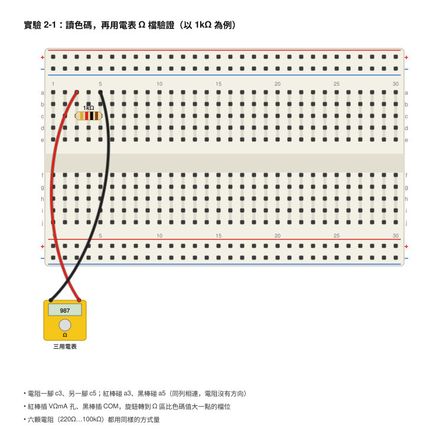
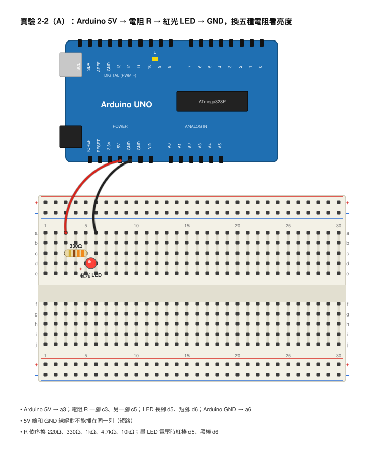
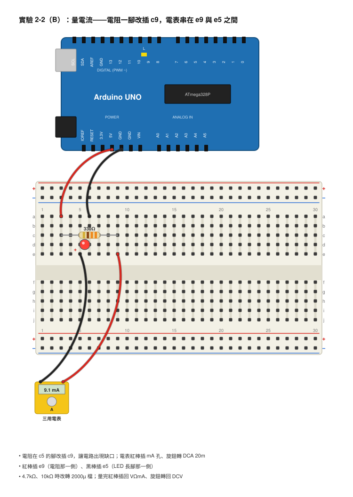
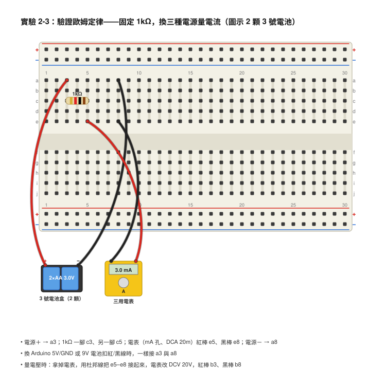

# 第 2 章　電阻與歐姆定律

## 本章目標
- 學完你會說出電阻是什麼、單位歐姆（Ω）代表什麼意思。
- 學完你會看懂電阻上的四環色碼，不用電表也能讀出 220Ω、1kΩ、10kΩ。
- 學完你會用三用電表的 Ω 檔量電阻，而且知道哪些情況量出來會不準。
- 學完你會用歐姆定律 V ＝ I × R 和它的兩個變形，算出電路裡的電壓、電流或電阻。
- 學完你會自己算出 LED 該配多大的限流電阻，並且用電表驗證你算的對不對。

## 開場：為什麼不能把 LED 直接接電池？

上一章的實驗裡，我們在 LED 前面串了一顆 1kΩ 的電阻，然後說「第 2 章會告訴你為什麼」。現在就是時候了。

阿哲不信邪。他想：「電阻只是在『擋』電流，拿掉的話 LED 不就更亮嗎？」於是他把 LED 的長腳直接碰 9V 電池的正極、短腳碰負極。LED 閃了一下非常亮的光，然後……就再也不亮了。拿近一看，LED 裡面的小金屬片燒黑了。

LED 確實會「更亮」，但只有不到一秒。因為沒有電阻擋著，電流大到 LED 承受不了，它就像一根被太大電流燒斷的保險絲。

那麼，電阻到底要多大才「剛剛好」？太大 LED 太暗，太小 LED 燒掉。這一章要教你一個 200 年前德國老師歐姆（Georg Ohm）發現的簡單公式，它只有三個字母，卻是整本書最常用的工具。學會以後，你就能算出任何 LED 需要的電阻，再也不用猜。

## 核心概念

### 電阻：水管有多窄

回到水管的比喻。同樣的水壓，粗水管流出的水多，細水管流出的水少。細水管「阻礙」水流的能力比較強。

電阻（Resistance）就是材料阻礙電流通過的程度。導線很粗、材料是銅，電阻很小；電阻器裡面是一層薄薄的碳膜或金屬膜，電流很難擠過去，電阻就大。

電阻的單位是歐姆（Ohm），記作 Ω（希臘字母 Omega）。常用的倍數單位：
- 1 kΩ（千歐姆）＝ 1000 Ω
- 1 MΩ（百萬歐姆）＝ 1,000,000 Ω ＝ 1000 kΩ

所以 4.7kΩ 就是 4700Ω，100kΩ 就是 100,000Ω。

電阻器（Resistor）這個零件，就是故意做出一個「固定大小的電阻」給我們用。它長得像一顆有兩隻腳的小膠囊，身上有幾圈彩色條紋，沒有方向性，兩隻腳隨便接都可以。本書用的是最常見的 1/4 瓦（W）碳膜電阻，「1/4 瓦」的意思是它最多能承受多少發熱，第 4 章會講。

### 讀電阻色碼

電阻太小了，印不下數字，所以用顏色條紋來表示數值，叫做色碼（Color Code）。四環電阻的規則是：

```
        第1環 第2環 第3環      第4環
          │    │    │          │
      ────┤██┼██┼██┼──────┼██├────
          │    │    │          │
        第1個 第2個 後面補    誤差
        數字  數字  幾個 0   （金＝±5%）
```

| 顏色 | 數字 | 當第 3 環時：乘以 |
|------|------|-------------------|
| 黑 | 0 | ×1（不補 0） |
| 棕 | 1 | ×10（補 1 個 0） |
| 紅 | 2 | ×100（補 2 個 0） |
| 橙 | 3 | ×1000（補 3 個 0） |
| 黃 | 4 | ×10000（補 4 個 0） |
| 綠 | 5 | ×100000 |
| 藍 | 6 | ×1000000 |
| 紫 | 7 | — |
| 灰 | 8 | — |
| 白 | 9 | — |
| 金 | — | 第 4 環：誤差 ±5% |
| 銀 | — | 第 4 環：誤差 ±10% |

一個好記的口訣：**黑棕紅橙黃，綠藍紫灰白**，從 0 數到 9。

**怎麼看方向？** 金色（或銀色）那一環是誤差環，要放在最右邊。另一個線索是：第 1 環通常比較靠近電阻的邊緣。

**算幾個例子：**

| 色碼 | 第 1、2 環 | 第 3 環 | 結果 |
|------|-----------|---------|------|
| 紅 紅 棕 金 | 2、2 → 22 | 棕 → 補 1 個 0 | 220Ω ±5% |
| 橙 橙 棕 金 | 3、3 → 33 | 棕 → 補 1 個 0 | 330Ω ±5% |
| 棕 黑 紅 金 | 1、0 → 10 | 紅 → 補 2 個 0 | 1000Ω ＝ 1kΩ |
| 黃 紫 紅 金 | 4、7 → 47 | 紅 → 補 2 個 0 | 4700Ω ＝ 4.7kΩ |
| 棕 黑 橙 金 | 1、0 → 10 | 橙 → 補 3 個 0 | 10000Ω ＝ 10kΩ |
| 棕 黑 黃 金 | 1、0 → 10 | 黃 → 補 4 個 0 | 100000Ω ＝ 100kΩ |

**誤差是什麼意思？** 金色代表 ±5%，所以一顆標示 1kΩ 的電阻，實際值可能在 950Ω 到 1050Ω 之間，都算合格。這也是為什麼用電表量出來通常不會剛好是整數。

有些電阻包裡會有五環電阻（三個數字環＋倍數環＋誤差環），規則一樣，只是前面多一個數字。附錄 C 有完整對照表。

### 用三用電表量電阻

不想看色碼、或是色碼看不清楚（紅色和橙色、棕色和紅色常常很難分）時，直接量最快。

1. 黑棒插 COM，紅棒插 **VΩmA**（或 VΩ）孔，和量電壓一樣。
2. 旋鈕轉到 **Ω** 區。如果有多個檔位（200、2000、20k、200k、2M），選**比電阻值大一點**的檔：量 220Ω 選 2000 檔；量 4.7kΩ 選 20k 檔；量 100kΩ 選 200k 檔。自動量程電表直接轉到 Ω 就好。
3. 兩支測棒碰電阻的兩隻腳，等數字穩定。
4. 讀數時注意單位：在 20k 檔顯示 4.68，意思是 4.68 kΩ；在 2000 檔顯示 218，意思是 218Ω。

**三個會讓你量不準的狀況：**
- **電阻還接在電路上，而且電路通著電。** 一定要拔掉電源，最好把電阻整顆拔下來量，不然其他零件會干擾讀值。
- **兩隻手同時捏著電阻的兩隻腳。** 你的身體也是導體，會跟電阻「並排」在一起讓讀值變小（第 3 章會解釋並聯）。量大電阻（10kΩ 以上）時影響特別明顯。只用一隻手，或用麵包板固定電阻。
- **顯示「1」或「OL」。** 檔位太小，轉到更大的檔。如果轉到最大檔還是「1」，表示兩點之間根本不通，可能是電阻燒斷了，或測棒沒碰好。

### 歐姆定律：電壓、電流、電阻的三角關係

現在把三個角色放在一起看：

- 電壓（V）是推力：水壓。
- 電阻（R）是阻礙：水管多窄。
- 電流（I）是結果：實際流了多少。

直覺上：推力越大，流得越多；阻礙越大，流得越少。歐姆在 1827 年用實驗證明，這個關係不只是「大概」，而是**剛剛好成正比**：

> **V ＝ I × R**
>
> 電壓（伏特）＝ 電流（安培）× 電阻（歐姆）

這就是歐姆定律（Ohm's Law）。因為是簡單的乘法，可以移項變成三種形式，看你想求什麼：

```
            ┌───────┐
            │   V   │        遮住你想求的那一個，
            ├───┬───┤        剩下的兩個怎麼擺，就怎麼算：
            │ I │ R │
            └───┴───┘
      求 V：V ＝ I × R      （遮住 V，剩下 I 和 R 並排 → 相乘）
      求 I：I ＝ V ÷ R      （遮住 I，剩下 V 在 R 上面 → 相除）
      求 R：R ＝ V ÷ I      （遮住 R，剩下 V 在 I 上面 → 相除）
```

**算三個例子（單位一定要先換成 V、A、Ω）：**

**例一（求電流）：** 9V 電池接一顆 1kΩ 電阻，電流多大？
I ＝ V ÷ R ＝ 9 ÷ 1000 ＝ 0.009 A ＝ 9 mA。

**例二（求電流）：** 5V 接 330Ω，電流多大？
I ＝ 5 ÷ 330 ＝ 0.01515 A ≈ 15.2 mA。

**例三（求電阻）：** 我想讓 5V 的電源只流出 10 mA，該接多大的電阻？
先把 10 mA 換成 0.01 A。R ＝ V ÷ I ＝ 5 ÷ 0.01 ＝ 500Ω。

**例四（求電壓）：** 一顆 220Ω 電阻流過 20 mA 的電流，它兩端的電壓是多少？
V ＝ I × R ＝ 0.02 × 220 ＝ 4.4V。

一個很好用的小技巧：**如果電壓用 V、電阻用 kΩ，算出來的電流單位剛好就是 mA**。例如 9V ÷ 1kΩ ＝ 9 mA，5V ÷ 4.7kΩ ≈ 1.06 mA，不用一直換 0.00 幾。

### LED 的順向電壓

LED 和電阻有一個很大的不同：**LED 不遵守歐姆定律。** 它的行為比較像一道「門檻」：

- 兩端電壓不到門檻時，幾乎沒有電流，不亮。
- 電壓一到門檻，電流就會迅速增加，而且不管電流多大，LED 兩端的電壓幾乎都停在門檻附近，不太會再升高。

這個門檻電壓叫做順向電壓（Forward Voltage），記作 V_F。不同顏色的 LED 門檻不一樣，因為發光的材料不同：

| LED 顏色 | 順向電壓（大約） |
|----------|------------------|
| 紅 | 1.8–2.2V（本書以 2.0V 計算） |
| 黃 | 2.0–2.2V |
| 綠 | 2.0–2.4V（本書以 2.2V 計算） |
| 藍 | 3.0–3.4V（本書以 3.0V 計算） |
| 白 | 3.0–3.4V（本書以 3.0V 計算） |

LED 的「正常工作電流」一般是 10–20 mA。10 mA 就已經很清楚，20 mA 很亮，超過 30 mA 就開始縮短壽命，再大就會像阿哲的 LED 那樣燒掉。

### 限流電阻怎麼算

現在把歐姆定律和順向電壓合在一起，就能算出 LED 該配什麼電阻。這是全書最常用的計算，請一定要自己算一遍。

想法是這樣的：電源給的電壓，LED「吃掉」了 V_F，剩下的全部落在電阻上。然後用歐姆定律算出電阻。

> **R ＝ (電源電壓 − LED 順向電壓) ÷ 目標電流**

**算一個例子：** 電源 5V（Arduino 的 5V 腳位），紅光 LED（V_F ＝ 2.0V），希望電流 10 mA。

1. 落在電阻上的電壓：5 − 2.0 ＝ 3.0V。
2. 目標電流換成安培：10 mA ＝ 0.01 A。
3. R ＝ 3.0 ÷ 0.01 ＝ **300Ω**。

但電阻包裡沒有 300Ω 這個值（常見的值是 220、270、330、390……）。該怎麼選？**選比算出來大一點點的**，電流會稍微小一些、LED 稍微暗一些，但絕對安全。所以我們選 **330Ω**。

**驗算一下 330Ω 的實際電流：** I ＝ 3.0 ÷ 330 ＝ 0.00909 A ≈ **9.1 mA**。比 10 mA 少一點點，完全看不出差別。

如果選 220Ω 呢？I ＝ 3.0 ÷ 220 ≈ 13.6 mA，也在安全範圍，會亮一些。所以在本書裡，5V 配紅光 LED，用 220Ω 或 330Ω 都可以，這也是為什麼器材清單裡這兩個值特別多。

**再算一個例子：** 電源 9V，紅光 LED，希望 10 mA。
R ＝ (9 − 2.0) ÷ 0.01 ＝ 700Ω → 選 1kΩ（實際電流 7 ÷ 1000 ＝ 7 mA）。這就是第 1 章用 1kΩ 的原因。

## 動手做

### 實驗 2-1：讀色碼，再用電表驗證

**材料**
- 電阻 6 顆：220Ω、330Ω、1kΩ、4.7kΩ、10kΩ、100kΩ（先不要看袋子上的標示，自己讀色碼）
- 數位三用電表 1 台
- 麵包板 1 塊（用來固定電阻，避免手指影響讀值）

**接線**

```
   電阻插在麵包板上，兩隻腳跨不同列：

          a   b   c   d   e
    3     ○   ○  電阻  ○   ○    ← 一腳插 c3
    4     ○   ○   │   ○   ○
    5     ○   ○  電阻  ○   ○    ← 另一腳插 c5

   紅棒碰 a3、黑棒碰 a5（和電阻的腳同列，所以相連）
```



- 電阻一腳 → c3，另一腳 → c5
- 電表紅棒 → a3，黑棒 → a5（電阻沒有方向，紅黑對調也可以）

**步驟**
1. 從電阻包隨便拿一顆，把金色環放右邊，從左邊開始讀三環顏色，用口訣算出電阻值，填進表格的「色碼讀出的值」。
2. 把電阻插上麵包板。電表紅棒插 VΩmA 孔、黑棒插 COM，旋鈕轉到 Ω 區，選比你讀出的值大一點的檔位。
3. 測棒碰 a3 和 a5，等數字穩定，填進「電表量到的值」，記得寫單位。
4. 算一算誤差：(量到的值 − 色碼值) ÷ 色碼值 × 100%。應該在 ±5% 以內。
5. 試試看：量 100kΩ 的時候，故意用兩隻手捏住電阻的兩隻腳，再看一次讀值，記下來。
6. 六顆都做完。

**你應該看到**
- 每一顆量到的值都跟色碼很接近，但通常不會剛好一樣，例如 1kΩ 量到 987Ω 或 1.01kΩ。
- 用手捏 100kΩ 時，讀值會明顯變小（可能變成 80 幾 kΩ），因為你的身體提供了另一條路給電流走。

**觀察與記錄**

| 色碼（三環顏色） | 色碼讀出的值 | 用的 Ω 檔位 | 電表量到的值 | 誤差 % |
|------------------|--------------|-------------|--------------|--------|
| | | | | |
| | | | | |
| | | | | |
| | | | | |
| | | | | |
| | | | | |
| 100kΩ 用手捏兩腳 | 100kΩ | | | |

### 實驗 2-2：改變電阻看 LED 亮度，並量出電流

這是本章的主實驗：同一顆 LED，換五種電阻，看亮度怎麼變，再把電表串進去量電流，和歐姆定律算出來的比一比。

**材料**
- Arduino UNO 1 塊＋USB 線（只當作 5V 電源用，不用寫程式；也可以用 USB 行動電源配 USB 線剝線，但 Arduino 最方便）
- 麵包板 1 塊
- 紅光 LED 1 顆
- 電阻：220Ω、330Ω、1kΩ、4.7kΩ、10kΩ 各 1 顆
- 公公杜邦線 3 條
- 數位三用電表 1 台

**接線**

```
   Arduino 5V ──[ R ]──►|── Arduino GND
                       LED
                    長腳 短腳

   麵包板：
          a    b    c    d    e
    3    5V線  ○   電阻   ○    ○      ← Arduino 5V 接 a3，電阻一腳 c3
    4     ○   ○    │    ○    ○
    5     ○   ○   電阻  LED長  ○      ← 電阻另一腳 c5，LED 長腳 d5
    6   GND線  ○    ○   LED短  ○      ← LED 短腳 d6，Arduino GND 接 a6
```





- Arduino 5V 腳位 → 麵包板 a3
- 電阻 R：一腳 c3，另一腳 c5
- 紅光 LED：長腳 d5，短腳 d6
- Arduino GND 腳位 → 麵包板 a6

**步驟**
1. Arduino 先不要插 USB。先插 330Ω 電阻、LED 和兩條線。再檢查一次：5V 線和 GND 線絕對不能插在同一列（那是短路，Arduino 會過熱保護）。
2. 把 Arduino 的 USB 接上電腦或行動電源。LED 亮了。
3. 先量電壓（紅棒 VΩmA 孔，DCV 20V 檔）：紅棒 d5、黑棒 d6，量 LED 兩端的順向電壓，記下來。你會發現它接近 2.0V，但不會剛好。
4. 拔掉 USB。現在要量電流：把電阻在 c5 的腳拔起來改插 c9，讓電路出現缺口。電表紅棒換到 mA 孔，旋鈕轉 DCA 20m 檔。紅棒插 e9、黑棒插 e5。
5. 接回 USB，LED 亮，讀電流，填表。
6. 拔掉 USB，換下一顆電阻（220Ω），重複步驟 5。220Ω 預期約 13.6 mA，20m 檔夠用。
7. 換 1kΩ、4.7kΩ、10kΩ。到 4.7kΩ 和 10kΩ 時，電流不到 1 mA，20m 檔只會顯示 0.6 或 0.3，不夠精細，請把旋鈕轉到 **2000µ** 檔（2000 微安培 ＝ 2 mA），讀出來的數字單位是 µA，例如顯示 640 就是 640 µA ＝ 0.64 mA。
8. 每換一顆電阻，順便用眼睛比較 LED 亮度，用「很亮／亮／普通／暗／幾乎看不到」記錄。
9. 做完記得紅棒插回 VΩmA 孔、旋鈕轉回 DCV。

**你應該看到**

把歐姆定律的預測先算好（假設 LED 順向電壓 2.0V，落在電阻上的電壓是 3.0V）：

| 電阻 | 預測電流 I ＝ 3.0 ÷ R | 亮度預測 |
|------|------------------------|----------|
| 220Ω | 3.0 ÷ 220 ≈ 13.6 mA | 很亮 |
| 330Ω | 3.0 ÷ 330 ≈ 9.1 mA | 亮 |
| 1kΩ | 3.0 ÷ 1000 ＝ 3.0 mA | 普通 |
| 4.7kΩ | 3.0 ÷ 4700 ≈ 0.64 mA | 暗 |
| 10kΩ | 3.0 ÷ 10000 ＝ 0.30 mA | 很暗，但還看得到 |

實際量到的會跟預測有一點差距，原因有兩個：第一，電阻本身有 ±5% 誤差；第二，LED 的順向電壓在電流小的時候會稍微低一點（例如 0.3 mA 時可能只有 1.8V），所以小電阻那幾列會比預測略高。差個 10% 都算正常，這就是真實世界和公式的差別。

**觀察與記錄**

| 電阻 | 預測電流 | 量到的電流 | 量到的 LED 電壓 | 亮度 |
|------|----------|------------|-----------------|------|
| 220Ω | 13.6 mA | | | |
| 330Ω | 9.1 mA | | | |
| 1kΩ | 3.0 mA | | | |
| 4.7kΩ | 0.64 mA | | | |
| 10kΩ | 0.30 mA | | | |

### 實驗 2-3：驗證歐姆定律——固定電阻，改變電壓

實驗 2-2 有 LED 在裡面攪局（它不守歐姆定律）。這次我們把 LED 拿掉，只留一顆 1kΩ 電阻，換三種電源，看電流是不是真的跟電壓成正比。

**材料**
- 1kΩ 電阻 1 顆
- 3 號電池 2 顆＋電池盒（約 3V）
- Arduino UNO＋USB 線（5V）
- 9V 電池＋電池扣（約 9V）
- 麵包板、杜邦線、三用電表

**接線**

```
   電源＋ ──[ 1kΩ ]── 紅棒〔 電表 A⎓ 20m 〕黑棒 ── 電源－

   麵包板：
          a    b    c    d    e
    3    電源＋ ○   電阻   ○    ○
    4     ○   ○    │    ○    ○
    5     ○   ○   電阻   ○   紅棒
    ⋮
    8    電源－ ○    ○    ○   黑棒
```



- 電源正極（電池盒紅線 / Arduino 5V / 9V 電池扣紅線）→ a3
- 1kΩ 電阻：一腳 c3，另一腳 c5
- 電表紅棒 → e5，黑棒 → e8（電表串在電阻和電源負極之間）
- 電源負極（電池盒黑線 / Arduino GND / 9V 電池扣黑線）→ a8

**步驟**
1. 電表設定成量電流：紅棒 mA 孔，DCA 20m 檔，紅棒 e5、黑棒 e8。
2. 接上 2 顆 3 號電池的電池盒，讀電流，填表。
3. 接著量電壓：把電表拿開，改用一條杜邦線把 e5 和 e8 接起來（補上缺口），電表換成量電壓（紅棒 VΩmA 孔，DCV 20V），紅棒 b3、黑棒 b8，讀出電源電壓，填表。
4. 換成 Arduino 5V，重複步驟 1–3。
5. 換成 9V 電池，重複步驟 1–3。
6. 每一列算 R ＝ V ÷ I，看是不是都接近 1kΩ。

**你應該看到**
- 大約 3V → 3 mA；5V → 5 mA；9V → 9 mA。電壓變三倍，電流也變三倍。
- 每一列用 V ÷ I 算出來都接近 1000Ω（例如 4.98V ÷ 0.00497 A ≈ 1002Ω）。

如果你把「電壓」當橫軸、「電流」當縱軸，把三個點畫在方格紙上，它們會排成一條**通過原點的直線**。直線的斜率就是 1 ÷ R。這條直線，就是「歐姆定律」的長相。

**觀察與記錄**

| 電源 | 量到的電壓 V | 量到的電流 I | R ＝ V ÷ I |
|------|--------------|--------------|------------|
| 2 顆 3 號電池 | | | |
| Arduino 5V | | | |
| 9V 電池 | | | |

## 用儀器看看

本章的主角儀器還是三用電表，而且我們一口氣用了它的三種功能。整理一下三種模式的差別，這張表以後會一直用到：

| 要量什麼 | 紅棒插哪 | 旋鈕轉哪 | 電表怎麼接 | 電路要不要拆 |
|----------|----------|----------|------------|--------------|
| 電壓 | VΩmA | DCV（V⎓） | 跨在兩點之間（並排） | 不用 |
| 電流 | mA（或 VΩmA，看電表標示） | DCA（A⎓） | 串進電路缺口 | 要切開一個缺口 |
| 電阻 | VΩmA | Ω | 碰電阻兩腳 | 要拔掉電源，最好把電阻拔下來 |

**用電表看 LED「不守歐姆定律」：** 在實驗 2-2 裡你量了五次 LED 兩端電壓。把它們排在一起看：電流從 0.3 mA 變到 13.6 mA，變了 45 倍，但 LED 電壓只從大約 1.8V 變到 2.0V。如果 LED 是一顆電阻，電壓應該也要變 45 倍才對。這就是「門檻」的行為。

**電表的二極體檔也能看 LED：** 旋鈕轉到二極體符號（►|）那一檔（和蜂鳴檔通常是同一檔），紅棒碰 LED 長腳、黑棒碰短腳。LED 會微微亮起來，螢幕顯示的數字就是它的順向電壓（例如 1.85）。這是電表送出一個很小的測試電流（大約 1 mA）量出來的，所以會比 10 mA 時的值低一點。紅黑棒反接的話 LED 不亮、螢幕顯示「1」，再次證明 LED 有方向。

**預告：** 從第 5 章開始，示波器會登場。到時候你會看到，電阻兩端的電壓波形和流過它的電流波形「長得一模一樣」（只差一個倍數 R），這就是歐姆定律在示波器上的樣子。

## 常見錯誤與除錯

- **色碼讀出來的值很奇怪（例如 22MΩ）** → 從金色那一邊開始讀了，方向反了 → 把金色環放右邊再讀一次。
- **棕色和紅色、紅色和橙色分不清** → 燈光不好或電阻印刷偏色 → 直接用電表量，色碼只是輔助。
- **Ω 檔顯示 1 或 OL** → 檔位太小，或電阻根本沒接到 → 轉到更大檔；確認測棒碰到金屬腳。
- **Ω 檔讀值一直慢慢變** → 量大電阻時手指碰到腳 → 放開手，用麵包板固定。
- **量電阻時讀值比色碼小很多** → 電阻還接在電路裡，其他零件並排干擾 → 把電阻拔下來單獨量。
- **LED 不亮，換哪顆電阻都不亮** → LED 接反了 → 長腳要在電阻那一側。
- **LED 不亮，Arduino 上的電源燈也暗了** → 5V 和 GND 短路，Arduino 過熱保護 → 立刻拔 USB，檢查 5V 線和 GND 線是不是插在同一列。
- **量電流時顯示 1** → 電流超過檔位 → 轉到 200m 檔。
- **量電流時顯示 0.00 但 LED 亮著** → 電表沒有真的串進缺口，電流從別的路走了 → 檢查缺口是不是真的斷開（電阻的腳是不是還留在原來那一列）。
- **量 4.7kΩ、10kΩ 時電流顯示 0.6、0.3，變化看不清楚** → 檔位太粗 → 轉到 2000µ 檔讀微安培。
- **量完電流忘記把紅棒插回 VΩmA** → 下次量電壓時一跨接就短路，燒保險絲 → 養成「量完電流立刻插回去」的習慣。

## 想一想

1. 一顆電阻的色碼是「紅 紫 橙 金」，它是幾 Ω？誤差多少？
<details><summary>參考答案</summary>

紅＝2、紫＝7，所以是 27；橙＝補 3 個 0，所以是 27000Ω ＝ 27kΩ；金＝±5%。實際值可能在 25.65kΩ 到 28.35kΩ 之間。

</details>

2. 把一顆 220Ω 的電阻直接接在 9V 電池上（沒有 LED），電流是多少？如果接的是 10kΩ 呢？
<details><summary>參考答案</summary>

I ＝ V ÷ R。220Ω：9 ÷ 220 ≈ 0.0409 A ≈ 40.9 mA。10kΩ：9 ÷ 10000 ＝ 0.0009 A ＝ 0.9 mA。電阻大 45 倍，電流就小 45 倍。

</details>

3. 用 5V 電源點亮一顆藍光 LED（順向電壓 3.0V），希望電流 10 mA。該用多大的電阻？電阻包裡沒有這個值的話該選哪個？選了之後實際電流多少？
<details><summary>參考答案</summary>

落在電阻上的電壓：5 − 3.0 ＝ 2.0V。R ＝ 2.0 ÷ 0.01 ＝ 200Ω。電阻包裡選比 200Ω 大一點的 **220Ω**。實際電流 I ＝ 2.0 ÷ 220 ≈ 9.1 mA。注意藍光 LED 的順向電壓比紅光高，所以同樣 5V 要用比較小的電阻。

</details>

4. 阿哲這次學乖了，想用 9V 電池點紅光 LED，但他手邊只有 220Ω 的電阻。這樣安全嗎？算算看電流。
<details><summary>參考答案</summary>

落在電阻上的電壓：9 − 2.0 ＝ 7V。I ＝ 7 ÷ 220 ≈ 0.0318 A ≈ 31.8 mA。這已經超過 LED 建議的 20 mA 上限，LED 會很亮但壽命會縮短，摸起來可能會溫溫的。比較好的選擇是 1kΩ（7 mA）或 470Ω（約 14.9 mA）。

</details>

5. 你用 Ω 檔量一顆插在電路裡、沒有拔下來的 10kΩ 電阻，電表顯示 4.8kΩ。電阻壞了嗎？
<details><summary>參考答案</summary>

很可能沒壞。電阻還接在電路上時，旁邊的其他零件（例如另一顆電阻）會和它「並排」，給電流另一條路走，所以電表量到的會比它本身小。把電阻拔下來單獨量，應該就會回到接近 10kΩ。（第 3 章學並聯之後你就會知道，10kΩ 旁邊如果並排一顆 9.2kΩ 左右的東西，量出來剛好就是 4.8kΩ。）

</details>

6. （開放挑戰）ESP32 的電源是 3.3V，不是 5V。請算出用 ESP32 點紅光 LED、電流 10 mA 時該用的電阻，然後想一想：如果改用藍光 LED（3.0V），會發生什麼事？有什麼辦法解決？
<details><summary>參考答案</summary>

紅光：(3.3 − 2.0) ÷ 0.01 ＝ 130Ω，電阻包裡選 150Ω（實際約 8.7 mA）或 220Ω（約 5.9 mA，稍暗但夠用）。藍光：3.3 − 3.0 只剩 0.3V 給電阻，(0.3 ÷ 0.01) ＝ 30Ω。問題是藍光 LED 的順向電壓有 ±0.2V 的個體差異，如果拿到一顆 3.4V 的，3.3V 根本推不亮；拿到 3.0V 的又可能太亮。解決辦法：用 5V 當 LED 的電源（ESP32 板子上通常有 VIN 或 5V 腳位從 USB 拿電），或是接受亮度會不穩定、用 47Ω 左右稍微保護一下。這個問題在第 16 章用 ESP32 時會再遇到。

</details>

## 本章小結

- 電阻是材料阻礙電流的程度，單位歐姆（Ω）；1kΩ ＝ 1000Ω，1MΩ ＝ 1000kΩ。
- 四環色碼：前兩環是數字，第三環是補幾個 0，第四環是誤差。口訣「黑棕紅橙黃，綠藍紫灰白」。
- 用電表量電阻要拔掉電源、最好把電阻拔下來、手不要同時碰兩腳。
- 歐姆定律：V ＝ I × R，變形為 I ＝ V ÷ R、R ＝ V ÷ I。計算前先把單位換成 V、A、Ω（或用 V、mA、kΩ 這組也行）。
- 電壓固定時，電阻越大電流越小；電阻固定時，電壓越大電流越大，而且是成正比的直線。
- LED 不守歐姆定律：它有一個順向電壓門檻（紅約 2.0V、綠約 2.2V、藍／白約 3.0V），電流再大電壓也差不多。
- LED 限流電阻：R ＝ (電源電壓 − 順向電壓) ÷ 目標電流，算出來後選電阻包裡「比它大一點」的值。5V 配紅光 LED 算出 300Ω，選 330Ω，實際約 9.1 mA。
- 三用電表三種模式（電壓、電流、電阻）的紅棒位置和接法不一樣，量完電流一定要把紅棒插回 VΩmA 孔。

## 名詞表

| 中文 | 英文 | 一句話解釋 |
|------|------|------------|
| 電阻 | Resistance | 材料阻礙電流通過的程度，單位歐姆（Ω），符號 R。 |
| 歐姆 | Ohm（Ω） | 電阻的單位；1Ω 表示加 1V 會流 1A。 |
| 電阻器 | Resistor | 提供固定電阻值的零件，沒有方向性。 |
| 色碼 | Color Code | 用彩色條紋標示電阻值的方法。 |
| 誤差 | Tolerance | 電阻實際值和標示值可能的差距，金色 ±5%。 |
| 歐姆定律 | Ohm's Law | V ＝ I × R，電壓、電流、電阻三者的關係。 |
| 成正比 | Proportional | 一個變幾倍，另一個也跟著變幾倍。 |
| 順向電壓 | Forward Voltage（V_F） | LED 開始導通發光所需的門檻電壓。 |
| 限流電阻 | Current-limiting Resistor | 串在 LED 前面、把電流限制在安全範圍的電阻。 |
| 二極體檔 | Diode Test | 三用電表的功能，可以量 LED 或二極體的順向電壓。 |
| 微安培 | Microampere（µA） | 百萬分之一安培；1 mA ＝ 1000 µA。 |
| 瓦 | Watt（W） | 功率的單位，電阻標示 1/4W 表示它能承受的發熱上限（第 4 章詳述）。 |
