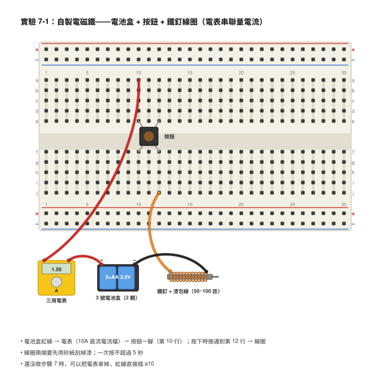
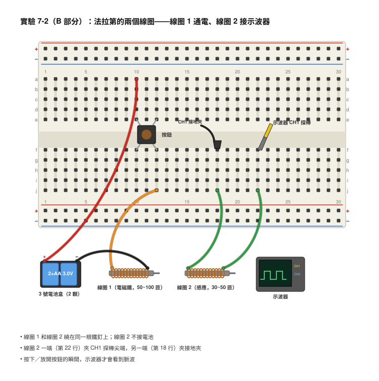
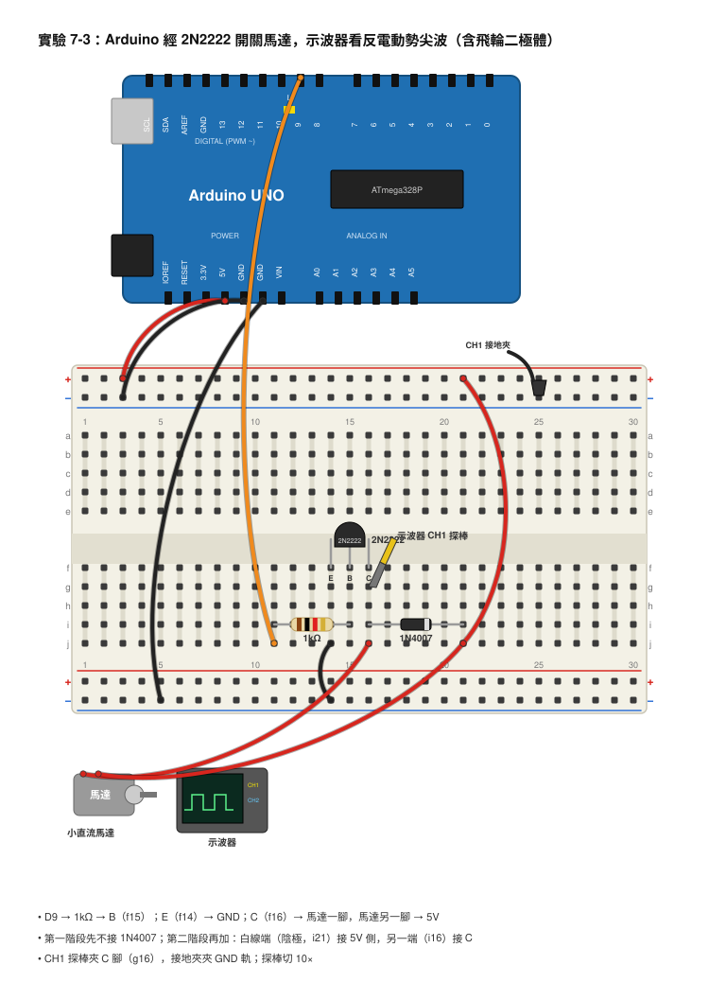

# 第 7 章　電感與電磁

## 本章目標

學完這一章，你會：

- 用鐵釘和漆包線做出一個電磁鐵，並且說出「電流會生磁」是怎麼回事。
- 解釋「磁生電」：線圈裡的磁場一變化，線圈兩端就會出現電壓。
- 說出電感（Inductance）的單位是什麼，以及電感為什麼「討厭電流突然改變」。
- 用示波器親眼看到關掉線圈的那一瞬間冒出來的高電壓尖波，再用一顆飛輪二極體把它消掉。
- 說明繼電器和直流馬達裡面是怎麼靠磁力工作的。

## 開場：為什麼拔插頭會冒火花？

你有沒有注意過，家裡老舊的電風扇或吸塵器，關掉開關的瞬間，有時候會「啪」一聲，甚至看得到開關縫隙裡閃一下小火花？（提醒：那是 110V 的家電，看看就好，千萬不要自己去拆開關！）

更誇張的例子是汽車。汽車的電瓶只有 12V，可是引擎裡的火星塞需要兩萬伏特以上的高壓才能打出火花點燃汽油。12V 是怎麼變成兩萬伏特的？答案不是什麼魔法，而是一個纏得密密麻麻的線圈，加上「突然把電流切斷」這個動作。

前面幾章的電阻、電容都是「乖乖牌」：電壓給多少，電流就流多少。可是線圈有一種「脾氣」：你想讓電流突然停下來，它偏偏要用很高的電壓硬把電流推下去。這個脾氣會弄壞電晶體、讓 Arduino 當機，但也能讓汽車發動、讓馬達轉動、讓繼電器喀喀作響。這一章我們先用鐵釘做電磁鐵，再用示波器把那個「關掉瞬間的尖波」抓出來，最後學會怎麼馴服它。

## 核心概念

### 電流會生磁：奧斯特的意外發現

1820 年，丹麥科學家奧斯特（Ørsted）上課時不小心把一條通電的電線放在指南針旁邊，指南針偏掉了；一斷電，又轉回北方。他發現：**只要有電流流過導線，導線周圍就會產生磁場（Magnetic Field）。**

一條直直的電線產生的磁場很弱。把電線繞成一圈一圈的線圈（Coil），每一圈的磁場會疊在一起變強；再在中間塞一根鐵釘當「鐵心（Core）」，鐵會把磁場集中起來，磁力再強好幾十倍。這就是**電磁鐵（Electromagnet）**。

電磁鐵的強度大致上跟兩件事成正比：

> 磁力強度 ∝ 匝數（繞了幾圈） × 電流

工程師把「匝數 × 電流」叫做**安培匝數**（Ampere-turns）。算一個例子：100 匝的線圈流 0.5 A 的電流，就是 100 × 0.5 = 50 安匝；如果你把線圈繞到 200 匝，電流只要 0.25 A，200 × 0.25 = 50 安匝，磁力差不多一樣強。所以想要省電又有力，就多繞幾圈。

### 磁生電：法拉第的線圈

既然電能生磁，磁能不能生電？英國的法拉第（Faraday）花了十年才找到答案：能，但有一個條件——**磁場必須「正在變化」**。

把磁鐵靜靜放在線圈旁邊，什麼事都不會發生；但把磁鐵「推進去」或「抽出來」的那一瞬間，線圈兩端就會冒出一個電壓。推得越快、匝數越多、磁鐵越強，電壓越高。這叫**電磁感應（Electromagnetic Induction）**，產生的電壓叫**感應電動勢（Induced EMF）**。發電廠的發電機、腳踏車的摩電燈、手機的無線充電，全都是這個原理。

有趣的是，直流馬達和發電機是同一個東西：給馬達電，軸會轉；反過來用手轉軸，兩端就會跑出電壓。實驗 7-2 我們就要用小直流馬達當發電機。

### 電感：電流的「慣性」

想像一台裝滿貨的超市推車。你想推動它，要用力推一下子才會動起來；你想讓它停，也得用力拉住才停得下來。推車有「慣性」，不喜歡速度突然改變。

線圈對電流就是這樣。線圈裡的電流一變化，磁場就跟著變化；而磁場變化又會在線圈自己身上感應出一個電壓，方向永遠是「反對電流變化」的——電流想變大，它就產生電壓拖住；電流想變小，它就產生電壓硬把電流推下去。這個「反對電流變化」的能力，就叫做**電感（Inductance）**，符號 L，單位是**亨利（Henry，H）**。

1 H 非常大，常用的是毫亨（mH，千分之一 H）和微亨（µH，百萬分之一 H）。本書器材裡的 100µH 和 1mH 電感，長得像一顆胖胖的電阻，裡面就是繞在小磁心上的線圈。

電感產生的電壓有一條簡單的公式：

> V = L × （電流變化量 ÷ 變化花的時間） = L × ΔI / Δt

Δ 念做「delta」，就是「變化量」的意思。這條公式告訴我們：電感越大、電流變化越多、變化得越快，電壓就越高。

算一個例子：一顆 1mH 的電感，電流在 1 毫秒內從 0 升到 1 A。

> V = 0.001 H × （1 A ÷ 0.001 s） = 0.001 × 1000 = 1 V

只有 1 V，很溫和。那如果變化得非常快呢？假設一個繼電器線圈的電感是 10mH，裡面流著 0.1 A 的電流，我們用電晶體在 1 微秒（0.000001 秒）內把它切斷：

> V = 0.01 H × （0.1 A ÷ 0.000001 s） = 0.01 × 100000 = 1000 V

一千伏特！當然，在真實電路裡電晶體會先被擊穿、線圈本身也有一些漏電的路徑，所以不會真的衝到 1000 V，但幾十伏特是家常便飯。這就是汽車火星塞的祕密，也是為什麼一顆小小的線圈能弄壞 Arduino。

### 反電動勢與尖波

我們把上面這個「關掉的瞬間，線圈自己產生的高電壓」叫做**反電動勢（Back EMF）**。「反」是因為它的方向跟原本推動電流的電源相反——電源想讓電流停，它偏要讓電流繼續流。

想像用電晶體當開關接在線圈下面（電源 → 線圈 → 電晶體 → GND）。電晶體一關，電流沒路走了，線圈就把下方那一點（電晶體的集極）的電壓硬往上推，推到遠超過電源電壓，直到電流找到出路為止——可能是電晶體被擊穿，可能是在空氣中跳火花。在示波器上這像一根又細又高的針，所以叫**尖波（Spike）**。

### 飛輪二極體：給電流一條回家的路

既然線圈堅持「電流要繼續流」，那我們就給它一條路。在線圈兩端並聯一顆二極體，方向是：**陰極（有白色線的那一端）接電源正極，陽極接電晶體那一端。**

```
          +5V
           │
     ┌─────┴─────┐
     │           │
  ┌──┴──┐        ▲   1N4007
  │線圈 │        │   （白線那端朝上，接 +5V）
  └──┬──┘        │
     │           │
     └─────┬─────┘
           │ ← 接電晶體集極
```

平常電晶體導通時，二極體是「反向」的，根本不導電，就像不存在一樣。但電晶體一關，線圈把下端往上推，推到比 5V 高 0.7V 時，二極體就導通了，電流可以從線圈下端 → 二極體 → 線圈上端繞一圈，在線圈裡慢慢消耗掉。所以集極電壓最高就只會到 5 + 0.7 = 5.7 V 左右，尖波消失。

這顆二極體叫**飛輪二極體（Flyback Diode）**，也叫續流二極體：讓電流像飛輪一樣在圈圈裡慢慢轉到停。**本書的安全紅線：只要用電晶體開關馬達、繼電器線圈這類東西，一定要加飛輪二極體。**

### 繼電器：用小電流開關大電流

**繼電器（Relay）**是一個「用電磁鐵去按開關」的裝置。裡面有：

- 一個線圈（電磁鐵）。
- 一片可以被吸過去的鐵片（銜鐵）和一根彈簧。
- 一組金屬接點：共用端（COM）、常開（NO，Normally Open，平常不通）、常閉（NC，Normally Closed，平常是通的）。

線圈通電 → 變成電磁鐵 → 吸住鐵片 → 鐵片把 COM 從 NC 推到 NO，「喀」一聲。線圈斷電 → 彈簧把鐵片拉回來，又「喀」一聲。

5V 繼電器的線圈電阻大約 70Ω，線圈電流大約是 5 ÷ 70 ≈ 0.071 A = 71 mA，比 Arduino 腳位能給的 20 mA 大，所以不能直接用腳位推線圈。本書的「5V 繼電器模組」板子上已經裝好電晶體和飛輪二極體，IN 腳可以直接接 Arduino。也因為模組上已經有二極體，實驗 7-3 看尖波時我們改用小直流馬達——馬達裡面也是線圈。

### 直流馬達：磁鐵推線圈

小直流馬達裡面有一圈固定的永久磁鐵，中間有一個會轉的線圈（轉子）。線圈通電就變成電磁鐵，被外面的磁鐵一吸一推，就轉了。轉半圈之後吸力方向就不對了，所以馬達裡有一個叫**換向器（Commutator）**的小銅環和兩片**電刷（Brush）**，每轉半圈就自動把電流方向反過來，馬達才能一直轉下去。

這也解釋了兩件事：電刷不停切換電流，所以馬達會產生很多小雜訊；馬達剛起動還沒轉起來時，電流特別大，可能是正常轉動時的好幾倍。

## 動手做

### 實驗 7-1：自製電磁鐵

**材料**

- 鐵釘 1 根（長 8–10 公分，越粗越好）
- 漆包線 2–3 公尺（約 0.3–0.5 mm 粗）
- 砂紙或美工刀（刮掉漆包線兩端的絕緣漆）
- 3 號電池盒（裝 2 顆 3 號電池，3V）
- 按鈕開關 1 個
- 麵包板、杜邦線
- 數位三用電表
- 迴紋針一把（當作被吸的東西）

**接線**

```
 電池盒 +（3V）──[ 按鈕 ]──┐
                           │
                     ┌─────┴─────┐
                     │  線圈     │   纏在鐵釘上
                     │ (50~100匝)│
                     └─────┬─────┘
                           │
 電池盒 − ─────────────────┘
```



- 電池盒紅線 → 麵包板 → 按鈕一腳。
- 按鈕另一腳 → 線圈的一端（刮掉漆的部分）。
- 線圈另一端 → 電池盒黑線。

**步驟**

1. 漆包線一端留 10 公分，從釘頭開始一圈緊貼一圈朝釘尖繞 50 圈，繞完也留 10 公分，用膠帶固定。
2. 用砂紙把兩端各 1 公分的漆刮乾淨，露出亮亮的銅色。這一步沒做好，電流流不過去。
3. 用三用電表 Ω 檔量線圈兩端電阻，記下來（通常不到 1Ω）。
4. 照圖接線。線圈電阻很小，幾乎等於把電池短路，所以**一定要用按鈕，一次按不超過 5 秒**，放開讓它休息再按。
5. 把釘尖靠近一堆迴紋針，按下按鈕，看能吸起幾個。放開按鈕，迴紋針會不會掉？
6. 再多繞 50 圈（變成 100 匝），重做步驟 5，比較數量。
7. 進階：電表切到 10A 直流電流檔，串聯在電池和按鈕之間，按一下讀電流（快快讀完就放開）。

**你應該看到**

按住按鈕時釘子能吸起好幾個迴紋針；放開後大部分會掉下來（鐵釘留有一點磁性，可能黏住一兩個）。100 匝比 50 匝吸得多。電流大約 1–2 A，受電池內阻限制（第 4 章學過）。線圈和電池會變溫是正常的，但燙到不能摸就馬上拆掉。

**觀察與記錄**

| 匝數 | 電池顆數 | 線圈電阻（Ω） | 電流（A） | 吸起迴紋針數 |
|------|---------|--------------|-----------|-------------|
| 50   | 2       |              |           |             |
| 100  | 2       |              |           |             |
| 100  | 3（4.5V）|              |           |             |

### 實驗 7-2：磁生電——馬達當發電機，與法拉第的兩個線圈

**材料**

- 小直流馬達（3–6V）1 顆
- 實驗 7-1 做好的電磁鐵（連同電池盒與按鈕）
- 漆包線約 1.5 公尺（再繞第二個線圈）
- 數位三用電表
- 示波器（1 個通道即可，探棒切 1×）
- 杜邦線、麵包板

**接線（A 部分：馬達發電）**

```
 ┌────────┐
 │ 直流馬達 │──── 紅棒（三用電表 DC V 檔）
 │  (用手轉)│──── 黑棒
 └────────┘
```

- 馬達兩隻腳直接接到三用電表的紅、黑棒，電表切到直流電壓 20V 檔（或 2V 檔更靈敏）。

**接線（B 部分：法拉第線圈）**

```
                 鐵釘
   ═══════════════════════════════
   ║ 線圈 1（電磁鐵）║ 線圈 2（感應）║
   ═══════════════════════════════
     │         │         │       │
   按鈕+電池   電池−     示波器   示波器
                        CH1 探棒  接地夾
```



- 線圈 1 就是實驗 7-1 的電磁鐵，接法不變（電池 → 按鈕 → 線圈 1 → 電池）。
- 在同一根鐵釘的另一段，再繞 30–50 圈當作線圈 2，兩端刮漆。
- 線圈 2 一端 → 示波器 CH1 探棒尖端；另一端 → 示波器接地夾。線圈 2 **不接電池**。

**步驟**

1. A 部分：用手指捏住馬達軸，快速一轉，同時看電表讀數。再反方向轉一次。
2. 試著用更快的速度轉（例如把軸壓在桌面上用力一搓），看電壓能到多高。
3. B 部分：示波器設定 CH1 為 200 mV/div、時間 10 ms/div，觸發模式選「單次（Single）」，觸發準位設在 +100 mV 左右（詳細設定見「用儀器看看」）。
4. 按下線圈 1 的按鈕，示波器應該會被觸發，畫面停住，顯示一個小小的電壓波。
5. 再按一次「Single」準備好，然後**放開**按鈕，看看這次的波形方向是不是跟剛才相反（如果觸發不到，把觸發邊緣改成「下降」，準位改成 −100 mV）。
**你應該看到**

A 部分：轉馬達時電表會跳出 0.1–1 V 左右的電壓，反方向轉會變成負的；轉得越快電壓越高，手一停電壓馬上歸零。

B 部分：線圈 2 明明沒接電池，可是當線圈 1 的電流「正在改變」（按下或放開的瞬間）時，示波器會看到一個幾十到幾百 mV 的脈波；按住不放的時候是一條平線。按下去和放開的脈波方向相反。這就是法拉第 1831 年做的實驗。

**觀察與記錄**

| 動作 | 電表讀數或示波器波高 | 方向（正/負） |
|------|----------------------|---------------|
| 慢慢轉馬達 |  |  |
| 快速轉馬達 |  |  |
| 反方向快速轉 |  |  |
| 按下線圈 1 按鈕（線圈 2 匝數＝＿＿） |  |  |
| 放開線圈 1 按鈕 |  |  |

### 實驗 7-3：看見反電動勢尖波，再用飛輪二極體消掉它

這是本章最重要的實驗。我們用 Arduino 透過電晶體把馬達開開關關，用示波器盯著電晶體的集極，看看關掉那一瞬間發生什麼事。

**材料**

- Arduino UNO 與 USB 線
- 2N2222 NPN 電晶體 1 顆
- 1kΩ 電阻 1 顆
- 小直流馬達（3–6V）1 顆
- 1N4007 整流二極體 1 顆
- 100µF 電解電容 1 顆（選用，讓電源穩一點）
- 麵包板、杜邦線
- 示波器（探棒切 10×）

**接線**

```
                 Arduino 5V ─────────┬────────────┐
                                     │            │
                                  ┌──┴──┐         │
                                  │ 馬達 │     （第二階段才加）
                                  └──┬──┘      1N4007 ▲ 白線端朝上
                                     │            │
                  CH1 探棒接這裡 ───►├────────────┘
                                     │ C（集極）
  Arduino D9 ──[ 1kΩ ]───────────────┤ B（基極）   2N2222
                                     │ E（射極）
                                     │
                 Arduino GND ────────┴──── 示波器接地夾
```



- Arduino D9 → 1kΩ → 2N2222 的 B 腳。
- 2N2222 的 E 腳 → Arduino GND。
- 2N2222 的 C 腳 → 馬達一腳；馬達另一腳 → Arduino 5V。
- 示波器 CH1 探棒尖端 → 2N2222 的 C 腳；接地夾 → Arduino GND。
- 2N2222 腳位：平的那一面朝向自己，由左到右是 E、B、C（第 9 章會再詳細講）。
- **第一階段先不要接 1N4007。**

**程式**

```cpp
// 第 7 章 實驗 7-3：用電晶體開關馬達，觀察反電動勢尖波
const int motorPin = 9;        // D9 接 1kΩ，再接 2N2222 的基極

void setup() {
  pinMode(motorPin, OUTPUT);   // 把 D9 設成輸出腳
  Serial.begin(9600);          // 打開序列埠，確認程式有在跑
  Serial.println("Motor switching started");
}

void loop() {
  digitalWrite(motorPin, HIGH);  // 電晶體導通，馬達開始轉
  delay(100);                    // 轉 100 毫秒

  digitalWrite(motorPin, LOW);   // 電晶體關閉，就在這一瞬間會出現尖波
  delay(100);                    // 停 100 毫秒，然後重來
}
```

**步驟**

1. 照接線圖接好，**先不接二極體**，確認示波器接地夾夾在 Arduino GND。
2. 上傳程式。馬達會一下轉一下停，每秒 5 次，聽起來像「噠噠噠」。
3. 示波器：探棒切到 10× 並在示波器上設定探棒倍率 10×，CH1 先設 2 V/div、時間 50 ms/div、觸發 CH1 上升緣、準位 2.5 V。你會看到集極電壓在 0V 和 5V 之間跳來跳去的方波（馬達轉時集極接近 0V，停時是 5V）。
4. 仔細看 5V 那一段的開頭（也就是馬達被關掉的瞬間），有沒有一根細細的直線衝出畫面上方？**那就是尖波，它可能超過 20V，所以把 V/div 調大到 10 V/div**，讓畫面能顯示到 ±40V。
5. 把觸發準位調到 8 V（比 5V 高，這樣只有尖波會觸發），時間調到 20 µs/div，觸發模式改「一般（Normal）」。現在畫面應該只在尖波出現時更新，你可以清楚看到尖波的形狀。用游標量它的最高點和持續時間，記下來。
6. 把 Arduino 的 USB 拔掉（斷電），加上 1N4007：白線那一端（陰極）接 Arduino 5V，另一端（陽極）接集極，也就是跟馬達並聯。
7. 重新接上 USB，示波器設定不變。尖波還在嗎？把觸發準位慢慢降到 6V、5.5V，看看現在集極最高到幾伏。
8. 把 V/div 調回 2 V/div，再看一次整體波形，比較加二極體前後的差別。

**你應該看到**

沒有二極體時：每次馬達關掉，集極會瞬間衝出一根 20V 到 40V 以上的尖波（高度跟馬達有關；2N2222 大約在 40–60V 會被擊穿，尖波可能剛好被「削」在那附近），幾微秒到幾十微秒後掉回 5V。5V 那段也會毛毛的，那是電刷切換造成的小雜訊。

加上二極體後：大尖波不見了，集極最高只到約 5.7V（5V + 二極體的 0.7V）。馬達運作看起來一樣，但電晶體從此安全了。

**觀察與記錄**

| 情況 | 集極平常的高電位（V） | 尖波最高電壓（V） | 尖波持續時間（µs） |
|------|---------------------|-------------------|--------------------|
| 沒有二極體 |  |  |  |
| 加 1N4007 |  |  |  |
| （進階）把二極體換成 1N4148 |  |  |  |

> 如果馬達一起動 Arduino 就重新開機（序列埠一直印出「Motor switching started」），表示 USB 給的電不夠。你可以在 Arduino 5V 與 GND 之間並聯一顆 100µF 電解電容（長腳接 5V），或改用 3 號電池盒（3 顆，4.5V）供電給馬達：電池盒黑線接 Arduino GND，紅線接馬達和二極體的陰極。

## 用儀器看看

### 示波器：抓一根只出現幾微秒的尖波

尖波又短又高，正是示波器「觸發」功能大顯身手的時候：

| 項目 | 設定 | 為什麼 |
|------|------|--------|
| 探棒 | 10× | 尖波可能超過 20V，1× 探棒量程不夠也不安全 |
| 接地夾 | Arduino GND | 安全紅線，不可以夾在集極或 5V |
| CH1 V/div | 先 2 V/div 看整體，再 10 V/div 看尖波 | 10 V/div 時畫面上下共 8 格 = ±40V |
| s/div | 先 50 ms/div，再 20 µs/div | 方波週期 200 ms；尖波只有幾微秒 |
| 觸發來源 | CH1 | 我們只有一個訊號 |
| 觸發邊緣 | 上升 | 尖波是往上衝的 |
| 觸發準位 | 8 V | 高於 5V，平常的方波不會觸發，只有尖波會 |
| 觸發模式 | 一般（Normal） | 沒尖波就不更新畫面，畫面才會停住給你看 |

沒加二極體時的畫面大概像這樣（10 V/div、20 µs/div）：

```
電壓（集極）
 30V ┤                 ╷
     │                 │╲
 20V ┤                 │ ╲
     │                 │  ╲
 10V ┤                 │   ╲
  5V ┤                 │    ╲_________________  ← 馬達關掉後停在 5V
  0V ┼─────────────────┘                        時間
       電晶體導通（≈0.2V）▲
                      關掉的這一瞬間
       ◄──────────────────────►
            每格 20 µs
```

加了 1N4007 之後（可以切回 2 V/div）：

```
電壓（集極）
  6V ┤                 ┌┐
  5V ┤                 │└──────────────────────  ← 最高只到約 5.7V
  4V ┤                 │
  2V ┤                 │
  0V ┼─────────────────┘                        時間
```

### 三用電表：量線圈、量馬達

- **線圈電阻**：Ω 檔量馬達兩腳約 1–10Ω，量自製線圈不到 1Ω。電阻這麼小，所以才需要電晶體或按鈕來控制。
- **馬達電流**：直流電流 10A 檔串聯在馬達與 5V 之間。自由轉動約 100–300 mA；用手指捏住軸讓它變慢，電流會飆高到接近 1A，這就是「堵轉電流」。
- **感應電壓**：三用電表一秒只更新兩三次，實驗 7-2 只能看到一閃而過的數字；想看完整波形要用示波器。

## 常見錯誤與除錯

- **電磁鐵完全不吸** → 漆包線兩端的漆沒刮乾淨，或是接點鬆了 → 用電表 Ω 檔從電池盒的接點量到線圈另一端，讀數應該不到 1Ω；如果是 OL（無限大）就是斷路。
- **實驗 7-2 示波器什麼都沒看到** → 觸發準位設太高，或線圈 2 匝數太少 → 把觸發準位降到 50 mV，V/div 降到 100 mV/div；增加匝數；按快一點。
- **實驗 7-3 馬達完全不轉** → 電晶體 E、C 接反，或 D9 的杜邦線沒接到 1kΩ → 用電表量 B 腳對 GND，程式 HIGH 時應該約 0.7V；量 C 腳對 GND，HIGH 時應該接近 0V。
- **看不到尖波** → 你用的是繼電器模組（板子上已經有二極體），或者探棒沒接在集極 → 換成馬達；確認探棒尖端夾在 C 腳。
- **Arduino 一直重開機** → 馬達起動電流太大把 5V 拉垮 → 加 100µF 電容，或改用電池盒給馬達供電（記得共地）。
- **加了二極體，馬達不轉而且二極體發燙** → 二極體接反了（白線端接到集極）→ 立刻斷電，把二極體轉 180 度。

## 想一想

**1.** 想讓實驗 7-1 的電磁鐵吸起更多迴紋針，有哪兩個最直接的方法？各有什麼代價？

<details><summary>參考答案</summary>

（1）多繞幾圈（增加匝數）：代價是要用更多漆包線、線圈電阻變大一點。（2）加大電流（例如多串一顆電池）：代價是線圈和電池更容易發熱，電池也更快沒電。另外換更粗、更長的鐵心也有幫助。

</details>

**2.** 一顆 1mH 的電感流著 0.2 A 的電流，被電晶體在 2 µs 內切斷。用公式算算看，它會產生多高的反電動勢？

<details><summary>參考答案</summary>

V = L × ΔI / Δt = 0.001 × （0.2 ÷ 0.000002） = 0.001 × 100000 = 100 V。這就是為什麼一定要加飛輪二極體。

</details>

**3.** 如果你把飛輪二極體接反了（白線那端接到電晶體集極），電晶體一導通會發生什麼事？

<details><summary>參考答案</summary>

接反的二極體在電晶體導通時會變成「順向」，等於把 5V 直接經過二極體和電晶體短路到 GND。電流會非常大，二極體或電晶體會發燙甚至燒毀，Arduino 的 5V 會被拉垮而重開機。所以接二極體前一定要再確認白線方向。

</details>

**4.** 為什麼繼電器模組的 IN 腳可以直接接 Arduino 腳位，但是單獨一顆繼電器的線圈不行？

<details><summary>參考答案</summary>

繼電器線圈需要大約 70 mA，超過 Arduino 腳位建議的 20 mA；而且線圈關掉時會產生反電動勢尖波。繼電器模組板子上已經裝了電晶體（放大電流）和飛輪二極體（吸收尖波），所以 Arduino 只要給它一個很小的訊號電流就好。

</details>

**5.（開放挑戰）** 老式電鈴的原理是：電磁鐵吸住鐵片 → 鐵片上的小鎚敲到鈴 → 鐵片被吸走的同時剛好把自己的電路切斷 → 電磁鐵失去磁力，彈簧把鐵片拉回 → 電路又接通……一直重複。請用本章的電磁鐵、一片鐵（例如鐵釘或迴紋針）和一根彈性的金屬片，試著畫出一個「自己會斷電」的電鈴設計圖，並說明每一步電流從哪裡流到哪裡。

<details><summary>參考答案</summary>

關鍵是把「鐵片本身」當作開關的一部分：電池 + → 彈性金屬片（接觸點 A）→ 固定接點 B → 線圈 → 電池 −。鐵片靜止時 A 碰著 B，電路通，線圈吸鐵片；鐵片一被吸過去，A 離開 B，電路斷，磁力消失，彈簧把鐵片彈回，A 又碰到 B……每來回一次，鐵片上的小鎚就敲一次鈴。這個開關每秒斷開很多次，每次都有一點小火花，那也是反電動勢造成的。

</details>

## 本章小結

- 電流流過導線會產生磁場；把導線繞成線圈、中間放鐵心，就是電磁鐵。磁力 ∝ 匝數 × 電流。
- 磁場「變化」時，線圈會感應出電壓，這叫電磁感應。馬達反過來用手轉就是發電機。
- 線圈抗拒電流變化的能力叫電感 L，單位亨利（H），常用 mH、µH。
- 電感產生的電壓 V = L × ΔI / Δt：電流變化越快，電壓越高。關掉線圈的瞬間可以產生幾十到幾百伏特的尖波，叫反電動勢。
- 在線圈兩端並聯一顆飛輪二極體（陰極接電源正極），尖波就會被限制在電源電壓 + 0.7V。開關馬達、繼電器一定要加。
- 繼電器是用電磁鐵去推開關；5V 繼電器模組已經內建電晶體和二極體。
- 直流馬達靠換向器每半圈切換電流方向而持續旋轉；起動和堵轉時電流特別大。
- 示波器抓尖波的訣竅：10× 探棒、V/div 調大、觸發準位比正常電壓高一點、用一般（Normal）觸發模式。

## 名詞表

| 中文 | 英文 | 一句話解釋 |
|------|------|-----------|
| 磁場 | Magnetic Field | 磁鐵或電流周圍看不見、但能吸鐵的作用範圍 |
| 線圈 | Coil | 導線繞成一圈一圈的樣子，能讓磁場疊加變強 |
| 電磁鐵 | Electromagnet | 通電才有磁力、斷電就沒有的「可開關磁鐵」 |
| 鐵心 | Core | 塞在線圈中間、把磁場集中起來的鐵塊 |
| 安培匝數 | Ampere-turns | 匝數 × 電流，用來估計電磁鐵有多強 |
| 電磁感應 | Electromagnetic Induction | 磁場變化時在線圈裡產生電壓的現象 |
| 感應電動勢 | Induced EMF | 電磁感應產生的那個電壓 |
| 電感 | Inductance | 線圈抗拒電流變化的能力，符號 L |
| 亨利 | Henry（H） | 電感的單位，常用 mH 和 µH |
| 反電動勢 | Back EMF | 電流被切斷時線圈自己產生、方向相反的高電壓 |
| 尖波 | Spike | 示波器上又細又高、只持續幾微秒的電壓突波 |
| 飛輪二極體 | Flyback Diode | 並聯在線圈兩端、吸收反電動勢的二極體 |
| 繼電器 | Relay | 用電磁鐵去推動金屬接點的開關 |
| 常開 / 常閉 | NO / NC | 繼電器平常不通 / 平常導通的那個接點 |
| 換向器 | Commutator | 馬達裡每半圈自動反轉電流方向的銅環 |
| 電刷 | Brush | 馬達裡壓在換向器上、把電送進轉子的金屬片 |
| 堵轉電流 | Stall Current | 馬達被卡住轉不動時的最大電流 |
