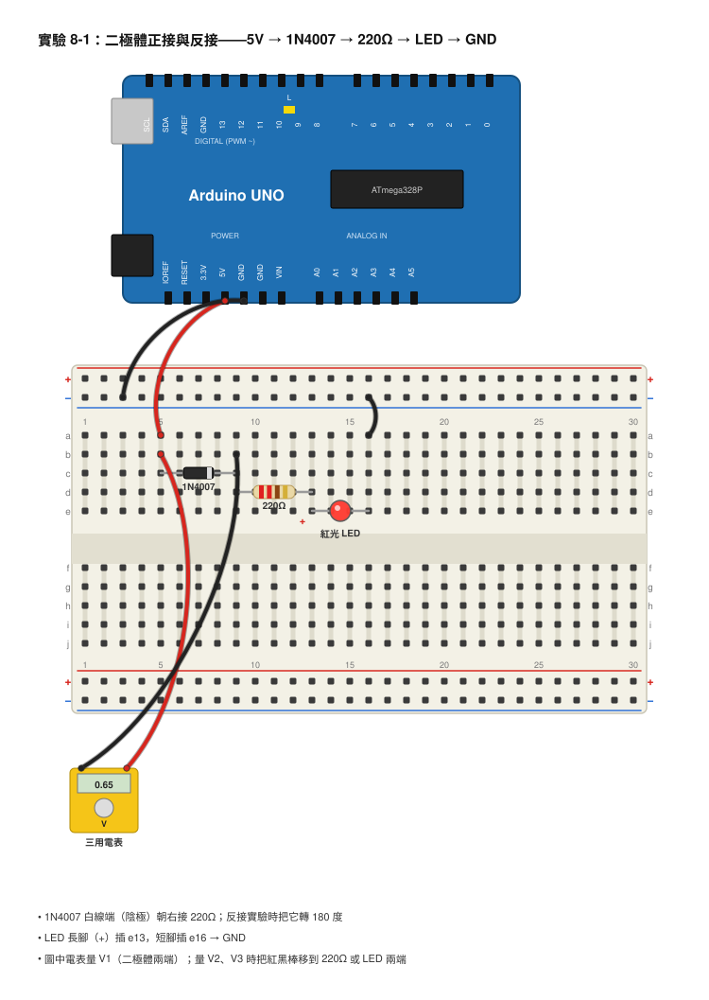
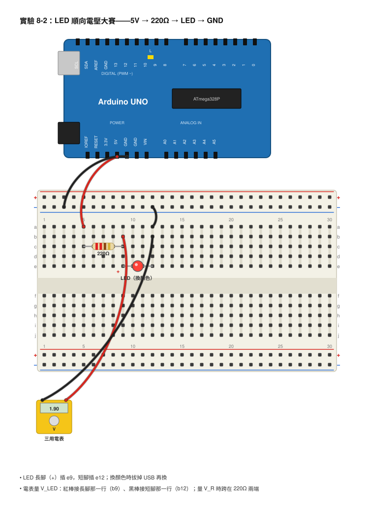
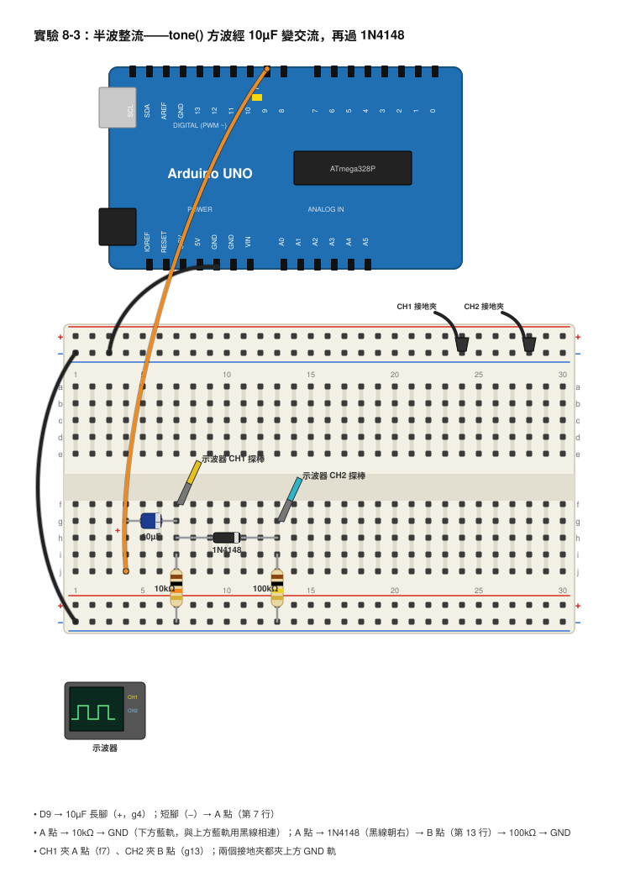

# 第 8 章　二極體與 LED

## 本章目標

學完這一章，你會：

- 說出二極體（Diode）是「只准電流往一個方向走」的元件，並且從外觀認出哪一端是陰極。
- 知道二極體導通時會「吃掉」一點電壓：1N4007 大約 0.7V，LED 依顏色不同從 1.8V 到 3.4V。
- 自己算出 LED 該配多大的限流電阻，並用三用電表量出各種顏色 LED 的順向電壓。
- 用 Arduino 做出一個有正有負的交流訊號，再用二極體把負的那一半切掉——這叫半波整流，你會在示波器上看到整個過程。
- 說出二極體在電路裡的三種保護用途。

## 開場：只准進、不准出的門

捷運站的閘門你一定走過：刷卡之後只能往前走，想從出口倒退進站，閘門會擋住你。腳踏車打氣筒的氣嘴也是這樣：空氣只能被打進輪胎，不能從輪胎跑回打氣筒。這種「只開一個方向」的東西叫單向閥。

電路裡也有單向閥，就是這一章的主角：二極體。它長得很不起眼——小小的圓柱，兩隻腳，身上一條線——但它到處都是：手機充電器裡把交流電變成直流電的是它；Arduino 板子上防止電池接反燒掉晶片的是它；上一章保護電晶體的飛輪二極體也是它。

而且你早就用過二極體了：LED 的全名是「發光二極體（Light Emitting Diode）」，它就是一顆會發光的二極體。還記得第 1 章 LED 接反不會亮嗎？那正是單向閥在起作用。

這一章我們要把二極體的脾氣摸清楚：它什麼時候讓電流過、過的時候要收多少「過路費」、關起來的時候能擋多高的電壓，最後用示波器看它把交流電「切」成只剩一半的樣子。

## 核心概念

### 單向導通：電的單向閥

二極體有兩隻腳：**陽極（Anode）**和**陰極（Cathode）**。電流只能從陽極流進去、從陰極流出來。電路符號是一個三角形加一條直線，三角形的尖端指著電流能流的方向，直線那邊就是陰極：

```
   陽極 ────►|──── 陰極
          電流只能往這邊 →
```

實體元件上，陰極那一端會印一條線（1N4007 是黑色身體配一條白線；1N4148 是橘紅色玻璃身體配一條黑線）。記法：**符號上的那條直線 = 元件上的那條線 = 陰極**。

```
      1N4007 實體（黑色塑膠）          1N4148 實體（橘紅色玻璃）
   ────┤██████████▌████├────        ────┤▒▒▒▒▒▒▒▒▒▒▒▌▒├────
   陽極            ▲    陰極        陽極            ▲  陰極
                 白線                             黑線
```

- 電流從陽極往陰極流：叫**順向（Forward）**，二極體導通，像閘門打開。
- 電壓反過來加（陰極比陽極高）：叫**逆向（Reverse）**，二極體不導通，像閘門關著。

### 順向壓降：過門要付的「過路費」

二極體不是完美的閘門。電流要通過它，必須在它兩端維持一個最低的電壓，不然門打不開；而且門一旦開了，這個電壓就大致固定住，不太會再變。這個電壓叫**順向壓降（Forward Voltage Drop）**，常寫成 V_F。

| 元件 | 順向壓降（大約） |
|------|----------------|
| 1N4007 整流二極體 | 0.6–0.8V，算的時候用 0.7V |
| 1N4148 小訊號二極體 | 0.6–0.7V，電流很小時只有 0.5V 左右 |
| 紅色 LED | 1.8–2.2V |
| 黃色 LED | 2.0–2.2V |
| 綠色 LED | 2.0–3.0V（傳統黃綠色偏低，翠綠色偏高） |
| 藍色 / 白色 LED | 3.0–3.4V |

比喻：這就像過收費站，不管你後面要開多遠，過站都要先付一筆固定的費用。電源給 5V，經過一顆 1N4007 之後，剩下給後面電路用的就只有 5 − 0.7 = 4.3V。

算一個例子：5V 電源 → 1N4007 → 1kΩ 電阻 → GND。電阻兩端的電壓是 5 − 0.7 = 4.3V，所以電流是 I = V ÷ R = 4.3 ÷ 1000 = 0.0043 A = 4.3 mA。

### 逆向：門關著，但門也有極限

逆向時二極體幾乎不導電，只有非常非常小的漏電流（微安等級，電表大多量不到）。但是如果逆向電壓太高，門會被「撞破」，這叫**逆向崩潰（Reverse Breakdown）**。不同二極體能擋的逆向電壓差很多：

- 1N4007：能擋 1000V（所以它常用在插座電壓的整流，當然我們本書不碰 110V）。
- 1N4148：能擋 100V。
- LED：只能擋大約 5V！所以 LED 不可以用 9V 電池反接，會壞掉。

在我們 12V 以下的世界裡，1N4007 和 1N4148 永遠不會被逆向撞破，但 LED 要小心。

### 二極體的家族：該用哪一顆？

本書器材有三種二極體，各有擅長：

- **1N4007 整流二極體**：耐得住 1A 的電流和 1000V 的逆向電壓，但是反應慢（從導通切換到關閉要幾微秒）。拿來當飛輪二極體、反接保護、整流大電流都很適合。
- **1N4148 小訊號二極體**：反應非常快（幾奈秒），但只能承受大約 200 mA。拿來處理 Arduino 的高頻訊號、做邏輯保護很適合。本章整流實驗用它，因為訊號是 500Hz 的方波，要快。
- **LED**：會發光，順向壓降高，電流不可以超過 20–30 mA，逆向耐壓很低。

### LED：會發光的二極體

LED 的腳位：**長腳是陽極（+），短腳是陰極（−）**；燈體邊緣有一個小缺口（平的那一邊）也是陰極那側。

LED 最重要的規則：**電流不能太大。**一般 5mm LED 最大安全電流是 20 mA，其實 5–10 mA 就已經很亮了。但 LED 一旦導通，它兩端的電壓幾乎固定，自己不會限制電流——你直接把 LED 接在 5V 上，它會因為電流暴衝幾百 mA 而在一秒內燒掉。所以 LED 永遠要串一顆**限流電阻**。

限流電阻怎麼算？把電源電壓扣掉 LED 的順向壓降，剩下的電壓都落在電阻上，再用歐姆定律：

> R = （電源電壓 − V_F） ÷ 想要的電流

例子一：5V 電源，紅色 LED（V_F 用 2.0V），想要 10 mA。

> R = （5 − 2.0） ÷ 0.010 = 3 ÷ 0.010 = 300Ω

電阻包裡沒有 300Ω，取最接近且比較大的 330Ω，實際電流是 3 ÷ 330 ≈ 0.0091 A = 9.1 mA。很好。

例子二：同樣 5V 和 220Ω，換成藍色 LED（V_F 用 3.2V）。

> I = （5 − 3.2） ÷ 220 = 1.8 ÷ 220 ≈ 0.0082 A = 8.2 mA

比紅色（3 ÷ 220 ≈ 13.6 mA）少了不少。這告訴我們：**同樣的電阻，順向壓降越高的 LED 電流越小。**

這也解釋了第 3 章一個有趣的現象：如果你把一顆紅色和一顆藍色 LED 並聯，只共用一顆電阻，藍色幾乎不會亮——因為並聯時兩顆的電壓一樣，紅色在 2V 就開門了，電流全部從紅色那邊走，藍色根本等不到它需要的 3V。正確做法是每一顆 LED 各配一顆電阻。

### 整流：把交流變直流

**交流（AC，Alternating Current）**是電壓一下正、一下負，來回擺盪的電（第 10 章會更詳細講）。我們的 LED、Arduino 都只吃**直流（DC，Direct Current）**，電壓方向固定。怎麼把交流變直流？用單向閥！

在交流訊號後面串一顆二極體：正半週時二極體順向導通，訊號過得去；負半週時二極體逆向不通，輸出就是 0。結果是只剩下正半週的「半個」波形，這叫**半波整流（Half-wave Rectification）**。

```
整流前（交流）                    整流後（半波）
 +V ┤ ┌──┐    ┌──┐               +V ┤ ┌──┐    ┌──┐
    │ │  │    │  │                  │ │  │    │  │
  0 ┼─┘  └─┐  ┘  └─┐    時間      0 ┼─┘  └────┘  └──── 時間
    │      │  │    │                 │   負半週被切掉，變成 0
 −V ┤      └──┘    └──            −V ┤
```

再進階一點，用四顆二極體排成「橋」，可以把負半週翻上來變成正的，叫全波整流；再並聯一顆大電容把起伏填平，就接近乾淨的直流了。這就是你手機充電器裡做的事。本章先把半波看清楚，電容濾波第 10 章會做。

### 二極體的保護用途

二極體不只整流，還是電路裡的保全人員：

1. **反接保護**：在電池正極後面串一顆 1N4007，電池接反時二極體不導通，後面的電路一點事都沒有。代價是正常時會損失 0.7V。
2. **飛輪二極體**：第 7 章學過，並聯在馬達、繼電器線圈兩端，吸收反電動勢尖波。
3. **箝位（Clamp）**：把二極體接在訊號線和電源之間，訊號電壓一超過電源電壓 + 0.7V 就被二極體導走，保護晶片的輸入腳。很多晶片的腳位內部就內建這種二極體。

### 七段顯示器（簡介）

把 7 條長條形的 LED 排成一個「8」的形狀（加小數點是 8 顆），就是**七段顯示器（Seven-segment Display）**，電子鐘、計算機上的數字就是它。它裡面的每一段都是一顆獨立的 LED，所以**每一段都要配自己的限流電阻**，而且分「共陽極」（所有陽極接在一起接電源）和「共陰極」（所有陰極接在一起接 GND）兩種。這個元件不在本書器材裡，先知道它是「一包 LED」就好；以後你拿到一個，就知道該怎麼點亮它。

## 動手做

### 實驗 8-1：單向閥測試——二極體正接與反接

**材料**

- 1N4007 整流二極體 1 顆
- 1N4148 小訊號二極體 1 顆
- 紅色 LED 1 顆
- 220Ω 電阻 1 顆
- Arduino UNO（只用它的 5V 和 GND 當電源）或 3 號電池盒（3 顆，4.5V）
- 麵包板、杜邦線
- 數位三用電表

**接線**

```
 +5V ────►|────[ 220Ω ]────►|──── GND
        1N4007             紅色 LED
      （白線朝右）        （長腳在左）

 量 V1：電表紅棒在 1N4007 左邊、黑棒在右邊
 量 V2：電表跨在 220Ω 兩端
 量 V3：電表跨在 LED 兩端
```



- Arduino 5V → 1N4007 陽極（沒有白線那端）。
- 1N4007 陰極（白線那端）→ 220Ω 一端。
- 220Ω 另一端 → LED 長腳；LED 短腳 → Arduino GND。

**步驟**

1. 照圖接好，接上 Arduino 的 USB 供電。LED 應該會亮。
2. 電表切到直流電壓 20V 檔，分別量 1N4007 兩端（V1）、220Ω 兩端（V2）、LED 兩端（V3），記下來。
3. 把三個數字加起來，跟 Arduino 5V 腳對 GND 的電壓比一比（第 3 章的克希荷夫電壓定律：串聯的電壓加起來等於電源電壓）。
4. 用 V2 算電流：I = V2 ÷ 220。
5. 拔掉 USB，把 1N4007 轉 180 度再插回去（白線朝左）。接上 USB，LED 還亮嗎？再量一次 V1、V2、V3。
6. 把 1N4007 換成 1N4148（黑線朝右），正接，再量一次 V1。比較兩種二極體的順向壓降。

**你應該看到**

正接時 LED 亮，V1 大約 0.6–0.7V，V3 大約 1.8–2.0V，V2 大約 2.3V，三個加起來約等於 5V。電流大約 2.3 ÷ 220 ≈ 0.0105 A = 10.5 mA。

反接時 LED 不亮，V2 和 V3 都接近 0V，而 V1 變成大約 5V（全部的電壓都落在「關著的門」上）——注意電表會顯示負號，因為現在陰極那邊電壓比較高。

1N4148 的順向壓降和 1N4007 差不多，都在 0.6–0.7V 附近，1N4148 可能略高一點點。

**觀察與記錄**

| 情況 | V1 二極體（V） | V2 電阻（V） | V3 LED（V） | V1+V2+V3（V） | 電流 = V2 ÷ 220（mA） | LED 亮嗎 |
|------|---------------|-------------|------------|--------------|---------------------|---------|
| 1N4007 正接 |  |  |  |  |  |  |
| 1N4007 反接 |  |  |  |  |  |  |
| 1N4148 正接 |  |  |  |  |  |  |

### 實驗 8-2：LED 順向電壓大賽

**材料**

- 紅、綠、藍、白 LED 各 1 顆
- 220Ω 電阻 1 顆
- Arduino UNO（5V 與 GND 當電源）
- 麵包板、杜邦線
- 數位三用電表

**接線**

```
 +5V ────[ 220Ω ]────►|──── GND
                     LED（換不同顏色）

 V_R：電表跨在 220Ω 兩端
 V_LED：電表跨在 LED 兩端（紅棒接長腳）
```



- Arduino 5V → 220Ω → LED 長腳；LED 短腳 → GND。

**步驟**

1. 先插紅色 LED，接上電源。
2. 量 LED 兩端電壓 V_LED 和電阻兩端電壓 V_R，算出電流 I = V_R ÷ 220。
3. 拔掉 USB，換綠色 LED，重複步驟 2。接著換藍色、白色。
4. 每一顆都觀察亮度，用「暗、普通、亮、很亮」描述（亮度很主觀，沒有標準答案）。
5. 進階：把電表切到「二極體檔」（符號是 ►|），紅棒接 LED 長腳、黑棒接短腳，看看電表直接顯示的數字（電表會自己送一個小電流進去，顯示的就是順向壓降，LED 會微微發亮）。

**你應該看到**

紅色約 1.9V、綠色約 2.0–2.8V（看你拿到哪一種綠）、藍色和白色約 3.0–3.2V。電流從紅色的約 13–14 mA 一路降到藍色的約 8 mA，但藍、白 LED 因為本身效率高，看起來可能反而更亮。

用二極體檔量時，紅、綠可以直接讀到壓降；藍色和白色可能顯示「OL」或「1」（超出範圍），因為大多數電表的二極體檔最高只能送到 2–3V，推不開藍光 LED 的門。這不是 LED 壞了。

**觀察與記錄**

| 顏色 | V_LED（V） | V_R（V） | I = V_R ÷ 220（mA） | 亮度 | 二極體檔讀數 |
|------|-----------|---------|--------------------|------|-------------|
| 紅   |  |  |  |  |  |
| 綠   |  |  |  |  |  |
| 藍   |  |  |  |  |  |
| 白   |  |  |  |  |  |

### 實驗 8-3：半波整流——用示波器看負半週被切掉

Arduino 的 tone() 只能輸出 0V 到 5V 的方波，它「全部都是正的」，沒有負半週，拿來示範整流看不出差別。所以我們先用一顆 10µF 電容把方波「推」成一半正、一半負的交流訊號，再送進二極體。原理回想第 5 章：電容充飽之後，直流過不去，只有「變化」能穿過電容——而方波在不停變化，所以方波的形狀會通過，但它的平均值（直流部分）會被擋掉，結果就是一個上下對稱、中心在 0V 的方波。

**材料**

- Arduino UNO 與 USB 線
- 10µF 電解電容 2 顆（1 顆用來把方波變成交流，1 顆留給進階步驟濾波用）
- 10kΩ 電阻 1 顆
- 100kΩ 電阻 1 顆
- 1N4148 小訊號二極體 1 顆
- 麵包板、杜邦線
- 示波器（雙通道，探棒切 1× 或 10× 皆可，記得在示波器上設對）

**接線**

```
                        A 點                      B 點
 Arduino D9 ────┤├────┬─────────►|──────────┬──────── 示波器 CH2
  tone()      10µF    │        1N4148       │
         （+ 極接 D9） │      （黑線朝右）    │
                   [ 10kΩ ]              [ 100kΩ ]
                      │                     │
 Arduino GND ─────────┴─────────────────────┴──────── 示波器接地夾
                      ▲
                 示波器 CH1 接 A 點
```



- Arduino D9 → 10µF 電解電容的長腳（+）；電容短腳（−）→ A 點。
- A 點 → 10kΩ → GND（這顆電阻讓 A 點有一個「回到 0V 的參考」，不能省）。
- A 點 → 1N4148 陽極；1N4148 陰極（黑線端）→ B 點。
- B 點 → 100kΩ → GND。
- 示波器 CH1 探棒 → A 點；CH2 探棒 → B 點；兩個接地夾都 → Arduino GND。

**程式**

```cpp
// 第 8 章 實驗 8-3：用 tone() 產生 500Hz 方波當作訊號源
const int signalPin = 9;     // D9 輸出方波

void setup() {
  tone(signalPin, 500);      // 在 D9 輸出 500 Hz 方波（週期 2 ms），會一直輸出
}

void loop() {
  // 什麼都不用做，tone() 會在背景自己持續輸出
}
```

**步驟**

1. 照圖接好，上傳程式。
2. 示波器：CH1 與 CH2 都設 1 V/div，耦合（Coupling）都選 DC，時間 500 µs/div，觸發來源 CH1、上升緣、準位 0V。兩個通道的 0V 基準線調到畫面中間（或各自分上下，方便對照）。
3. 看 CH1（A 點）：應該是一個有正有負的方波，大約在 +2.4V 和 −2.6V 之間跳動。它不會剛剛好上下對稱，因為二極體那一邊只在正半週拿電流，沒關係。
4. 看 CH2（B 點）：正半週的時候跟著 CH1 一起往上（但矮了大約 0.5V，那是二極體的過路費），負半週的時候則是一條 0V 的平線。**負的一半不見了。**
5. 用游標量 CH1 的最高與最低電壓，以及 CH2 的最高與最低電壓，記下來。
6. 拔掉 USB，把 1N4148 轉 180 度（黑線朝左）再插回去。接上 USB，看 CH2：現在變成只剩下負半週，正半週變成 0V。這證明二極體的方向決定了哪一半能通過。
7. 把二極體轉回正接。進階：在 100kΩ 兩端並聯一顆 10µF 電解電容（長腳接 B 點，短腳接 GND）。看 CH2 變成什麼樣子？

**你應該看到**

步驟 3–4 的畫面大概像這樣：

```
CH1（A 點，整流前）
 +2V ┤ ┌────┐      ┌────┐      ┌────┐
  0V ┼─┘    │      │    │      │    │
 −2V ┤      └──────┘    └──────┘    └──────  時間
       ◄────────────►
            2 ms（500 Hz）

CH2（B 點，整流後）
 +2V ┤ ┌────┐      ┌────┐      ┌────┐
  0V ┼─┘    └──────┘    └──────┘    └──────  時間
 −2V ┤   ↑ 比 CH1 矮約 0.5V      ↑ 負半週變成 0V
```

步驟 6 二極體反接後：

```
CH2（B 點，二極體反接）
 +2V ┤
  0V ┼─┐    ┌──────┐    ┌──────┐    ┌──────  時間
 −2V ┤ └────┘      └────┘      └────┘
         只剩下負半週
```

步驟 7 加上電容後：CH2 的方波消失，變成一條接近 +1.8V 的直線，只有非常輕微的起伏。因為電容在正半週被充飽，負半週時二極體關著，電容只能透過 100kΩ 慢慢放電（τ = 100kΩ × 10µF = 1 秒，比 2 ms 的週期長太多了，所以幾乎沒掉）。恭喜，你做出了一個把交流變直流的電源！

**觀察與記錄**

| 情況 | CH1 最高（V） | CH1 最低（V） | CH2 最高（V） | CH2 最低（V） |
|------|-------------|-------------|-------------|-------------|
| 二極體正接 |  |  |  |  |
| 二極體反接 |  |  |  |  |
| 正接 + 100kΩ 並聯 10µF |  |  |  |  |

## 用儀器看看

### 三用電表的二極體檔

大部分數位三用電表有一個 ►| 符號的檔位。在這個檔，電表會從紅棒送出大約 1 mA 的小電流，並顯示紅棒到黑棒之間的電壓。

- 紅棒接陽極、黑棒接陰極：1N4007 顯示約 0.55–0.65，1N4148 約 0.6–0.7，紅色 LED 約 1.7–1.9（而且會微微亮）。
- 反過來接：顯示 OL 或 1（表示超出範圍，門關著）。
- 兩個方向都顯示 0.0：二極體短路，壞了。兩個方向都 OL：二極體斷路，也壞了。
- 藍、白 LED 顯示 OL 不代表壞了，是電表的電壓不夠高。改用實驗 8-2 的方法（220Ω + 5V）來量。

這也是認腳位最快的方法：拿一顆看不清楚線的二極體，兩個方向各量一次，顯示 0.6 的那次，紅棒接的就是陽極。

### 示波器：看整流

實驗 8-3 的設定整理如下：

| 項目 | 設定 | 為什麼 |
|------|------|--------|
| CH1、CH2 V/div | 1 V/div | 訊號大約 ±2.5V，8 格的畫面放得下 |
| 耦合 | DC | 我們要看「有沒有負電壓」，AC 耦合會把 0V 線移掉，看不出整流效果 |
| s/div | 500 µs/div | 500Hz 的週期是 2 ms，一格半一個週期，畫面約 5 個週期 |
| 觸發 | CH1、上升緣、0V | 讓每一次掃描都從同一個地方開始，波形才會停住 |
| 接地夾 | 兩個都夾 Arduino GND | 安全紅線 |

小技巧：把兩個通道的 0V 線對齊在同一個位置，你會一眼看出 CH2 的正半週比 CH1 矮了一截（0.5V 的過路費），而負半週被「切平」在 0V。

## 常見錯誤與除錯

- **實驗 8-1 LED 不亮，二極體正接** → 二極體白線方向看錯、LED 長短腳接反，或麵包板同一排沒插在一起 → 用電表二極體檔逐顆確認方向；量 5V 腳確認有電。
- **實驗 8-2 藍、白 LED 的二極體檔顯示 OL** → 電表電壓不夠，不是 LED 壞 → 用 220Ω + 5V 量。
- **實驗 8-3 CH1 看起來是 0–5V 的方波，沒有負的部分** → CH1 探棒夾到 D9 而不是 A 點，或 10kΩ 沒接 → 確認探棒在電容的另一邊，10kΩ 一端接 A 點一端接 GND。
- **實驗 8-3 CH1 是一條平線** → tone() 沒跑（程式沒上傳成功）或電容接反壞了 → 先把探棒直接夾 D9 看有沒有方波。
- **實驗 8-3 CH2 什麼都沒有** → 二極體方向反了而剛好你在看正半週，或 100kΩ 沒接 → 對照圖檢查黑線方向。
- **示波器波形一直左右跑不停** → 觸發來源不是 CH1 或準位設錯 → 把觸發來源切到 CH1、準位設 0V、模式「自動」。

## 想一想

**1.** 用 9V 電池點亮一顆紅色 LED（V_F 用 2.0V），想要 15 mA 的電流，該用多大的電阻？電阻包裡最接近的值是多少？實際電流會是多少？

<details><summary>參考答案</summary>

R = （9 − 2.0） ÷ 0.015 = 7 ÷ 0.015 ≈ 467Ω。取 470Ω。實際電流 = 7 ÷ 470 ≈ 0.0149 A ≈ 14.9 mA。

</details>

**2.** 小明把一顆紅色 LED 和一顆藍色 LED 並聯，共用一顆 220Ω 接 5V。結果紅色很亮、藍色幾乎不亮。為什麼？要怎麼改？

<details><summary>參考答案</summary>

並聯的兩顆 LED 兩端電壓相同。紅色 LED 在大約 2V 就導通，把電壓「釘」在 2V 附近，藍色 LED 需要 3V 以上才會開門，所以等不到足夠的電壓。改法：每顆 LED 各自串一顆電阻，再分別接到 5V。

</details>

**3.** 實驗 8-3 中，為什麼 CH2 的正半週會比 CH1 矮大約 0.5V？如果把 1N4148 換成紅色 LED，CH2 會變成怎樣？

<details><summary>參考答案</summary>

矮掉的那 0.5V 是 1N4148 的順向壓降（電流很小時大約 0.5V）。換成紅色 LED 之後，順向壓降變成約 1.8V，但 A 點正半週最高只有約 2.4V，所以 CH2 的正半週只剩大約 0.6V 高，LED 也只會非常微弱地閃爍（500Hz 太快，看起來像常亮但很暗）。

</details>

**4.** 實驗 8-3 的進階步驟，把 100kΩ 換成 10kΩ，再並聯同一顆 10µF 電容，CH2 的直線會變得比較「平」還是比較「起伏」？為什麼？

<details><summary>參考答案</summary>

會比較起伏。τ = 10kΩ × 10µF = 0.1 秒，比原來的 1 秒短 10 倍，所以在負半週（1 ms）的時候電容放電得比較多，電壓掉得比較明顯，直線上會出現看得見的鋸齒。這種起伏叫「漣波」，第 10 章會學怎麼把它濾得更平。

</details>

**5.（開放挑戰）** 設計一個「Arduino 用 9V 電池供電，但就算電池扣接反也不會燒掉」的接法。畫出電路，說明正常使用時 Arduino 的 VIN 腳會拿到幾伏，以及接反時電流往哪裡走。

<details><summary>參考答案</summary>

電池 + → 1N4007 陽極；1N4007 陰極（白線端）→ Arduino VIN；電池 − → Arduino GND。正常時 VIN 拿到 9 − 0.7 = 8.3V，Arduino 的穩壓器只要 7V 以上就能正常工作。接反時，電池的正極跑到 GND、負極經過二極體的陰極那端，二極體逆向不導通，所以沒有電流流動，Arduino 什麼事也沒有。（注意：要用 1N4007 而不是 1N4148，因為 Arduino 可能需要超過 200 mA。）

</details>

**6.（開放挑戰）** 用四顆 1N4007 可以做出「全波整流」：不管交流是正半週還是負半週，輸出永遠是正的。查資料或自己想想看這四顆二極體要怎麼排，畫出來，並用箭頭標出正半週和負半週時電流分別走哪條路。然後試著用實驗 8-3 的 A 點當訊號源做做看。

<details><summary>參考答案</summary>

四顆二極體排成菱形（橋式整流）：交流的兩端接在菱形左右兩個角，輸出的 + 在上角（兩顆二極體的陰極會合處），輸出的 − 在下角（兩顆二極體的陽極會合處）。正半週時電流從左角經右上的二極體到上角 → 負載 → 下角 → 經左下的二極體回右角；負半週時從右角經左上二極體到上角 → 負載 → 下角 → 經右下二極體回左角。兩種情況負載上的電流方向都一樣，所以輸出永遠是正的。注意：橋式整流的輸出 − 不是訊號源的 GND，所以示波器接地夾要夾在輸出的 −，而不能同時夾 Arduino GND，否則會把一顆二極體短路——這個實驗最好用電池盒或馬達發電機當訊號源，比較安全。

</details>

## 本章小結

- 二極體只讓電流從陽極流向陰極；元件上有線的那端是陰極，對應符號上的直線。
- 順向導通時有固定的順向壓降：1N4007 / 1N4148 約 0.7V，紅 LED 約 2V，藍白 LED 約 3.2V。
- 逆向時不導通，但逆向電壓太高會崩潰：1N4007 耐 1000V，1N4148 耐 100V，LED 只耐約 5V。
- LED 一定要串限流電阻：R = （電源電壓 − V_F） ÷ 電流。不同顏色的 LED 不要共用一顆電阻並聯。
- 半波整流：交流訊號串一顆二極體，負半週被切掉只剩正半週。二極體反過來接就剩負半週。
- 整流後並聯一顆電容可以把起伏填平，變成接近直流（τ 要比週期長很多）。
- 二極體的保護用途：反接保護、飛輪二極體、箝位。
- 三用電表的二極體檔可以量順向壓降、判斷二極體好壞和腳位；藍白 LED 可能顯示 OL，不是壞掉。

## 名詞表

| 中文 | 英文 | 一句話解釋 |
|------|------|-----------|
| 二極體 | Diode | 只讓電流往一個方向流的元件 |
| 陽極 | Anode | 二極體讓電流「進來」的那一腳（LED 的長腳） |
| 陰極 | Cathode | 二極體讓電流「出去」的那一腳，元件上有線的那端 |
| 順向 | Forward | 電流從陽極往陰極流的方向，二極體導通 |
| 逆向 | Reverse | 電壓反過來加，二極體不導通 |
| 順向壓降 | Forward Voltage Drop（V_F） | 二極體導通時兩端固定「吃掉」的電壓 |
| 逆向崩潰 | Reverse Breakdown | 逆向電壓太高把二極體「撞破」而導通 |
| 發光二極體 | LED（Light Emitting Diode） | 導通時會發光的二極體 |
| 限流電阻 | Current-limiting Resistor | 跟 LED 串聯、防止電流太大的電阻 |
| 交流 | AC（Alternating Current） | 電壓方向一正一負來回變化的電 |
| 直流 | DC（Direct Current） | 電壓方向固定不變的電 |
| 整流 | Rectification | 用二極體把交流變成只有一個方向的電 |
| 半波整流 | Half-wave Rectification | 用一顆二極體只留下交流的一半 |
| 全波整流 | Full-wave Rectification | 用四顆二極體把兩個半週都變成正的 |
| 漣波 | Ripple | 整流加電容之後殘留的小起伏 |
| 反接保護 | Reverse Polarity Protection | 用二極體防止電源接反燒壞電路 |
| 箝位 | Clamp | 用二極體把電壓限制在某個範圍內 |
| 七段顯示器 | Seven-segment Display | 用 7 段 LED 排成「8」字形來顯示數字的元件 |
