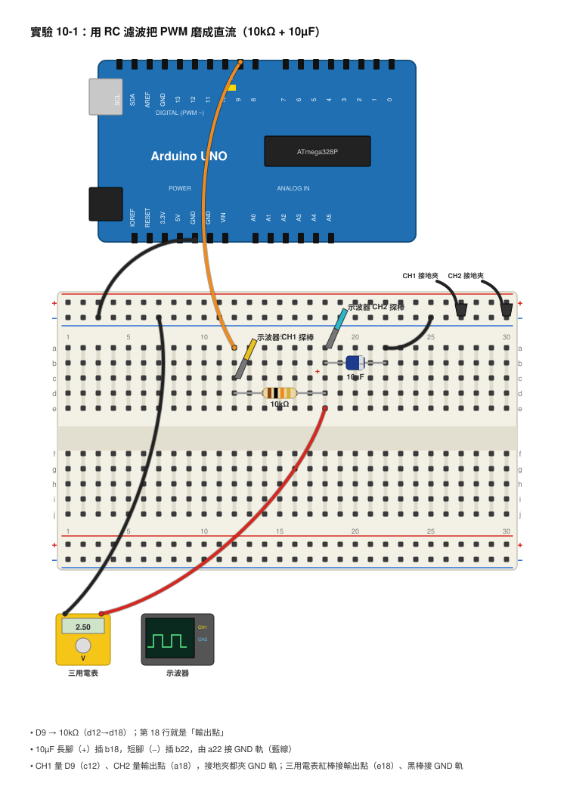
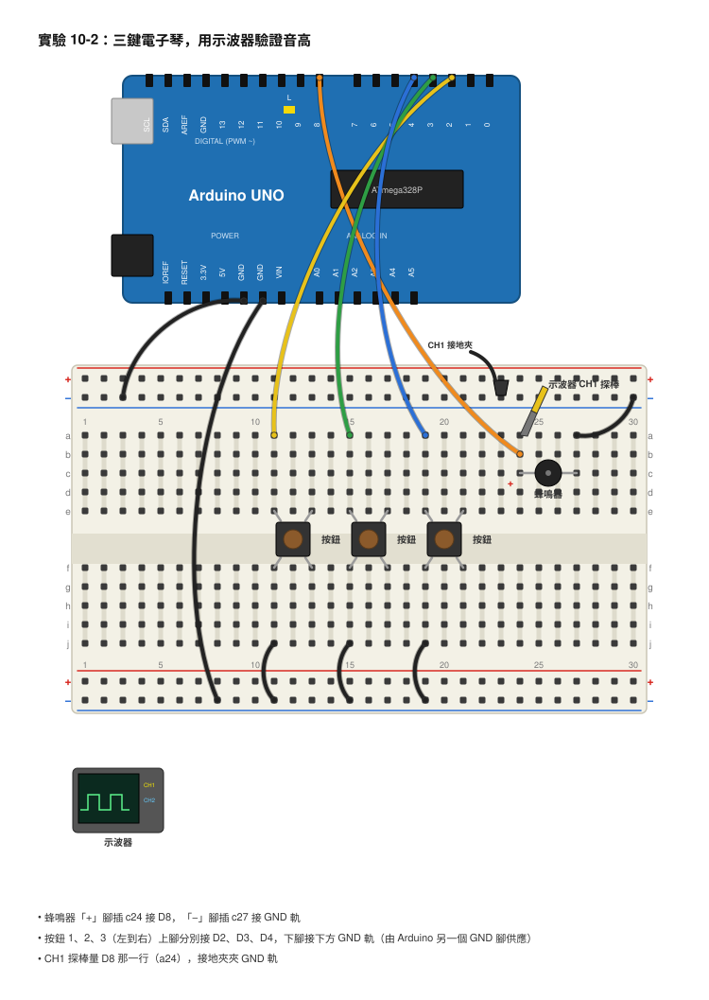

# 第 10 章　交流訊號與濾波

## 本章目標
- 學完你會分辨直流與交流，說得出一個波的「週期、頻率、振幅、Vpp」是什麼。
- 學完你會解釋 PWM 的占空比，並算出它的平均電壓。
- 學完你會用一顆電阻加一顆電容做出「低通濾波器」，把 Arduino 的 PWM 方波磨成接近直流，並用示波器看前後差別。
- 學完你會說出為什麼時間常數 τ 要比方波的週期大很多，濾波才有效。
- 學完你會用 `tone()` 做一台三鍵電子琴，再用示波器量出每個音的頻率。

## 開場：Arduino 只有 0V 和 5V，怎麼做出 2.5V？

園遊會快到了，社團決定做兩個攤位：一個是「電子琴」，按下按鈕就發出 Do、Re、Mi；另一個是「調光燈」，轉一轉就能讓燈從暗慢慢變亮。

做調光燈的同學先卡住了。他翻了翻 Arduino 的說明，發現數位腳位只會輸出兩種電壓：0V 或 5V。「那要怎麼得到 2.5V 呢？LED 要半亮，總不能叫它一下亮一下暗吧？」

另一個做電子琴的同學也有疑問：「蜂鳴器只是一片會震動的薄片，為什麼同一顆蜂鳴器可以發出 Do，也可以發出 Mi？聲音的高低到底是什麼決定的？」

其實這兩個問題的答案是同一個東西：**時間**。前面幾章我們看的多半是「不會變的電壓」，這一章開始，我們要看「會隨時間變來變去的電壓」，也就是訊號（Signal）。只要掌握訊號怎麼變，Arduino 就能做出 2.5V，蜂鳴器也能唱出整首歌。

## 核心概念

### 直流與交流：水往一個方向流，還是來回晃？

想像一條水管。如果水一直往同一個方向流，速度也差不多，這就像**直流（DC, Direct Current）**：電池、USB 供電、Arduino 的 5V 腳位都是直流，電流方向固定，電壓大致不變。

如果水管裡的水一下往左、一下往右，來回晃動，這就像**交流（AC, Alternating Current）**：電流的方向會週期性地反過來，電壓也在正負之間來回擺。家裡牆上的插座就是交流電（記住安全紅線：本書絕對不碰 110V 插座），第 7 章你拿磁鐵在線圈旁邊晃出來的電，也是交流。

還有一種介於中間的：電壓一直在 0V 和 5V 之間跳，方向沒有反過來，但是數值一直在變。Arduino 腳位輸出的方波就是這種。嚴格說它是「會變的直流」，不過它跟交流有一樣的特性：有週期、有頻率，所以我們把它們放在同一章講。

### 正弦波：最乾淨的波

最基本、最乾淨的交流訊號叫**正弦波（Sine Wave）**，長得像平滑的山丘和山谷一直重複：

```
電壓
 +1V ┤   ╭─╮       ╭─╮
     │  ╱   ╲     ╱   ╲
  0V ┼─╱─────╲───╱─────╲─── 時間
     │        ╲ ╱       ╲ ╱
 -1V ┤         ╰─╯       ╰─╯
       ◄───────►
        一個週期 T
```

描述一個波，要記住四個詞：

- **週期（Period，T）**：波重複一次需要的時間，單位是秒（s）或毫秒（ms）。
- **頻率（Frequency，f）**：一秒鐘重複幾次，單位是赫茲（Hz）。1 kHz = 1000 Hz。
- **振幅（Amplitude）**：從中間線到最高點的高度。
- **峰對峰值（Vpp，Peak-to-Peak Voltage）**：最高點到最低點的總高度。上面那個波振幅是 1V，Vpp 就是 2V。

週期和頻率互為倒數，這是本章最重要的公式：

```
f = 1 / T　　　　T = 1 / f
```

算一個例子：台灣的市電頻率是 60 Hz，一個週期 T = 1 ÷ 60 = 0.0167 秒 = 16.7 ms。反過來，如果示波器量到一個波的週期是 4 ms = 0.004 秒，那頻率 f = 1 ÷ 0.004 = 250 Hz。

單位換算要小心：先把 ms 換成秒再算。4 ms 是 0.004 秒，不是 4 秒。

### 方波與 PWM：用「快速開關」做出半亮

回到開場的問題：Arduino 只有 0V 和 5V，怎麼做 2.5V？答案是「快速切換」。如果 LED 亮 1 毫秒、暗 1 毫秒，一直重複，每秒切換幾百次，你的眼睛根本跟不上，看起來就是「半亮」。

這種在 HIGH 和 LOW 之間來回跳的訊號叫**方波（Square Wave）**。方波裡「HIGH 的時間占整個週期的比例」叫**占空比（Duty Cycle）**：

```
占空比 D = HIGH 的時間 ÷ 週期 × 100%
平均電壓 V平均 = V高 × D
```

Arduino 的 `analogWrite(腳位, n)` 就是在輸出這種方波，n 可以是 0 到 255，占空比 = n ÷ 255。這種「用占空比控制平均值」的技巧叫 **PWM（Pulse Width Modulation，脈波寬度調變）**。

算一次：

- `analogWrite(9, 128)`：占空比 = 128 ÷ 255 = 50.2% ≈ 50%，平均電壓 = 5V × 0.5 = 2.5V。
- `analogWrite(9, 64)`：占空比 = 64 ÷ 255 ≈ 25%，平均電壓 ≈ 1.25V。
- `analogWrite(9, 191)`：占空比 = 191 ÷ 255 ≈ 75%，平均電壓 ≈ 3.75V。

Arduino UNO 的 D9 腳位 PWM 頻率大約是 490 Hz，週期 T = 1 ÷ 490 ≈ 0.00204 秒 ≈ 2 ms。也就是每 2 ms 一個循環，50% 的時候 HIGH 約 1 ms、LOW 約 1 ms。

```
電壓（analogWrite(9,128)，約 490Hz，50%）
 5V ┤   ┌────┐    ┌────┐    ┌────┐
    │   │    │    │    │    │    │
 0V ┼───┘    └────┘    └────┘    └── 時間
        ◄────────►
          約 2 ms
```

### RC 低通濾波：把方波「磨平」成直流

眼睛會自己把閃爍平均掉，但很多東西不會。如果你要的是真正穩定的 2.5V（例如給別的電路當參考電壓），就得自己把方波磨平。工具是第 5 章學過的老朋友：一顆電阻加一顆電容。

想像一個水桶，進水管很細（電阻大），桶子很大（電容大）。水龍頭一秒開關幾百次，但因為管子細、桶子大，桶裡的水位幾乎不會跟著跳，只會慢慢停在一個「平均水位」。電阻加電容就是這樣的水桶，它讓慢的變化通過、把快的跳動擋掉，所以叫**低通濾波器（Low-pass Filter）**，「低」指的是低頻率的訊號可以通過。

```
 Arduino D9 ──[ R ]──┬──── 輸出（接近平均電壓）
                     │
                    ═╪═ C
                     │
                    GND
```

關鍵是第 5 章的時間常數 **τ = R × C**。這裡的規則是：

> **τ 要比方波的週期大很多（至少 10 倍，最好 50 倍以上），輸出才會平。**

因為在半個週期內，電容「來不及」充飽或放光，水位只會微微晃，這個微微晃叫**漣波（Ripple）**。漣波大概可以這樣估（50% 占空比時）：

```
漣波 ≈ （V高 − V平均）×（半個週期 ÷ τ）
```

算三組，等一下實驗會全部量到：

| R | C | τ = R × C | τ 比週期（2 ms） | 預期結果 |
|---|---|---|---|---|
| 10 kΩ | 10 µF | 10000 × 0.00001 = 0.1 s = 100 ms | 大 50 倍 | 幾乎平的直線，漣波 ≈ 2.5V × (1 ms ÷ 100 ms) ≈ 25 mV |
| 10 kΩ | 100 nF | 10000 × 0.0000001 = 0.001 s = 1 ms | 只有一半 | 很明顯的三角波，上下晃大約 2.3V |
| 1 kΩ | 100 nF | 1000 × 0.0000001 = 0.0001 s = 0.1 ms | 比週期還短 20 倍 | 幾乎沒濾到：電容在半個週期內就充飽、放光，看起來像圓角的方波，晃動將近 5V |

磨得越平，代價就是「反應越慢」：τ = 0.1 s 的那組，從開機到輸出穩定在 2.5V，要等大約 5τ = 0.5 秒。如果你改占空比，它也要半秒才跟上。這是濾波永遠的取捨：**越平越慢，越快越抖**。

### 濾波為什麼也能去雜訊、去抖動？

雜訊（Noise）是什麼？就是訊號上面那些又快又小的毛毛刺刺。它們的頻率很高，而低通濾波器剛好專門擋高頻，所以電阻加電容也是最常見的「除毛器」。感測器的讀值一直跳，常常加一組 RC 就安靜很多。

下一章你會看到，按鈕按下去的瞬間，金屬片會「彈跳」好幾次，產生一串很快的 HIGH/LOW。同樣的道理，加一組 RC 可以把這些彈跳磨掉，讓 Arduino 只看到一次乾淨的按下。

甚至程式裡「把最近 10 次讀值平均起來」也是一種濾波，只是用軟體做。

### 聲音與頻率：蜂鳴器為什麼能唱歌

聲音是空氣來回震動，一秒震動幾次就是聲音的頻率。震得越快，我們聽到的音越高。本書的**無源蜂鳴器（Passive Buzzer）**本身不會響，它只是一片會跟著電壓動的薄片，你給它多少 Hz 的方波，它就震多少次。

Arduino 的 `tone(腳位, 頻率)` 會在那個腳位輸出 50% 的方波，頻率隨你指定，`noTone(腳位)` 則停止。音階和頻率的對照如下（中央 C 這一組）：

| 音名 | Do | Re | Mi | Fa | Sol | La | Si | 高音 Do |
|---|---|---|---|---|---|---|---|---|
| 頻率（Hz） | 262 | 294 | 330 | 349 | 392 | 440 | 494 | 523 |
| 週期（ms） | 3.82 | 3.40 | 3.03 | 2.87 | 2.55 | 2.27 | 2.02 | 1.91 |

算一個：Do 是 262 Hz，週期 T = 1 ÷ 262 = 0.00382 秒 = 3.82 ms。你會發現高音 Do（523 Hz）剛好是 Do（262 Hz）的兩倍，這就是「高八度」的意思：頻率加倍。

## 動手做

### 實驗 10-1：用 RC 濾波把 PWM 磨成直流

**材料**
- Arduino UNO 與 USB 線、麵包板、杜邦線
- 10 kΩ 電阻 ×1、1 kΩ 電阻 ×1
- 10 µF 電解電容 ×1（有極性！）、100 nF 陶瓷電容 ×1
- 雙通道示波器（兩支 10× 探棒）
- 數位三用電表

**接線**

```
 CH1 探棒 ─────────────────┐
                           │
 Arduino D9 ──[ 10kΩ ]─────┼──┬──── CH2 探棒
                              │
                             ═╪═ 10µF（長腳「+」在上方）
                              │
 Arduino GND ─────────────────┴──── 兩支探棒的接地夾
```



- Arduino D9 → 10 kΩ 電阻一端。
- 10 kΩ 電阻另一端 → 麵包板上一條橫排（叫它「輸出點」）。
- 10 µF 電解電容：長腳（+）→ 輸出點，短腳（−）→ Arduino GND。
- 示波器 CH1 探棒尖端 → Arduino D9（濾波前）；CH2 探棒尖端 → 輸出點（濾波後）。
- 兩支探棒的黑色接地夾 → Arduino GND。接地夾只能夾 GND。

**程式**（上傳後可以在序列埠監控視窗輸入 0–255 改占空比）

```cpp
// 實驗 10-1：輸出 PWM 給 RC 濾波器
const int pwmPin = 9;        // D9 支援 PWM，頻率約 490Hz
int dutyValue = 128;         // 128/255 ≈ 50%

void setup() {
  Serial.begin(9600);        // 打開序列埠，速度 9600
  pinMode(pwmPin, OUTPUT);
  analogWrite(pwmPin, dutyValue);   // 先輸出 50% 的方波
  Serial.println("輸入 0-255 可以改占空比");
}

void loop() {
  if (Serial.available() > 0) {          // 有人在序列埠打字？
    int newValue = Serial.parseInt();    // 把打的字讀成整數
    if (newValue >= 0 && newValue <= 255) {
      dutyValue = newValue;
      analogWrite(pwmPin, dutyValue);    // 更新占空比
      Serial.print("占空比 = ");
      Serial.print(dutyValue * 100.0 / 255.0);   // 換算成百分比
      Serial.println(" %");
    }
    while (Serial.available() > 0) Serial.read();  // 清掉多餘字元（例如換行）
  }
}
```

**步驟**
1. 先不要接電容，只接 10 kΩ，上傳程式。示波器 CH1 和 CH2 應該都看到一樣的方波（電阻後面沒有電容，沒有濾波效果）。
2. 把 10 µF 電解電容接上（注意長腳在輸出點、短腳在 GND）。看 CH2 的變化：等大約半秒，它會變成一條幾乎平的線，停在 2.5V 附近。
3. 用三用電表直流電壓檔量輸出點對 GND，記下來。
4. 在序列埠監控視窗輸入 `64`，再輸入 `191`，看 CH2 的線怎麼移、三用電表怎麼變。
5. 把 10 µF 換成 100 nF 陶瓷電容（沒有極性，隨便接）。這組是 τ = 1 ms，看 CH2 變成三角波。
6. 再把 10 kΩ 換成 1 kΩ（還是接 100 nF）。這組是 τ = 0.1 ms，看 CH2 幾乎回到方波，只是邊角變圓。
7. 把三組的波形畫下來、漣波量下來，填進表格。

**你應該看到**
- 10 kΩ + 10 µF：CH1 是 0V/5V 方波，CH2 幾乎是直線，停在 2.5V。把 CH2 的 V/div 調小一點會看到一點點鋸齒狀的小漣波，大約 20–30 mV。
- 10 kΩ + 100 nF：CH2 是明顯的三角波，在大約 1.3V 到 3.7V 之間來回。
- 1 kΩ + 100 nF：CH2 看起來像圓角方波，幾乎從 0V 衝到 5V，根本沒濾到什麼。
- 輸入 64 時平均電壓掉到約 1.25V，輸入 191 時升到約 3.75V。

**觀察與記錄**

| R | C | τ = R × C | CH2 平均電壓（示波器） | 三用電表讀值 | 漣波 Vpp | 波形長相 |
|---|---|---|---|---|---|---|
| 10 kΩ | 10 µF | 0.1 s | | | | |
| 10 kΩ | 100 nF | 1 ms | | | | |
| 1 kΩ | 100 nF | 0.1 ms | | | | |

| analogWrite 的值 | 占空比（算出來） | 平均電壓（算出來） | 三用電表量到（10 kΩ + 10 µF） |
|---|---|---|---|
| 64 | | | |
| 128 | | | |
| 191 | | | |

### 實驗 10-2：三鍵電子琴，用示波器驗證音高

**材料**
- Arduino UNO、麵包板、杜邦線
- 無源蜂鳴器 ×1
- 按鈕開關 ×3
- 示波器（一支探棒）

**接線**

```
 Arduino D8 ──────── 蜂鳴器「+」
 Arduino GND ─────── 蜂鳴器「−」

 Arduino D2 ──┬── 按鈕 1 ──┐
 Arduino D3 ──┼── 按鈕 2 ──┤
 Arduino D4 ──┴── 按鈕 3 ──┴── Arduino GND

 CH1 探棒尖端 → D8，接地夾 → GND
```



- 蜂鳴器「+」腳（通常有標示或腳較長）→ Arduino D8；「−」腳 → GND。
- 三個按鈕各一腳 → D2、D3、D4；另一腳 → GND。按鈕不需要外接電阻，程式會打開 Arduino 內建的上拉電阻（下一章會詳細解釋，現在只要記得：按下去讀到的是 LOW）。
- 示波器 CH1 探棒尖端夾在 D8 那條線上，接地夾夾 GND。

**程式**

```cpp
// 實驗 10-2：三鍵電子琴 Do Re Mi
const int buzzerPin = 8;                 // 蜂鳴器接 D8
const int buttonPins[3] = {2, 3, 4};     // 三個按鈕接 D2、D3、D4
const int noteFreqs[3] = {262, 294, 330};   // Do、Re、Mi 的頻率（Hz）

void setup() {
  pinMode(buzzerPin, OUTPUT);
  for (int i = 0; i < 3; i++) {
    pinMode(buttonPins[i], INPUT_PULLUP);   // 內建上拉：沒按是 HIGH，按下是 LOW
  }
}

void loop() {
  bool anyPressed = false;                  // 記錄有沒有任何按鈕被按
  for (int i = 0; i < 3; i++) {
    if (digitalRead(buttonPins[i]) == LOW) {   // 按下去了
      tone(buzzerPin, noteFreqs[i]);           // 發出對應頻率的方波
      anyPressed = true;
      break;                                   // 一次只發一個音
    }
  }
  if (!anyPressed) {
    noTone(buzzerPin);                        // 沒按就安靜
  }
}
```

**步驟**
1. 接好線、上傳程式。按按鈕 1、2、3，應該聽到三個由低到高的音。
2. 示波器調到 1 ms/div，觸發設在 CH1 上升邊緣。按住按鈕 1 不放，畫面會出現穩定的方波。
3. 用游標或自動量測的「週期」功能量一個週期的時間，記下來，再用 f = 1 ÷ T 算回頻率。
4. 換按鈕 2、按鈕 3 重做一次。
5. 把程式裡的 262 改成 523（高八度的 Do），重新上傳，聽聽看、量量看，週期是不是變成一半。

**你應該看到**
- 按鈕 1（262 Hz）：週期約 3.82 ms，在 1 ms/div 下，一個週期差不多占 3.8 格。
- 按鈕 2（294 Hz）：約 3.40 ms。按鈕 3（330 Hz）：約 3.03 ms。
- 音越高，方波擠得越密。

**觀察與記錄**

| 按鈕 | 音名 | 程式設定頻率（Hz） | 示波器量到的週期 T（ms） | 算回來的頻率 1 ÷ T（Hz） | 和設定差多少？ |
|---|---|---|---|---|---|
| 1 | Do | 262 | | | |
| 2 | Re | 294 | | | |
| 3 | Mi | 330 | | | |
| 1（改程式） | 高音 Do | 523 | | | |

## 用儀器看看

### 示波器：前後對照 PWM 與濾波後的輸出（實驗 10-1）

- **接法**：CH1 → D9，CH2 → 輸出點，兩支接地夾 → GND。探棒開關撥到 10×，示波器通道設定也要選 10×。
- **CH1**：2 V/div，耦合 DC。
- **CH2**：先也用 2 V/div，方便和 CH1 比較。
- **時間**：500 µs/div。一個週期 2 ms 會占 4 格，畫面上看到兩、三個週期。
- **觸發**：來源 CH1，上升邊緣，準位約 2.5V。模式 Auto 或 Normal 都可以。

10 kΩ + 10 µF 的畫面大概像這樣：

```
 CH1 (D9)
 5V ┤  ┌────┐    ┌────┐    ┌────┐
    │  │    │    │    │    │    │
 0V ┼──┘    └────┘    └────┘    └──
 CH2 (電容端)
 5V ┤
2.5V┤─────────────────────────────── ← 幾乎平的線
 0V ┼───────────────────────────────
     ◄────────►
       約 2 ms
```

想看清楚那一點點漣波：把 CH2 的耦合改成 **AC**（把 2.5V 的直流部分去掉，只留下變化的部分），再把 CH2 改成 **20 mV/div**。你會看到一個小小的三角波，高度大約 1 格多一點（20–30 mV），和算出來的 25 mV 很接近。

換成 10 kΩ + 100 nF 時把 CH2 改回 DC、1 V/div：

```
 CH2 (10kΩ + 100nF，τ = 1 ms)
 5V ┤
    │   ╱╲    ╱╲    ╱╲    ╱╲
2.5V┤  ╱  ╲  ╱  ╲  ╱  ╲  ╱  ╲      ← 三角波，上下晃約 2.3V
    │ ╱    ╲╱    ╲╱    ╲╱    ╲
 0V ┼──────────────────────────────
```

用示波器的自動量測功能，可以直接叫出 CH1 的「頻率」「占空比」和 CH2 的「平均值（Mean）」「Vpp」，和自己算的對一下。

### 示波器：量電子琴的週期（實驗 10-2）

- **接法**：CH1 → D8，接地夾 → GND。
- **CH1**：2 V/div。
- **時間**：1 ms/div。
- **觸發**：CH1 上升邊緣，Normal 模式（這樣沒按按鈕時畫面會停住，不會亂跳）。
- 按住按鈕後，把兩條垂直游標分別放在相鄰兩個上升邊緣，讀出 ΔT 就是週期。

### 三用電表：它也在「濾波」

把三用電表切到直流電壓檔，直接量 D9 對 GND（濾波前）。你會發現它居然也讀到大約 2.5V，而不是在 0 和 5 之間跳。這是因為三用電表反應慢，它自己就把快速的方波平均掉了，等於內建了一個低通濾波器。這也提醒你：**量方波的平均值用電表可以，但想看方波本身的樣子，一定要用示波器。**

## 常見錯誤與除錯

- **CH2 跟 CH1 長得一模一樣，完全沒濾到** → 電容可能沒接到迴路裡，或電容接在 D9 那一側而不是電阻之後 → 檢查電容是不是跨在「輸出點」和 GND 之間。
- **電容發熱、鼓起甚至爆開** → 電解電容極性接反 → 立刻拔掉 USB，換一顆新電容，長腳（+）接輸出點、短腳（−）接 GND。
- **CH2 的線慢慢爬，等很久才到 2.5V** → 這是正常的！τ = 0.1 s 時要等約 0.5 秒 → 如果等超過幾秒都還沒到，檢查電阻值是不是拿成 100 kΩ 或 1 MΩ。
- **示波器畫面一直左右漂、看不清楚** → 觸發沒設好 → 觸發來源選 CH1，準位拉到 2.5V 附近，邊緣選上升。
- **示波器的方波頂端只有 0.5V** → 探棒撥在 10× 但示波器通道設成 1×（或相反） → 兩邊要一致。
- **蜂鳴器完全沒聲音** → 用到了有源蜂鳴器（它自己會響，不吃頻率），或正負接反 → 確認是無源蜂鳴器，並檢查 D8 的線。
- **一直響個不停，放開按鈕也不停** → 按鈕的另一腳沒接到 GND，或按鈕插在麵包板上方向錯（四腳按鈕有兩對腳本來就是通的） → 把按鈕轉 90 度再插一次。
- **序列埠輸入數字沒反應** → 監控視窗的鮑率不是 9600，或送出時沒按 Enter → 右下角選 9600，並確認「換行」設定。

## 想一想

1. 示波器量到一個方波的週期是 5 ms，它的頻率是多少？

<details><summary>參考答案</summary>

5 ms = 0.005 秒，f = 1 ÷ 0.005 = 200 Hz。

</details>

2. `analogWrite(9, 51)` 的占空比是多少？平均電壓是多少？

<details><summary>參考答案</summary>

占空比 = 51 ÷ 255 = 0.2 = 20%。平均電壓 = 5V × 0.2 = 1.0V。

</details>

3. 如果把實驗 10-1 的 10 kΩ 換成 100 kΩ（還是接 10 µF），τ 變成多少？輸出會更平還是更不平？有什麼代價？

<details><summary>參考答案</summary>

τ = 100000 × 0.00001 = 1 秒，比原來大 10 倍，漣波會小 10 倍（約 2.5 mV），更平。代價是反應更慢：從開機到穩定要等約 5τ = 5 秒；改占空比後也要等好幾秒才跟上。

</details>

4. 1 kΩ + 100 nF 那組為什麼幾乎沒有濾波效果？如果堅持要用 1 kΩ，電容要換成多大，τ 才能和 10 kΩ + 10 µF 那組一樣是 0.1 秒？

<details><summary>參考答案</summary>

因為 τ = 0.1 ms 比週期 2 ms 還短，電容在半個週期內就充飽又放光，跟著方波跑。要讓 τ = 0.1 秒：C = τ ÷ R = 0.1 ÷ 1000 = 0.0001 F = 100 µF。器材箱裡剛好有 100 µF 電解電容，可以試試看。

</details>

5. La 的頻率是 440 Hz，週期是多少？高八度的 La 是幾 Hz？

<details><summary>參考答案</summary>

T = 1 ÷ 440 = 0.00227 秒 = 2.27 ms。高八度是頻率加倍：880 Hz。

</details>

6. **開放挑戰**：器材箱裡只有幾顆按鈕，但你想做一台可以「滑音」的琴，手轉過去音就連續變高。提示：10 kΩ 可變電阻、`analogRead()`（第 13 章會教，現在可以先查一下）、`map()`。想想看怎麼接、程式怎麼寫。

<details><summary>參考答案</summary>

把可變電阻兩端接 5V 和 GND，中間腳接 A0。`analogRead(A0)` 會得到 0–1023，用 `map(value, 0, 1023, 262, 523)` 換算成 262–523 Hz，再丟給 `tone()`。轉動旋鈕時頻率連續變化，就是滑音。進階：讓示波器一邊看 D8，一邊看 A0 的電壓怎麼變。

</details>

## 本章小結
- 直流的方向與大小固定；交流的方向會來回變。Arduino 的方波是「會變的直流」，但同樣有週期與頻率。
- 週期 T 和頻率 f 互為倒數：f = 1 ÷ T。算之前先把 ms 換成秒。
- 振幅是中線到頂的高度，Vpp 是頂到底的總高度。
- PWM 用占空比控制平均電壓：V平均 = V高 × (n ÷ 255)。`analogWrite(9, 128)` ≈ 2.5V，UNO D9 的 PWM 約 490 Hz，週期約 2 ms。
- RC 低通濾波器讓慢的通過、擋掉快的。τ = R × C 要比週期大很多（50 倍以上）才能磨平；越平就越慢。
- 10 kΩ + 10 µF（τ = 0.1 s）可以把 PWM 磨成只有約 25 mV 漣波的直流；1 kΩ + 100 nF（τ = 0.1 ms）幾乎沒效。
- 濾波同時也能去雜訊、去按鈕彈跳；三用電表量方波時其實自己就在平均。
- 聲音的高低由頻率決定，`tone()` 輸出指定頻率的方波給無源蜂鳴器；Do = 262 Hz，週期 3.82 ms，高八度是頻率加倍。

## 名詞表

| 中文 | 英文 | 一句話解釋 |
|---|---|---|
| 訊號 | Signal | 會隨時間變化、用來傳遞資訊的電壓或電流。 |
| 直流 | DC, Direct Current | 方向固定的電流，電池與 USB 供電都是。 |
| 交流 | AC, Alternating Current | 方向週期性反過來的電流，家用電與線圈晃磁鐵產生的電都是。 |
| 正弦波 | Sine Wave | 最平滑、最基本的週期性波形，像連續的山丘與山谷。 |
| 週期 | Period（T） | 波重複一次所需的時間。 |
| 頻率 | Frequency（f） | 一秒內重複的次數，單位赫茲（Hz），f = 1 ÷ T。 |
| 振幅 | Amplitude | 從中線到波峰的高度。 |
| 峰對峰值 | Vpp, Peak-to-Peak Voltage | 波峰到波谷的總高度。 |
| 方波 | Square Wave | 在 HIGH 和 LOW 之間跳的波形。 |
| 占空比 | Duty Cycle | 一個週期裡 HIGH 所占的時間比例。 |
| 脈波寬度調變 | PWM, Pulse Width Modulation | 用改變占空比來控制平均電壓的方法。 |
| 低通濾波器 | Low-pass Filter | 讓低頻通過、擋掉高頻的電路，最簡單的是一顆電阻加一顆電容。 |
| 漣波 | Ripple | 濾波後殘留的小幅上下晃動。 |
| 雜訊 | Noise | 訊號上不想要的、又快又小的隨機抖動。 |
| 無源蜂鳴器 | Passive Buzzer | 需要外部給方波才會響的蜂鳴器，頻率決定音高。 |
