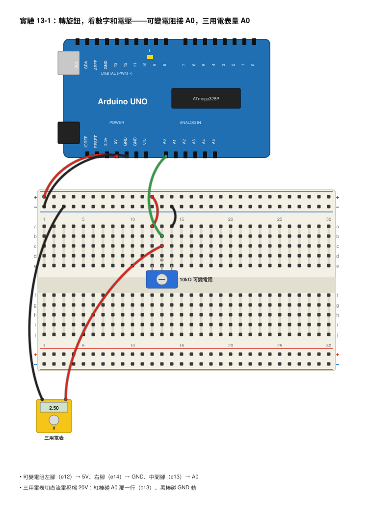
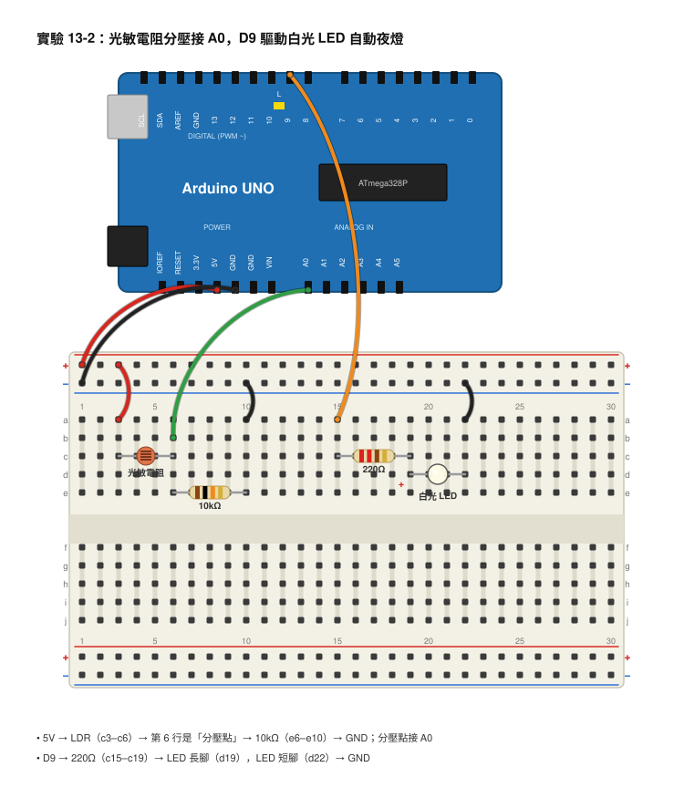
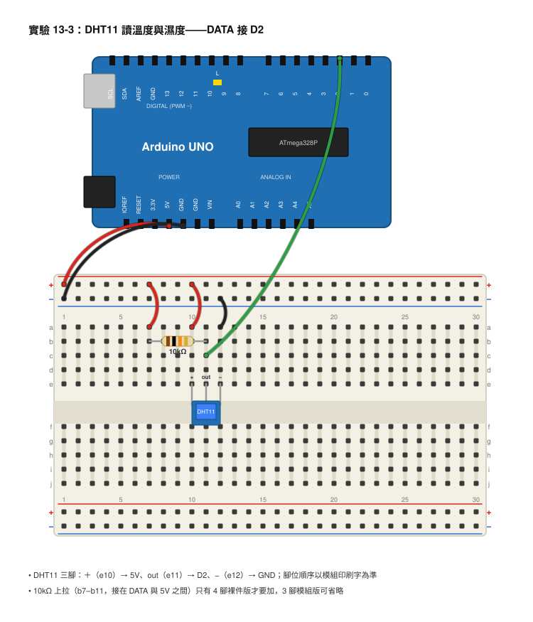

# 第 13 章　感測器與類比輸入

## 本章目標
學完這一章，你會：
- 說出「數位」與「類比」訊號的差別，並知道微控制器為什麼需要 ADC。
- 用 `analogRead()` 讀取 0–1023（ESP32 是 0–4095）的數字，並把它換算回真正的電壓。
- 用光敏電阻加 10kΩ 電阻做出分壓器，讓 Arduino 感覺到「亮」和「暗」。
- 用 `map()` 把讀值換成好用的範圍，並用序列繪圖器把感測器的變化畫成曲線。
- 用 DHT11 和函式庫讀出溫度與濕度，並完成一個會自己開燈的自動夜燈。

## 開場：Arduino 怎麼知道「天黑了」？

你家樓下的路燈，傍晚天色一暗就自己亮起來，早上又自己關掉。沒有人站在旁邊按開關，那它是怎麼「看到」天黑的？

上一章我們讓 Arduino 用 `digitalRead()` 讀按鈕，但按鈕只有「按下」和「沒按」兩種狀態，就像問「有沒有」這種是非題。可是天色不是是非題，它會從大亮、微亮、昏暗一路慢慢變到全黑，中間有無數種程度。溫度也是，今天 24.5 度、明天 26.1 度，不是只有「熱」和「冷」。

這一章我們要教 Arduino 回答「有多亮？」「有多熱？」這種需要一個數字的問題。祕密武器是一個藏在晶片裡的小翻譯機，叫做 ADC。學會它之後，光敏電阻、可變電阻、溫濕度感測器，全都可以變成 Arduino 的眼睛和皮膚。

## 核心概念

### 數位與類比：樓梯和斜坡

想像兩種上樓的方法：走樓梯，和走斜坡。樓梯只有一階一階，你不是站在第 3 階就是第 4 階，沒有「第 3.5 階」；斜坡則是連續的，你可以站在任何高度。

**數位訊號（Digital Signal）** 就像樓梯，只有固定幾種狀態，最常見的是只有 0 和 1 兩階（HIGH 和 LOW）。**類比訊號（Analog Signal）** 就像斜坡，電壓可以是 0V 到 5V 之間的任何值：1.23V、3.8V、4.999V 都可以。

真實世界裡的東西幾乎都是類比的：亮度、溫度、聲音大小、可變電阻轉到哪裡。但微控制器的大腦只懂 0 和 1。所以我們需要一個翻譯機，把「斜坡的高度」翻譯成「一個整數」。

### ADC：把電壓翻譯成數字

這個翻譯機叫做**類比數位轉換器（Analog-to-Digital Converter，ADC）**。它的工作就是看一眼腳位上的電壓，然後回報一個整數。

Arduino UNO 的 ADC 是 **10 位元（bit）**，意思是它用 10 個 0/1 來表示結果，所以總共有 2 的 10 次方 = 1024 種可能，也就是 0 到 1023。0V 回報 0，5V 回報 1023，中間按比例分配。等於把 0–5V 這條斜坡切成 1023 格樓梯，每一格大約是：

> 5V ÷ 1023 ≈ 0.0049V ≈ 4.9mV

ESP32 的 ADC 是 **12 位元**，有 4096 種可能（0 到 4095），而且它的滿刻度電壓是 3.3V，所以每一格是 3.3V ÷ 4095 ≈ 0.0008V ≈ 0.8mV，比 UNO 切得更細。

在程式裡，讀 ADC 只要一行：`analogRead(A0)`，它會回傳一個整數。

### 把讀值換算回電壓

ADC 回報的是「第幾格」，我們常常想知道「幾伏特」。換算公式很簡單，就是按比例：

> **電壓 = 讀值 × 5 ÷ 1023**　　（Arduino UNO）
>
> **電壓 = 讀值 × 3.3 ÷ 4095**　（ESP32）

算一個例子：UNO 的 `analogRead()` 回傳 512。

> 電壓 = 512 × 5 ÷ 1023 = 2560 ÷ 1023 ≈ 2.50V

剛好是 5V 的一半。再算一個：回傳 205。

> 電壓 = 205 × 5 ÷ 1023 = 1025 ÷ 1023 ≈ 1.00V

ESP32 讀到 2048 呢？

> 電壓 = 2048 × 3.3 ÷ 4095 = 6758.4 ÷ 4095 ≈ 1.65V

也剛好是 3.3V 的一半。注意 ESP32 的類比輸入腳**不能超過 3.3V**，接 5V 會把它燒壞。

在程式裡寫的時候，記得要用小數（`5.0`、`1023.0`），不然整數除法會把小數點後面全部丟掉：

```cpp
float voltage = raw * 5.0 / 1023.0;   // 正確：會得到 2.50
int wrong = raw * 5 / 1023;           // 錯誤：只會得到 2
```

### 感測器大多是「會變的電阻」

很多便宜的感測器，骨子裡只是一個電阻值會跟著環境改變的元件。**光敏電阻（Light Dependent Resistor，LDR）** 就是最好的例子：光線越亮，它的電阻越小；越暗，電阻越大。亮的時候可能只有 1kΩ，全黑的時候可能超過 100kΩ。

問題來了：ADC 只會量電壓，不會量電阻。怎麼辦？用第 3 章學過的**分壓器（Voltage Divider）**！把光敏電阻和一個固定的 10kΩ 電阻串在一起，中間那一點的電壓就會跟著光線變化：

```
 5V ──[ LDR ]──┬──[ 10kΩ ]── GND
               │
              A0
```

分壓公式：中間點電壓 = 5V × 10kΩ ÷ (LDR + 10kΩ)。來算兩種情況：

- **亮**：LDR ≈ 1kΩ，A0 電壓 = 5 × 10 ÷ (1 + 10) = 50 ÷ 11 ≈ 4.55V，讀值 ≈ 4.55 × 1023 ÷ 5 ≈ 930。
- **暗**：LDR ≈ 100kΩ，A0 電壓 = 5 × 10 ÷ (100 + 10) = 50 ÷ 110 ≈ 0.45V，讀值 ≈ 0.45 × 1023 ÷ 5 ≈ 93。

所以在這種接法下：**越亮，讀值越大；越暗，讀值越小**。如果你把 LDR 和 10kΩ 的位置對調，結果就會反過來，兩種接法都可以，只要你知道自己接的是哪一種。

可變電阻也是同樣道理，而且更簡單：它本身就是一個分壓器。兩端接 5V 和 GND，中間腳接 A0，轉動旋鈕，A0 的電壓就在 0V 到 5V 之間滑動。

### map()：把數字換成好用的範圍

讀到 0–1023 的數字之後，我們常常想把它變成別的範圍，例如變成 0–100 的百分比，或是下一章要用的 0–255 亮度。Arduino 內建的 `map()` 函式就是在做比例換算：

```cpp
map(值, 原本最小, 原本最大, 新的最小, 新的最大)
```

例如 `map(512, 0, 1023, 0, 255)`，計算方式是 512 × 255 ÷ 1023 = 130560 ÷ 1023 ≈ 127.6，`map()` 只保留整數，所以得到 127。再算一個：`map(700, 0, 1023, 0, 100)` = 700 × 100 ÷ 1023 ≈ 68.4，結果是 68，也就是「68%」。

### DHT11：會自己講話的感測器

光敏電阻只是一個電阻，但 **DHT11 溫濕度感測器** 裡面有一顆小晶片，它會自己量好溫度和濕度，然後用一連串 0 和 1 的脈波「講」給 Arduino 聽。這種訊號我們不用自己解讀，直接使用現成的**函式庫（Library）** 就好。函式庫就是別人寫好、打包起來的程式，我們只要呼叫它的功能。

DHT11 的規格：溫度 0–50°C（誤差約 ±2°C）、濕度 20–90%（誤差約 ±5%），而且每次讀取之間至少要間隔 1 秒，讀太快它會回傳錯誤。

## 動手做

### 實驗 13-1：轉旋鈕，看數字和電壓

**材料**
- Arduino UNO 與 USB 線
- 10kΩ 可變電阻
- 麵包板、杜邦線（公公）
- 數位三用電表

**接線**

```
 Arduino 5V ──┐
              [ 10kΩ 可變電阻 ]
              │  （中間腳）──── Arduino A0
 Arduino GND ─┘
```



- 可變電阻的左腳 → Arduino 5V
- 可變電阻的右腳 → Arduino GND
- 可變電阻的中間腳 → Arduino A0

**步驟**
1. 照上面接好線，確認 5V 和 GND 沒有接反（接反只是轉動方向相反，不會壞，但先養成習慣）。
2. 在 Arduino IDE 輸入下面的程式，上傳。

```cpp
const int potPin = A0;      // 可變電阻中間腳接 A0

void setup() {
  Serial.begin(9600);       // 打開序列埠，速度 9600
}

void loop() {
  int raw = analogRead(potPin);           // 讀 ADC，得到 0~1023
  float voltage = raw * 5.0 / 1023.0;     // 換算成電壓（記得用小數）

  Serial.print("raw = ");
  Serial.print(raw);                      // 印出原始讀值
  Serial.print("   volt = ");
  Serial.print(voltage, 2);               // 印出電壓，保留 2 位小數
  Serial.println(" V");
  delay(200);                             // 每 0.2 秒讀一次
}
```

3. 打開「工具 → 序列埠監控視窗」，右下角的速度選 9600。
4. 慢慢轉動可變電阻，從一端轉到另一端。
5. 轉到大約一半的位置，拿三用電表（直流電壓檔 20V）紅棒碰 A0 那條線、黑棒碰 GND，把電表讀到的電壓和畫面上的 volt 比一比。

**你應該看到**
轉到一端時 raw 接近 0、volt 接近 0.00V；轉到另一端時 raw 接近 1023、volt 接近 5.00V。中間位置大約是 512 和 2.50V。三用電表量到的電壓應該和畫面上的數字差不到 0.05V。

**觀察與記錄**

| 旋鈕位置 | raw 讀值 | 程式算出的電壓 | 三用電表量到的電壓 |
|---|---|---|---|
| 轉到最左 | | | |
| 大約 1/4 | | | |
| 大約一半 | | | |
| 大約 3/4 | | | |
| 轉到最右 | | | |

### 實驗 13-2：光敏電阻與自動夜燈

這個實驗分兩段：先「觀察」光敏電阻在你的教室裡讀到多少，再用那個數字「決定」夜燈什麼時候該亮。

**材料**
- Arduino UNO 與 USB 線
- 光敏電阻（LDR）1 個
- 10kΩ 電阻 1 個
- 220Ω 電阻 1 個
- 白色 LED 1 個
- 麵包板、杜邦線

**接線**

```
 Arduino 5V ──[ LDR ]──┬──[ 10kΩ ]── Arduino GND
                       │
                  Arduino A0

 Arduino D9 ──[ 220Ω ]──►|── Arduino GND
                        LED
```



- Arduino 5V → LDR 一腳；LDR 另一腳 → 麵包板某一列（叫它「分壓點」）
- 分壓點 → 10kΩ → Arduino GND
- 分壓點 → Arduino A0
- Arduino D9 → 220Ω → LED 長腳，LED 短腳 → GND

**步驟（第一段：觀察）**
1. 先上傳這個觀察程式：

```cpp
const int ldrPin = A0;      // 光敏電阻分壓點接 A0

void setup() {
  Serial.begin(9600);       // 打開序列埠
}

void loop() {
  int light = analogRead(ldrPin);   // 讀亮度，越亮數字越大
  Serial.print("light:");           // 標籤加冒號，繪圖器會顯示名稱
  Serial.println(light);
  delay(50);                        // 每 0.05 秒畫一個點
}
```

2. 打開「工具 → 序列繪圖器（Serial Plotter）」，右上角速度選 9600。你會看到一條線在畫面上慢慢往左捲動。
3. 用手掌蓋住光敏電阻，線會往下掉；移開，線又升回來。用手機手電筒照它，線會衝到更高。
4. 記下三個數字：正常教室亮度、用手蓋住、手電筒照。把它們填進下面的表格。
5. 決定一個**門檻值（Threshold）**：取「正常亮度」和「手蓋住」的中間值。例如正常是 700、蓋住是 150，門檻就取大約 400。

**步驟（第二段：自動夜燈）**
6. 把你的門檻值填進下面程式的 `threshold`，上傳。

```cpp
const int ldrPin = A0;        // 光敏電阻分壓點接 A0
const int ledPin = 9;         // LED 接 D9
const int threshold = 400;    // 門檻值：先用繪圖器觀察，再改成你的數字

void setup() {
  pinMode(ledPin, OUTPUT);    // D9 設成輸出
  Serial.begin(9600);         // 打開序列埠方便觀察
}

void loop() {
  int light = analogRead(ldrPin);   // 讀亮度

  if (light < threshold) {          // 比門檻暗 → 天黑了
    digitalWrite(ledPin, HIGH);     // 開燈
  } else {                          // 比門檻亮 → 還是白天
    digitalWrite(ledPin, LOW);      // 關燈
  }

  Serial.print("light:");           // 順便印出來，可以用繪圖器看
  Serial.println(light);
  delay(100);                       // 每 0.1 秒判斷一次
}
```

7. 用手蓋住光敏電阻，LED 應該亮；移開，LED 應該熄。
8. 慢慢把手靠近又移開，找到 LED 剛好切換的那個位置，看看繪圖器上的數字是不是正好在門檻附近。

**你應該看到**
繪圖器上是一條會隨著光線上下起伏的曲線，蓋住時掉到一兩百，照手電筒時衝到九百多。夜燈程式上傳後，蓋住就亮、放開就熄，像路燈一樣。

**觀察與記錄**

| 情況 | light 讀值 | 算出的 A0 電壓（讀值 × 5 ÷ 1023） |
|---|---|---|
| 正常教室亮度 | | |
| 用手掌蓋住 | | |
| 手機手電筒直射 | | |
| 我決定的門檻值 | | |

### 實驗 13-3：DHT11 讀溫度與濕度

**材料**
- Arduino UNO 與 USB 線
- DHT11 溫濕度感測器（模組版 3 腳，或裸件 4 腳）
- 10kΩ 電阻（裸件版才需要）
- 麵包板、杜邦線

**接線**

```
 Arduino 5V  ──────────── DHT11 VCC（＋）
 Arduino D2  ─────┬────── DHT11 DATA（OUT）
                  │
               [ 10kΩ ]   ← 裸件版才要加，一端接 5V
                  │
 Arduino 5V  ─────┘
 Arduino GND ──────────── DHT11 GND（－）
```



- DHT11 VCC → Arduino 5V
- DHT11 DATA → Arduino D2
- DHT11 GND → Arduino GND
- 如果你的 DHT11 是 4 隻腳的裸件（沒有小電路板），要在 DATA 和 5V 之間加一個 10kΩ 上拉電阻；3 腳模組版通常已經內建，不用加。腳位順序請看模組板子上的印刷字（＋、OUT、－），不同廠牌順序不一樣。

**步驟**
1. 安裝函式庫：Arduino IDE 左側點「函式庫管理員」（或「工具 → 管理程式庫」），搜尋 **DHT sensor library**（作者 Adafruit），按安裝；它會問你要不要一起裝 **Adafruit Unified Sensor**，選「全部安裝」。如果沒有問，就再搜尋一次 Adafruit Unified Sensor 自己裝。
2. 輸入下面程式並上傳：

```cpp
#include "DHT.h"              // 載入 DHT 函式庫

#define DHTPIN 2              // DATA 接 D2
#define DHTTYPE DHT11         // 我們用的是 DHT11

DHT dht(DHTPIN, DHTTYPE);     // 建立一個叫 dht 的感測器物件

void setup() {
  Serial.begin(9600);         // 打開序列埠
  dht.begin();                // 啟動感測器
}

void loop() {
  delay(2000);                            // DHT11 很慢，每 2 秒讀一次
  float humidity = dht.readHumidity();    // 讀濕度（%）
  float temp = dht.readTemperature();     // 讀溫度（°C）

  if (isnan(humidity) || isnan(temp)) {   // isnan = 不是數字，代表讀失敗
    Serial.println("讀取失敗，檢查接線");
    return;                               // 跳過這一輪
  }

  Serial.print("溫度 = ");
  Serial.print(temp, 1);                  // 保留 1 位小數
  Serial.print(" C   濕度 = ");
  Serial.print(humidity, 0);              // 濕度只印整數
  Serial.println(" %");
}
```

3. 打開序列埠監控視窗（9600），每 2 秒會出現一行溫濕度。
4. 用手指捏住感測器 30 秒，看溫度有沒有慢慢上升。
5. 對著感測器呵一口氣（像對鏡子哈氣那樣），看濕度跳多少。

**你應該看到**
室內大約 20–30°C、濕度 50–80%（台灣很潮濕）。捏住後溫度會慢慢爬 1–3 度；呵氣後濕度會瞬間衝到 90% 以上，然後慢慢降回來。DHT11 反應不快，變化要等幾秒才看得到。

**觀察與記錄**

| 情況 | 溫度（°C） | 濕度（%） |
|---|---|---|
| 一開始 | | |
| 手捏 30 秒後 | | |
| 呵氣後馬上 | | |
| 呵氣後 1 分鐘 | | |

### ESP32 版本怎麼改

如果你用 ESP32 DevKit V1，有三件事要改：
1. 類比輸入腳改用 **GPIO 34**（`analogRead(34)`），它是「只能輸入」的腳，最適合讀感測器。
2. 分壓器的電源改接 **3.3V**，絕對不要把 5V 接進 ADC 腳。
3. 換算公式改成 `raw * 3.3 / 4095.0`，讀值範圍是 0–4095。

```cpp
const int ldrPin = 34;      // ESP32 用 GPIO 34 讀類比

void setup() {
  Serial.begin(115200);     // ESP32 習慣用 115200
}

void loop() {
  int raw = analogRead(ldrPin);            // 0~4095
  float voltage = raw * 3.3 / 4095.0;      // 滿刻度是 3.3V
  Serial.print("raw:");
  Serial.print(raw);
  Serial.print(",volt:");                  // 逗號分隔，繪圖器畫兩條線
  Serial.println(voltage);
  delay(100);
}
```

ESP32 的 ADC 在接近 0V 和接近 3.3V 的兩端比較不準（會黏在 0 或 4095），這是它的硬體特性，中間範圍是準的。

## 用儀器看看

### 用示波器看分壓點電壓「慢慢變」

ADC 讀到的數字到底對不對？我們直接用示波器看 A0 腳上的真實電壓。

- **接線**：示波器 CH1 探棒鉤在 A0（分壓點），**黑色接地夾一定夾 Arduino GND**。探棒切 10×，示波器上也設定 10×。
- **設定**：耦合選 DC；垂直 **1V/div**，把 0V 基準線移到畫面最下面一格；水平 **500ms/div**（或用「滾動模式 Roll」，很多示波器在 s/div 很慢的時候會自動切換成滾動）；觸發選「自動（Auto）」。
- **操作**：用手蓋住光敏電阻再放開，重複幾次。

你應該看到一條水平線在上下移動，像這樣：

```
電壓
 5V ┤
 4V ┤────────╮                 ╭──────────      ← 手移開，亮
 3V ┤        │                 │
 2V ┤        │                 │
 1V ┤        ╰─────────────────╯                ← 手蓋住，暗
 0V ┼──────────────────────────────────── 時間
            500ms/div，整個畫面 5 秒
```

線的高度就是 A0 的電壓。同時看序列埠監控視窗，把「示波器上的電壓」和「讀值 × 5 ÷ 1023」算出來的數字對照，兩者應該一致。你會發現線不是瞬間跳上跳下，而是有一點點圓角，因為光敏電阻本身反應需要幾十毫秒。

把 CH2 探棒鉤到 D9（LED 腳），你就能同時看到「A0 掉到門檻以下」和「D9 跳到 5V」是幾乎同時發生的。

### 用三用電表量 DHT11 的供電

DHT11 沒有類比輸出，示波器看它的 DATA 腳只會看到一串快速脈波（下一章之後的邏輯分析儀會更適合解讀）。但你可以用三用電表確認它有吃到電：直流電壓檔，紅棒碰 VCC、黑棒碰 GND，應該量到接近 5V。如果量到 0V，就是電源線沒接到。

## 常見錯誤與除錯

- **讀值一直是 0 或一直是 1023 不會變** → A0 線沒接到分壓點，或是分壓點直接接到 GND / 5V → 檢查杜邦線是不是插在同一列，用三用電表量分壓點電壓。
- **讀值亂跳，沒接東西也有數字** → 類比腳「浮接」（Floating）時會撿到空氣裡的雜訊，這是正常的 → 確定 A0 真的接到分壓器。
- **換算出來的電壓都是整數（2、3、4）** → 用了整數除法 `raw * 5 / 1023` → 改成 `raw * 5.0 / 1023.0`。
- **序列繪圖器一片空白或畫面亂跳** → 速度（鮑率）沒選 9600，或程式印的不是純數字 → 確認右上角速度，每一行只印「標籤:數字」。
- **序列繪圖器打不開，說連接埠被占用** → 序列埠監控視窗和繪圖器不能同時開 → 先關掉其中一個。
- **光敏電阻蓋住反而讀值變大** → 你把 LDR 和 10kΩ 的位置接反了 → 兩種接法都能用，只要把程式的 `<` 改成 `>`，或換回本章的接法。
- **DHT11 一直「讀取失敗」** → DATA 腳接錯、沒有上拉電阻（裸件版）、或讀太快 → 看模組印刷字對腳位，`delay(2000)` 不要改小，裸件版加 10kΩ 上拉。
- **編譯錯誤說找不到 DHT.h** → 函式庫沒裝好 → 重新到函式庫管理員搜尋「DHT sensor library」和「Adafruit Unified Sensor」兩個都裝。
- **ESP32 讀值永遠 4095** → 接了 5V 進 ADC 腳，或分壓器電源接到 5V → 立刻改接 3.3V，確認腳位沒燒壞。

## 想一想

1. Arduino UNO 讀到 `analogRead()` = 819，請問 A0 上大約是幾伏特？

<details><summary>參考答案</summary>

819 × 5 ÷ 1023 = 4095 ÷ 1023 ≈ 4.00V。

</details>

2. ESP32 的 GPIO 34 量到 1.1V，`analogRead(34)` 大約會回傳多少？

<details><summary>參考答案</summary>

把公式倒過來：讀值 = 電壓 × 4095 ÷ 3.3 = 1.1 × 4095 ÷ 3.3 = 4504.5 ÷ 3.3 = 1365。

</details>

3. 本章的光敏電阻接法是「5V → LDR → A0 → 10kΩ → GND」。如果把 10kΩ 換成 100kΩ，在同樣的亮度下（LDR = 10kΩ），A0 的電壓會變高還是變低？算算看。

<details><summary>參考答案</summary>

原本：5 × 10 ÷ (10 + 10) = 2.5V。換成 100kΩ：5 × 100 ÷ (10 + 100) = 500 ÷ 110 ≈ 4.55V，變高了。下面的電阻越大，分到的電壓越多。換電阻會改變整個讀值範圍，所以門檻值也要重新觀察。

</details>

4. `map(300, 0, 1023, 0, 255)` 會得到多少？為什麼 `map()` 不會自動幫你四捨五入？

<details><summary>參考答案</summary>

300 × 255 ÷ 1023 = 76500 ÷ 1023 ≈ 74.78，`map()` 用整數運算，小數直接捨去，得到 74。因為 Arduino 的 `map()` 是用整數（long）計算的，速度快但不會四捨五入；如果需要精確，自己用 float 算。

</details>

5. 夜燈程式有一個小毛病：當亮度剛好在門檻附近時，LED 會一直閃爍（亮、暗、亮、暗）。想一想為什麼，你能不能改程式讓它不要閃？（提示：用兩個門檻。）

<details><summary>參考答案</summary>

因為讀值會有小小的雜訊，在 399 和 401 之間跳來跳去，每跳一次 LED 就切換一次。解法叫「遲滯（Hysteresis）」：用兩個門檻，例如低於 350 才開燈、高於 450 才關燈，中間 350–450 這段維持原狀。程式可以寫成：
`if (light < 350) digitalWrite(ledPin, HIGH); else if (light > 450) digitalWrite(ledPin, LOW);`
中間的情況什麼都不做，LED 就不會抖。另一個方法是連續讀 10 次取平均，把雜訊平掉。

</details>

6. 開放挑戰：把實驗 13-2 和 13-3 合併，做一個「天黑而且溫度低於 20°C 才開燈」的程式。你會用到第 11 章學的哪一個邏輯閘？

<details><summary>參考答案</summary>

AND 閘。條件寫成 `if (light < threshold && temp < 20.0)`。要注意 DHT11 每 2 秒才讀一次，但光敏電阻可以隨時讀，所以可以把溫度存在一個變數裡，每 2 秒更新一次，而亮度每 0.1 秒判斷一次。

</details>

## 本章小結

- 數位訊號像樓梯只有幾階，類比訊號像斜坡可以是任何值；真實世界大多是類比的。
- ADC 把電壓翻譯成整數：UNO 是 10 位元（0–1023，滿刻度 5V），ESP32 是 12 位元（0–4095，滿刻度 3.3V）。
- 換算公式：UNO 電壓 = 讀值 × 5 ÷ 1023；ESP32 電壓 = 讀值 × 3.3 ÷ 4095。程式裡要用小數運算。
- 光敏電阻是「會變的電阻」，要靠 10kΩ 電阻組成分壓器才能被 ADC 量到；本章接法是越亮讀值越大。
- `map()` 做比例換算，只保留整數。
- 序列繪圖器把數字畫成曲線，是觀察感測器最快的方法；門檻值要先觀察再決定。
- DHT11 透過函式庫讀取，每次至少間隔 1 秒，讀失敗要用 `isnan()` 檢查。
- ESP32 的類比腳絕對不能接 5V。

## 名詞表

| 中文 | 英文 | 一句話解釋 |
|---|---|---|
| 類比訊號 | Analog Signal | 電壓可以是範圍內任何值的訊號，像斜坡。 |
| 數位訊號 | Digital Signal | 只有固定幾種狀態（通常是 0 和 1）的訊號，像樓梯。 |
| 類比數位轉換器 | Analog-to-Digital Converter（ADC） | 把電壓翻譯成整數的電路，藏在微控制器裡。 |
| 位元 | bit | 一個 0 或 1；10 位元的 ADC 有 1024 種讀值。 |
| 解析度 | Resolution | ADC 能分辨的最小電壓差，UNO 約 4.9mV。 |
| 光敏電阻 | Light Dependent Resistor（LDR） | 越亮電阻越小的元件。 |
| 分壓器 | Voltage Divider | 兩個電阻串聯，中間點分到一部分電壓。 |
| 門檻值 | Threshold | 用來判斷「夠暗了沒」的分界數字。 |
| 遲滯 | Hysteresis | 用兩個門檻避免在分界附近抖動。 |
| 函式庫 | Library | 別人寫好、打包起來讓你直接呼叫的程式。 |
| 序列繪圖器 | Serial Plotter | Arduino IDE 裡把序列埠數字畫成曲線的工具。 |
| 浮接 | Floating | 腳位沒有接任何東西，讀值會亂跳。 |
