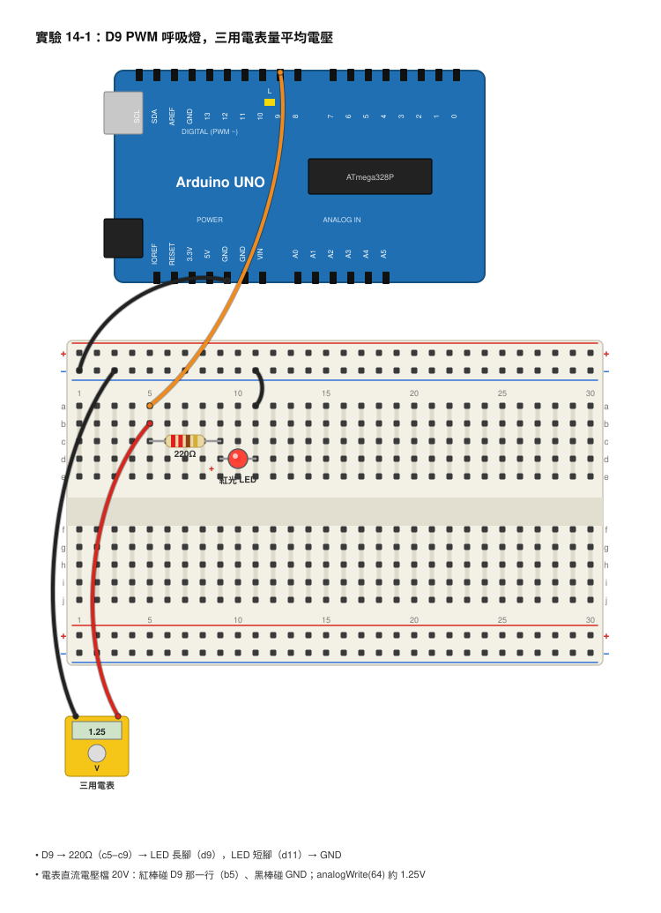
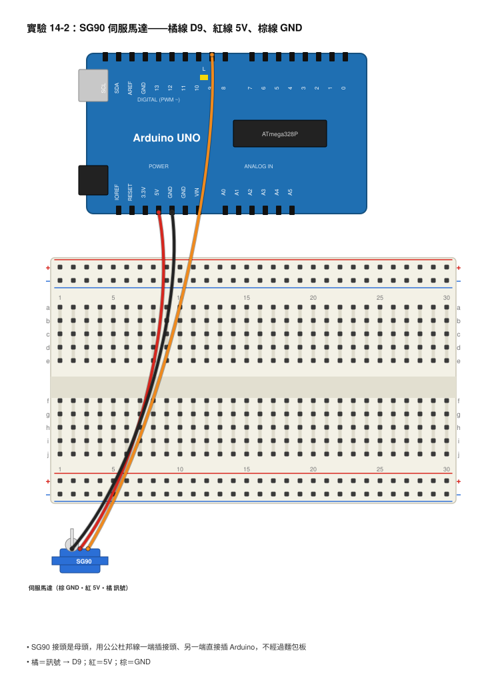
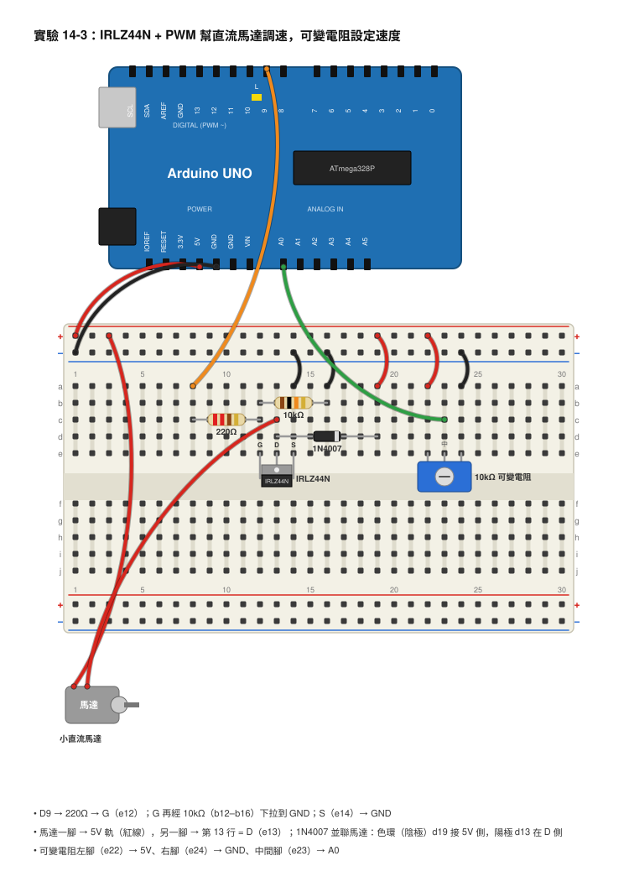

# 第 14 章　PWM 與馬達控制

## 本章目標
學完這一章，你會：
- 解釋 PWM 是怎麼用「開開關關」做出「半亮」的效果，並算出占空比與平均電壓。
- 用 `analogWrite()`（0–255）做出會呼吸的 LED，並用示波器量出它的頻率和占空比。
- 用 Servo 函式庫讓 SG90 伺服馬達轉到指定角度，並在示波器上看到 50Hz、脈寬 0.5–2.5ms 的控制訊號。
- 用 IRLZ44N MOSFET 加飛輪二極體，安全地用 PWM 調整直流馬達的轉速。
- 知道 ESP32 用 `ledcAttach()` / `ledcWrite()` 做 PWM，和 UNO 有什麼不一樣。

## 開場：Arduino 只會開和關，怎麼做出「半亮」？

上一章你學會讓 Arduino 讀「有多亮」，讀到的是一個 0 到 1023 的數字。那反過來呢？你想讓 LED「亮一半」、讓風扇「轉慢一點」，怎麼辦？

問題是，Arduino 的數位腳只有兩招：`HIGH` 輸出 5V，`LOW` 輸出 0V。沒有「2.5V」這個選項。

想像你拿著手電筒在黑暗的房間裡，快速地開、關、開、關。如果每秒開關幾百次，你的眼睛根本跟不上，只會覺得房間「有點亮」。如果開的時間比關的時間長，就覺得比較亮；開得短、關得長，就覺得比較暗。眼睛被騙了，但騙得很有用。

這一章的主角就是這招，叫做 PWM。它能讓 LED 慢慢呼吸、讓伺服馬達精準轉到 90 度、讓直流馬達從慢速平順加到全速。幾乎所有會動、會變亮的電子作品，背後都是 PWM 在工作。

## 核心概念

### PWM：用時間比例騙過眼睛和馬達

**脈波寬度調變（Pulse Width Modulation，PWM）** 就是用很快的開關，控制「開著的時間」占全部時間的比例。這個比例叫做**占空比（Duty Cycle）**，第 10 章我們已經在示波器上看過它：

> **占空比 = 高電位時間 ÷ 一個週期的時間 × 100%**

占空比 25% 表示每個週期裡有四分之一時間是 5V，四分之三時間是 0V。對 LED 來說，它「平均」收到的電壓就是：

> **平均電壓 = 5V × 占空比**

占空比 25% 的平均電壓是 5 × 0.25 = 1.25V；占空比 75% 是 5 × 0.75 = 3.75V。

```
      占空比 25%                     占空比 75%
 5V ┤ ┌─┐     ┌─┐     ┌─┐      5V ┤ ┌─────┐ ┌─────┐ ┌─────┐
    │ │ │     │ │     │ │         │ │     │ │     │ │     │
 0V ┼─┘ └─────┘ └─────┘ └──    0V ┼─┘     └─┘     └─┘     └─
      ◄──────►                      ◄──────►
       一個週期                       一個週期
```

重點：PWM 的電壓從來沒有真的變成 1.25V，它永遠只有 5V 和 0V 兩種，只是**時間的比例**變了。眼睛和馬達反應慢，感覺不出閃爍，只感覺到平均。

### analogWrite()：0 到 255

Arduino 用 `analogWrite(腳位, 值)` 產生 PWM。這個函式名字裡有 analog，但它輸出的其實是數位方波，只是「看起來像類比」。值的範圍是 **0 到 255**：

- `analogWrite(9, 0)`：占空比 0%，永遠 0V，LED 全暗。
- `analogWrite(9, 64)`：占空比 64 ÷ 255 ≈ 25.1%，大約 25%。
- `analogWrite(9, 128)`：占空比 128 ÷ 255 ≈ 50.2%，大約一半。
- `analogWrite(9, 191)`：占空比 191 ÷ 255 ≈ 74.9%，大約 75%。
- `analogWrite(9, 255)`：占空比 100%，永遠 5V，LED 全亮。

為什麼是 255？因為 Arduino 用 8 位元來存這個數字，2 的 8 次方 = 256 種（0–255），這和第 11 章的二進位是同一件事。

UNO 上只有腳位旁邊印著「~」符號的腳才能用 PWM：**D3、D5、D6、D9、D10、D11**。其他腳叫 `analogWrite()` 不會有錯誤訊息，但只會變成全開或全關。

### PWM 的頻率：UNO 的 490Hz 和 980Hz

PWM 每秒開關幾次？這是**頻率（Frequency）**。UNO 的 `analogWrite()` 頻率是固定的：

- **D3、D9、D10、D11：約 490Hz**，一個週期 = 1 ÷ 490 ≈ 0.00204 秒 ≈ **2.04ms**。
- **D5、D6：約 980Hz**，一個週期 = 1 ÷ 980 ≈ **1.02ms**。

算一下 D9 用 `analogWrite(9, 64)` 時，高電位會持續多久：

> 高電位時間 = 週期 × 占空比 = 2.04ms × 0.251 ≈ **0.51ms**

`analogWrite(9, 191)` 呢？2.04ms × 0.749 ≈ **1.53ms**。等一下我們會用示波器直接量到這兩個數字。

490Hz 對 LED 來說夠快，眼睛看不出閃。但馬達在 490Hz 下會發出「嗡」的聲音，因為 490Hz 剛好在人耳聽得到的範圍（接近鋼琴的 Si 音）。這不是壞掉，是 PWM 的特性。

### 伺服馬達：用脈波寬度說「轉到幾度」

**伺服馬達（Servo Motor）** 和普通馬達不一樣，它不會一直轉，而是「轉到你指定的角度然後停住」。SG90 是最常見的小型伺服，可以轉 0 到 180 度。它裡面有一個小馬達、一組齒輪、一個可變電阻（用來知道現在轉到哪裡）和一顆控制晶片。

SG90 有三條線：
- **橘色 = 訊號**（接 Arduino 的腳位）
- **紅色 = 5V**
- **棕色 = GND**

你怎麼跟它說「轉到 90 度」？也是用脈波，但規則和 `analogWrite()` 不一樣。伺服馬達要的是**每 20ms 一個脈波（也就是 50Hz）**，而且它看的是**脈波有多寬**，不是占空比：

- 脈寬約 **0.5ms** → 0 度
- 脈寬約 **1.5ms** → 90 度（正中間）
- 脈寬約 **2.5ms** → 180 度

```
 5V ┤ ┌─┐                  ┌─┐                  ┌─┐
    │ │ │                  │ │                  │ │
 0V ┼─┘ └──────────────────┘ └──────────────────┘ └────
      ◄►                   ◄►
     1.5ms（90度）        1.5ms
      ◄────────────────────►
            20ms（50Hz）
```

換算成占空比的話，1.5ms ÷ 20ms = 7.5%，很小，所以不能用 `analogWrite()` 來控制伺服馬達，要用 Arduino 內建的 **Servo 函式庫**，它會幫你產生正確的 50Hz 脈波，你只要說 `myServo.write(90)` 就好。

注意：在 UNO 上使用 Servo 函式庫之後，**D9 和 D10 的 `analogWrite()` 就不能用了**，因為它們共用同一個計時器。同一個程式裡要同時用伺服和 PWM 的話，PWM 改接 D5 或 D6。

### 直流馬達需要「大水閥」：MOSFET 與飛輪二極體

直流馬達轉起來要幾百毫安培的電流，Arduino 的腳位最多只能給 20mA 左右，直接接會燒壞腳位。第 9 章學過的解法：用電晶體當水閥，小電流控制大電流。這裡我們用 **N 通道 MOSFET IRLZ44N**，它是「邏輯準位」MOSFET，意思是用 Arduino 的 5V（甚至 ESP32 的 3.3V）就可以把它完全打開，能通過好幾安培。

IRLZ44N 的三隻腳，把印字那面朝向自己，從左到右是 **G（閘極）、D（汲極）、S（源極）**。G 像水閥的把手，D 和 S 是水管的兩端：G 的電壓夠高，D 和 S 之間就通。

接線的三個重點：
1. **G 前面串 220Ω**：MOSFET 的閘極像一個小電容，剛打開的瞬間會吸一股電流，220Ω 把它限制在 5 ÷ 220 ≈ 23mA 以下，保護 Arduino 腳位。
2. **G 到 GND 加 10kΩ 下拉電阻**：Arduino 上傳程式或重開機的瞬間，腳位是浮接的，10kΩ 會把閘極拉到 0V，讓馬達乖乖停著，不會突然暴衝。
3. **馬達兩端並聯 1N4007 飛輪二極體，有色環那端接 5V**：第 7 章學過，馬達是電感，突然切斷電流會產生高壓尖波。PWM 每秒切斷幾百次，沒有二極體的話，MOSFET 很快就被尖波打壞。

把 PWM 送到 G，MOSFET 就跟著開開關關，馬達得到的平均電壓隨占空比改變，轉速也就跟著變。

### ESP32 的 PWM：ledcAttach 與 ledcWrite

ESP32 的 PWM 硬體比 UNO 強很多，頻率和位元數都可以自己設定，但函式不一樣。ESP32 Arduino core **3.x 版**用兩個函式：

```cpp
ledcAttach(腳位, 頻率, 解析度位元數);   // 設定：這隻腳要用幾 Hz、幾位元
ledcWrite(腳位, 占空比數值);            // 輸出：0 到 (2^位元數 − 1)
```

例如 `ledcAttach(18, 5000, 8)` 表示 GPIO 18 用 5000Hz、8 位元（0–255）；然後 `ledcWrite(18, 128)` 就是 50%。如果設定 10 位元，範圍就變成 0–1023，`ledcWrite(18, 512)` 才是 50%。

如果你的 Arduino IDE 裝的是**舊版 ESP32 core（2.x）**，要用三個函式，而且要先指定一個「通道」：

```cpp
ledcSetup(0, 5000, 8);      // 通道 0：5000Hz、8 位元
ledcAttachPin(18, 0);       // 把 GPIO 18 接到通道 0
ledcWrite(0, 128);          // 注意：這裡填的是通道，不是腳位
```

編譯時如果出現「ledcSetup 沒有定義」，代表你是新版，改用 `ledcAttach`；反過來出現「ledcAttach 沒有定義」，就是舊版。

## 動手做

### 實驗 14-1：呼吸燈，然後量它的占空比

**材料**
- Arduino UNO 與 USB 線
- 紅色 LED 1 個、220Ω 電阻 1 個
- 麵包板、杜邦線
- 數位三用電表

**接線**

```
 Arduino D9 ──[ 220Ω ]──►|── Arduino GND
                        LED
```



- Arduino D9 → 220Ω → LED 長腳，LED 短腳 → GND

**步驟**
1. 先上傳這個「固定亮度」程式，用來量測：

```cpp
const int ledPin = 9;         // LED 接 D9（有 ~ 符號，能用 PWM）

void setup() {
  pinMode(ledPin, OUTPUT);    // D9 設成輸出
  analogWrite(ledPin, 64);    // 占空比約 25%
}

void loop() {
  // 什麼都不做，維持固定亮度
}
```

2. 拿三用電表（直流電壓檔 20V），紅棒碰 D9、黑棒碰 GND。電表反應慢，它量到的是平均電壓。
3. 把 `64` 改成 `128`、`191`、`255`，每改一次就重新上傳、重新量一次，把數字填進表格。
4. 現在上傳呼吸燈程式：

```cpp
const int ledPin = 9;               // LED 接 D9

void setup() {
  pinMode(ledPin, OUTPUT);
}

void loop() {
  for (int level = 0; level <= 255; level++) {    // 從 0 慢慢加到 255
    analogWrite(ledPin, level);                   // 越來越亮
    delay(4);                                     // 每階停 4ms，共約 1 秒
  }
  for (int level = 255; level >= 0; level--) {    // 從 255 慢慢減到 0
    analogWrite(ledPin, level);                   // 越來越暗
    delay(4);
  }
}
```

5. 看 LED 是不是在慢慢亮、慢慢暗，像在呼吸。
6. 把 LED 從 D9 換到 D13（沒有 ~ 的腳），程式裡的 9 改成 13，再上傳一次，看看發生什麼事。

**你應該看到**
固定亮度程式：`analogWrite(64)` 時電表量到大約 1.25V，`128` 約 2.5V，`191` 約 3.75V，`255` 約 5V。呼吸燈程式：LED 用約 2 秒完成一次亮暗循環。換到 D13 之後，LED 不會呼吸，只會在全亮和全暗之間跳，因為 D13 不支援 PWM。

**觀察與記錄**

| analogWrite 的值 | 算出的占空比（值 ÷ 255） | 算出的平均電壓（5V × 占空比） | 三用電表量到的電壓 |
|---|---|---|---|
| 64 | | | |
| 128 | | | |
| 191 | | | |
| 255 | | | |

### 實驗 14-2：讓 SG90 伺服馬達轉到指定角度

**材料**
- Arduino UNO 與 USB 線
- SG90 伺服馬達 1 個
- 杜邦線（公公 3 條）
- （選用）3 號電池盒 4 顆裝（約 6V），伺服抖動時使用

**接線**

```
 SG90 橘線（訊號）──── Arduino D9
 SG90 紅線（5V）  ──── Arduino 5V
 SG90 棕線（GND） ──── Arduino GND
```



- SG90 橘線 → Arduino D9
- SG90 紅線 → Arduino 5V
- SG90 棕線 → Arduino GND
- SG90 的接頭是母頭，用公公杜邦線一端插進接頭、另一端插 Arduino。

**步驟**
1. 上傳下面的程式：

```cpp
#include <Servo.h>          // 載入內建的 Servo 函式庫

Servo myServo;              // 建立一個伺服物件
const int servoPin = 9;     // 橘線接 D9

void setup() {
  myServo.attach(servoPin); // 告訴函式庫伺服接在哪隻腳
  Serial.begin(9600);
}

void loop() {
  myServo.write(0);         // 轉到 0 度
  Serial.println("0 度，脈寬約 0.5ms");
  delay(1000);              // 等 1 秒讓它轉到位

  myServo.write(90);        // 轉到 90 度
  Serial.println("90 度，脈寬約 1.5ms");
  delay(1000);

  myServo.write(180);       // 轉到 180 度
  Serial.println("180 度，脈寬約 2.5ms");
  delay(1000);
}
```

2. 觀察伺服的擺臂是不是每秒換一個位置：0 度、90 度、180 度，然後重頭來。
3. 把程式裡的三個角度改成 45、90、135，看擺臂移動的範圍是不是變小了。
4. 用手輕輕推擺臂（不要用力），感覺它「抵抗」你，這是伺服在自動修正角度。

**你應該看到**
擺臂每秒跳到一個新位置，轉動時會聽到小小的齒輪聲。三個位置之間各相差 90 度。SG90 的 0 度和 180 度可能不會剛好轉滿，差個 5–10 度是正常的。

**觀察與記錄**

| myServo.write() 的角度 | 擺臂實際位置（用量角器或目測） | 示波器量到的脈寬 |
|---|---|---|
| 0 | | |
| 45 | | |
| 90 | | |
| 135 | | |
| 180 | | |

### 實驗 14-3：用 MOSFET 和 PWM 幫直流馬達調速

**材料**
- Arduino UNO 與 USB 線
- 小直流馬達（3–6V）1 個
- N 通道 MOSFET IRLZ44N 1 個
- 220Ω 電阻 1 個、10kΩ 電阻 1 個
- 整流二極體 1N4007 1 個
- 10kΩ 可變電阻 1 個
- 麵包板、杜邦線
- （選用）3 號電池盒 3 或 4 顆裝（4.5–6V），馬達吃電太多時使用

**接線**

```
                       Arduino 5V ─────┬──────────┐
                                       │          │
                                   [ 馬達 ]    ─┴─  1N4007
                                       │       ▲    （色環朝 5V）
                                       │        │
                                       └────────┴──── D（汲極）
                                                       │
 Arduino D9 ──[ 220Ω ]──┬──────────────────────────── G（閘極）  IRLZ44N
                        │                              │
                     [ 10kΩ ]                          S（源極）
                        │                              │
 Arduino GND ───────────┴──────────────────────────────┘

 可變電阻：左腳 → 5V，右腳 → GND，中間腳 → A0
```



- Arduino D9 → 220Ω → IRLZ44N 的 G（閘極）
- IRLZ44N 的 G → 10kΩ → Arduino GND（下拉）
- IRLZ44N 的 S（源極）→ Arduino GND
- 馬達一腳 → Arduino 5V；馬達另一腳 → IRLZ44N 的 D（汲極）
- 1N4007 並聯在馬達兩端：**有色環的那端接 5V 那側**，沒色環的那端接 D 那側
- 可變電阻左腳 → 5V、右腳 → GND、中間腳 → A0
- IRLZ44N 印字面朝自己，三隻腳從左到右是 G、D、S

**步驟**
1. 先不要接馬達，接好其他部分，用三用電表確認 G 到 GND 之間是 10kΩ（確定下拉電阻有接到）。
2. 接上馬達和二極體。再檢查一次二極體方向，色環朝 5V。接反的話一通電就會短路發燙，要立刻拔掉 USB。
3. 上傳程式：

```cpp
const int motorPin = 9;     // D9 → 220Ω → MOSFET 閘極
const int potPin = A0;      // 可變電阻中間腳

void setup() {
  pinMode(motorPin, OUTPUT);
  Serial.begin(9600);
}

void loop() {
  int raw = analogRead(potPin);              // 讀旋鈕 0~1023
  int speed = map(raw, 0, 1023, 0, 255);     // 換成 0~255
  analogWrite(motorPin, speed);              // 送 PWM 給 MOSFET

  Serial.print("speed = ");
  Serial.println(speed);                     // 印出目前的速度值
  delay(100);
}
```

4. 慢慢轉動可變電阻，從 0 轉到最大。注意馬達是從多少才開始轉的。
5. 把耳朵靠近馬達（不要碰到轉軸），聽聽看中速時有沒有「嗡」的聲音。
6. 如果馬達一轉 Arduino 就重開機（序列埠一直重新出現開頭訊息）或 USB 被電腦斷開，表示馬達吃的電流超過 USB 能給的。改用電池盒：電池盒「＋」接馬達（取代 Arduino 5V），電池盒「－」接 Arduino GND，**一定要共地**。

**你應該看到**
speed 低於大約 50–80 時馬達只會「嗯」一聲但不動（力道不夠克服摩擦），超過之後開始慢慢轉，越轉越快，到 255 全速。中速時會聽到約 490Hz 的嗡嗡聲。摸 MOSFET 應該只有微溫，不會燙。

**觀察與記錄**

| speed 值 | 占空比 | 馬達狀態（不動 / 慢 / 中 / 快） | 有沒有嗡嗡聲 |
|---|---|---|---|
| 30 | | | |
| 80 | | | |
| 128 | | | |
| 191 | | | |
| 255 | | | |
| 馬達開始轉的最小 speed = | | | |

### ESP32 版本：用 ledcWrite 做呼吸燈

ESP32 板上的 LED 在 GPIO 2，不用接任何東西就能試：

```cpp
const int ledPin = 2;                 // ESP32 板上 LED

void setup() {
  ledcAttach(ledPin, 5000, 8);        // 新版 core 3.x：5000Hz、8 位元（0~255）
  // 舊版 core 2.x 改成下面兩行：
  // ledcSetup(0, 5000, 8);
  // ledcAttachPin(ledPin, 0);
}

void loop() {
  for (int level = 0; level <= 255; level++) {
    ledcWrite(ledPin, level);         // 新版填腳位；舊版 ledcWrite(0, level) 填通道
    delay(4);
  }
  for (int level = 255; level >= 0; level--) {
    ledcWrite(ledPin, level);
    delay(4);
  }
}
```

ESP32 的腳位是 3.3V，拿來推 IRLZ44N 也沒問題，因為它是邏輯準位 MOSFET。但 ESP32 不能用內建的 Servo 函式庫，要到函式庫管理員安裝 **ESP32Servo**，用法幾乎一樣。

## 用儀器看看

### 示波器量 PWM 的頻率與占空比

把實驗 14-1 的固定亮度程式（`analogWrite(9, 64)`）重新上傳。

- **接線**：CH1 探棒鉤在 D9（或 LED 的 220Ω 靠 Arduino 那端），**黑色接地夾夾 Arduino GND**。探棒 10×。
- **設定**：耦合 DC；垂直 **2V/div**（5V 剛好 2.5 格）；水平 **500µs/div**，這樣一個 2.04ms 的週期大約占 4 格，畫面上可以看到兩個多週期；觸發選 CH1、上升緣（Rising）、準位調到約 2.5V；模式「自動（Auto）」。

你應該看到：

```
電壓
 5V ┤ ┌──┐        ┌──┐        ┌──┐
    │ │  │        │  │        │  │
 0V ┼─┘  └────────┘  └────────┘  └──── 時間
      ◄─►
     0.51ms
      ◄──────────►
         2.04ms（490Hz）
```

**自動量測法**：按 Measure（量測）鍵，加入 **Freq（頻率）**、**Period（週期）**、**+Duty（正占空比）** 和 **+Width（正脈寬）**。你應該讀到 Freq ≈ 490Hz、Period ≈ 2.04ms、+Duty ≈ 25%、+Width ≈ 0.51ms。

**游標法**：如果你的示波器沒有 +Duty，用時間游標（Cursor）。把游標 1 放在上升緣、游標 2 放在同一個脈波的下降緣，讀出 Δt 就是高電位寬度；再把游標 2 移到下一個上升緣，讀出週期。占空比 = 高電位寬度 ÷ 週期。例如 0.51ms ÷ 2.04ms = 0.25 = 25%。

接著把程式改成 `analogWrite(9, 191)`，脈波會變寬，+Duty 應該變成約 75%、+Width 約 1.53ms，但 Freq 不變還是 490Hz。這就是 PWM 的本質：**頻率不動，只動寬度**。

再把 LED 換到 D5、程式改 `analogWrite(5, 64)`，水平改 **200µs/div**。你會發現 Freq 變成約 980Hz、Period 約 1.02ms，占空比還是 25%。

### 示波器看伺服馬達的 50Hz 脈波

上傳實驗 14-2 的程式，CH1 探棒鉤在 SG90 的橘線（D9），接地夾夾 GND。

- 先把水平設成 **5ms/div**：你會看到每 4 格（20ms）出現一根細細的脈波，這就是 50Hz。
- 再把水平縮小到 **500µs/div**，觸發上升緣，讓脈波放大：

```
      0 度                90 度                180 度
 5V ┤ ┌┐             5V ┤ ┌──┐           5V ┤ ┌────┐
    │ ││                │ │  │              │ │    │
 0V ┼─┘└──────       0V ┼─┘  └─────      0V ┼─┘    └───
      ◄►                  ◄──►                ◄────►
     0.5ms               1.5ms               2.5ms
```

用 +Width 量測，每秒切換一次角度時，數字會在 0.5ms、1.5ms、2.5ms 附近跳。把量到的值填回實驗 14-2 的表格。

### 示波器同時看閘極與汲極

實驗 14-3 的馬達電路，CH1 鉤 G（閘極）、CH2 鉤 D（汲極），接地夾夾 GND，兩個通道都 2V/div、500µs/div，觸發 CH1 上升緣。你會看到兩條波形**剛好相反**：G 是 5V 時 MOSFET 導通、D 被拉到 0V；G 是 0V 時 MOSFET 關閉、D 被馬達拉回 5V。在 D 關閉的瞬間可能看到一個小小的尖角，那就是被二極體壓住的反電動勢；把二極體暫時拔掉（只看一下下就要裝回去），尖角會變成高好幾伏特的尖波。

## 常見錯誤與除錯

- **LED 不會呼吸，只會全亮全暗** → 接到沒有 ~ 符號的腳 → 換到 D3/D5/D6/D9/D10/D11。
- **示波器量到的占空比和算的差很多** → 觸發準位不對，或探棒 1×/10× 設定和示波器不符 → 把觸發準位調到波形中間，確認探棒倍率。
- **示波器波形一直在跑，停不下來** → 觸發源沒選 CH1，或模式在「自動」但準位超出波形範圍 → 選 CH1 上升緣，準位 2.5V。
- **伺服馬達抖動、嗡嗡響、或 Arduino 一直重開機** → 伺服吃電太多，USB 供電不夠 → 用 4 顆 3 號電池盒（約 6V）供電給紅線，棕線和 Arduino GND 共地。
- **伺服只往一邊轉到底不停** → 橘線接錯腳，或 `attach()` 的腳號打錯 → 檢查程式和接線。
- **程式裡同時用 Servo 和 analogWrite(9)，PWM 沒反應** → Servo 函式庫占用了 D9/D10 的計時器 → PWM 改接 D5 或 D6。
- **馬達完全不轉，MOSFET 不熱** → G 沒有收到訊號，可能 220Ω 沒接到 G，或 G/D/S 三隻腳認錯 → 印字面朝自己，從左到右 G、D、S；用三用電表量 G 腳電壓，PWM 255 時應接近 5V。
- **馬達一直全速轉，調旋鈕沒用** → D 和 S 接反，或馬達接錯邊 → 對照接線圖重接。
- **MOSFET 或二極體發燙** → 二極體接反變成短路，或馬達卡住 → 立刻拔掉 USB，檢查色環方向。
- **ESP32 編譯錯誤：ledcSetup / ledcAttach 未定義** → core 版本不同 → 新版用 `ledcAttach`，舊版用 `ledcSetup` + `ledcAttachPin`。

## 想一想

1. `analogWrite(9, 51)` 的占空比是多少？平均電壓大約幾伏特？

<details><summary>參考答案</summary>

占空比 = 51 ÷ 255 = 0.2 = 20%。平均電壓 = 5V × 0.2 = 1.0V。

</details>

2. 在 D9（490Hz）上輸出 `analogWrite(9, 128)`，示波器上高電位會有多寬？如果改到 D5（980Hz）呢？

<details><summary>參考答案</summary>

D9：週期 2.04ms × (128 ÷ 255) = 2.04 × 0.502 ≈ 1.02ms。D5：週期 1.02ms × 0.502 ≈ 0.51ms。占空比一樣是 50%，但週期短一半，所以脈波也窄一半。

</details>

3. 伺服馬達的脈寬 1.5ms 對應 90 度。請問脈寬 1.0ms 大約對應幾度？（假設 0.5ms 到 2.5ms 是線性對應 0 到 180 度。）

<details><summary>參考答案</summary>

0.5ms 到 2.5ms 共 2.0ms 對應 180 度，所以每 1ms 對應 90 度。1.0ms 比 0.5ms 多 0.5ms，所以是 0.5 × 90 = 45 度。

</details>

4. 為什麼實驗 14-3 要在閘極加 10kΩ 下拉電阻？如果拿掉它，上傳程式的那幾秒鐘會發生什麼事？

<details><summary>參考答案</summary>

上傳程式或重開機時，Arduino 的腳位處於浮接狀態，閘極像天線一樣可能撿到雜訊而半開，馬達會突然抖動或轉動。10kΩ 把閘極牢牢拉到 0V，確保沒有訊號時 MOSFET 一定是關的。這在控制比較大的馬達時非常重要。

</details>

5. 有人說「PWM 占空比 50% 就是輸出 2.5V」，用示波器的角度來看，這句話哪裡不精確？

<details><summary>參考答案</summary>

示波器上看到的永遠是 5V 和 0V 的方波，從來沒有 2.5V。「2.5V」是平均值，只有對反應慢的東西（LED 的亮度、馬達的轉速、三用電表的讀數）才成立。如果真的要得到穩定的 2.5V 直流，要像第 10 章那樣加 RC 低通濾波器把方波平均掉。

</details>

6. 開放挑戰：把第 13 章的光敏電阻和本章的呼吸燈結合，做一個「越暗越亮」的智慧夜燈：環境越暗，LED 越亮，而不是只有開和關。提示：用 `map()`，但要注意方向。

<details><summary>參考答案</summary>

讀值越小（越暗）要讓 PWM 越大，所以 map 的目標範圍要反過來：`int level = map(light, 0, 1023, 255, 0);`，然後 `analogWrite(ledPin, level)`。更好的做法是先用繪圖器找出教室裡實際的最暗和最亮讀值（例如 100 和 800），用 `map(light, 100, 800, 255, 0)` 再加 `constrain(level, 0, 255)` 把超出範圍的值夾住。

</details>

## 本章小結

- PWM 用「開著的時間比例」騙過眼睛和馬達，占空比 = 高電位時間 ÷ 週期，平均電壓 = 5V × 占空比。
- `analogWrite(腳位, 0–255)`，64 約 25%、128 約 50%、191 約 75%；UNO 只有 D3/D5/D6/D9/D10/D11 能用。
- UNO 的 PWM 頻率固定：D3/D9/D10/D11 約 490Hz（週期 2.04ms），D5/D6 約 980Hz（週期 1.02ms）。PWM 改的是寬度，不是頻率。
- 示波器用 Measure 的 +Duty、+Width、Freq 可以直接量占空比；沒有的話用游標量高電位寬度 ÷ 週期。
- SG90 伺服馬達：橘＝訊號、紅＝5V、棕＝GND；吃 50Hz（20ms）脈波，脈寬 0.5–2.5ms 對應 0–180 度；用 Servo 函式庫的 `write(角度)`。
- 直流馬達要用 IRLZ44N 當開關：D9 → 220Ω → G，G 加 10kΩ 下拉，S 接 GND，馬達接 5V 與 D，馬達兩端並聯 1N4007（色環朝 5V）。
- ESP32 新版 core 用 `ledcAttach(pin, freq, bits)` + `ledcWrite(pin, duty)`；舊版用 `ledcSetup` + `ledcAttachPin` + `ledcWrite(channel, duty)`。

## 名詞表

| 中文 | 英文 | 一句話解釋 |
|---|---|---|
| 脈波寬度調變 | Pulse Width Modulation（PWM） | 用快速開關的時間比例，做出像是「半亮」的效果。 |
| 占空比 | Duty Cycle | 高電位時間占一個週期的百分比。 |
| 脈寬 | Pulse Width | 一個脈波高電位持續的時間，伺服馬達靠它判斷角度。 |
| 平均電壓 | Average Voltage | PWM 對反應慢的負載來說等效的電壓，= 5V × 占空比。 |
| 伺服馬達 | Servo Motor | 會轉到指定角度並停住的馬達，SG90 是常見小型款。 |
| 閘極 / 汲極 / 源極 | Gate / Drain / Source | MOSFET 的三隻腳：把手、入口、出口。 |
| 邏輯準位 MOSFET | Logic-Level MOSFET | 用 3.3V 或 5V 就能完全打開的 MOSFET，如 IRLZ44N。 |
| 下拉電阻 | Pull-down Resistor | 把腳位在沒訊號時拉到 0V 的電阻，避免浮接亂動。 |
| 飛輪二極體 | Flyback Diode | 並聯在馬達兩端，吸收切斷電流時的高壓尖波。 |
| 計時器 | Timer | 微控制器裡負責產生 PWM 的硬體，Servo 函式庫會占用它。 |
| LEDC | LED Control | ESP32 產生 PWM 的硬體模組，用 ledcAttach / ledcWrite 操作。 |
