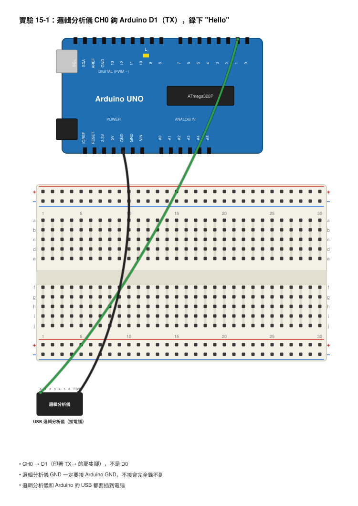
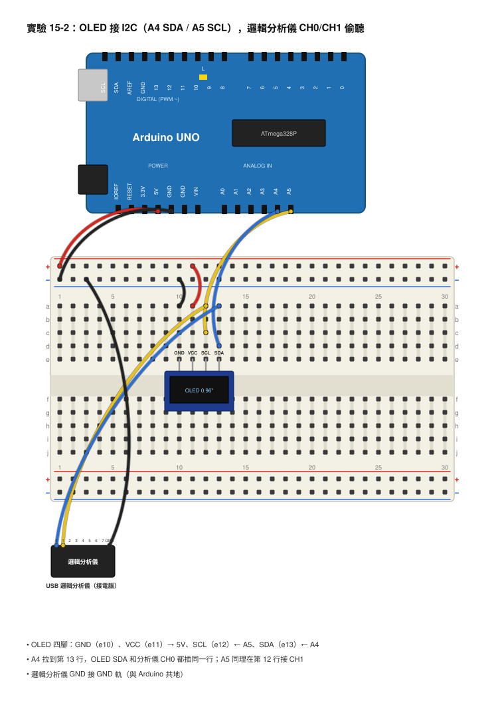

# 第 15 章　通訊協定與邏輯分析儀

## 本章目標
學完這一章，你會：
- 說出晶片之間為什麼要「講話」，以及序列與並列傳輸的差別。
- 畫出 UART 一個字元的波形：閒置、起始位元、8 個資料位元、停止位元，並算出 9600 鮑率下每個位元有多長。
- 解釋 I2C 的 SDA/SCL、位址、主從，以及 START、ACK、STOP 在波形上長什麼樣。
- 安裝 PulseView、接上 USB 邏輯分析儀、設定取樣率、加上解碼器，把 Arduino 送出的 "Hello" 和 OLED 的位址 0x3C 從波形裡「翻譯」出來。
- 說出示波器和邏輯分析儀各自擅長什麼。

## 開場：Arduino 跟電腦是怎麼「講話」的？

前面幾章你一直在用 `Serial.println()` 把數字印到電腦畫面上。你有沒有想過，Arduino 和電腦之間只有一條 USB 線，這條線裡面到底發生了什麼事？Arduino 又不會打字，它怎麼把「Hello」這五個字母送過去？

答案是：它只會送 0 和 1。Arduino 把每一個字母拆成 8 個 0/1，用一條線、按照講好的速度、一個接一個地送出去。電腦照同樣的速度接收，再拼回字母。這種「事先講好的規則」叫做**通訊協定（Protocol）**，就像兩個人要通電話，得先講好用什麼語言、講多快。

同樣的事情也發生在 Arduino 和 OLED 螢幕之間、和溫濕度感測器之間、ESP32 和 Wi-Fi 晶片之間。只要兩顆晶片要交換資料，就一定有一套協定。

問題是，這些 0 和 1 跑得太快了，示波器看得到波形但很難一個一個數。這一章我們要拿出新工具：**邏輯分析儀**。它能一次錄下好幾條線上的 0 和 1，然後自動幫你翻譯成字母和數字。你會親眼看到 "Hello" 從一堆方波裡跳出來。

## 核心概念

### 序列與並列：一條線排隊走，還是八條線一起走

要送一個 8 位元的數字（例如字母 H = 01001000），有兩種方法：

- **並列（Parallel）**：用 8 條線，每條線負責一個位元，一次全部送出去。快，但線很多。
- **序列（Serial）**：只用 1 條線，8 個位元排隊、一個一個送。線少，但要花 8 倍時間。

就像 8 個人要過一道門：並列是開 8 道門同時走，序列是只開 1 道門排隊走。現代的晶片幾乎都用序列，因為線少、便宜、不容易出錯，而且反正晶片跑得夠快。本章的 UART、I2C、SPI 全都是序列通訊。

### UART：最老也最簡單的講話方式

**UART（Universal Asynchronous Receiver-Transmitter，通用非同步收發器）** 就是 Arduino 和電腦之間用的協定。它只需要兩條線：

- **TX（Transmit）**：送資料出去。UNO 的 TX 是 D1。
- **RX（Receive）**：接資料進來。UNO 的 RX 是 D0。

一方的 TX 接另一方的 RX，交叉接，而且兩邊 GND 要接在一起。

UART 沒有時脈線，所以雙方必須**事先講好速度**，這個速度叫**鮑率（Baud Rate）**，單位是「每秒幾個位元」。`Serial.begin(9600)` 的 9600 就是鮑率：每秒送 9600 個位元，所以每個位元持續：

> 1 秒 ÷ 9600 = 0.000104 秒 ≈ **104µs**

一個字元怎麼送？規則是這樣（最常見的「8N1」格式）：

1. 沒事的時候線上保持 **HIGH**（閒置）。
2. 要送字元了，先把線拉 **LOW 一個位元的時間**，這叫**起始位元（Start Bit）**，通知對方「要開始了」。
3. 接著送 **8 個資料位元**，而且是**最低位元（LSB）先送**。
4. 最後把線拉 **HIGH 一個位元的時間**，這是**停止位元（Stop Bit）**，然後回到閒置。

所以一個字元總共 1 + 8 + 1 = **10 個位元**，在 9600 鮑率下要花 10 × 104µs ≈ **1.04ms**。`Serial.println("Hello")` 會送 H、e、l、l、o 再加換行的 `\r` 和 `\n`，共 7 個字元，大約 7.3ms。

來畫字母 H 的波形。H 的 ASCII 碼是 0x48，二進位是 0100 1000（從高位 b7 寫到低位 b0）。LSB 先送，所以送出的順序是 b0 到 b7：0、0、0、1、0、0、1、0。

```
HIGH ────┐               ┌───┐       ┌───┐   ┌─────────
         │               │   │       │   │   │
LOW      └───┴───┴───┴───┘   └───┴───┘   └───┘
   閒置  起始 b0  b1  b2  b3  b4  b5  b6  b7 停止  閒置
          0   0   0   0   1   0   0   1   0   1
         ◄──►
        104µs（9600 鮑率）
         ◄───────────────────────────────────►
                   10 個位元 ≈ 1.04ms
```

讀的那一方看到線從 HIGH 掉到 LOW，就知道起始位元來了，然後每隔 104µs 偷看一次線的狀態，連看 8 次，就得到 8 個位元，再倒過來排就是 0x48 = H。

如果兩邊鮑率不同會怎樣？送的人每 104µs 送一個位元，收的人卻每 8.7µs 看一次（115200 鮑率），看到的全是錯的，畫面上就會出現一堆亂碼。這就是為什麼序列埠監控視窗右下角的速度一定要和程式一樣。

### I2C：兩條線接一堆裝置

UART 只能兩個人講話。如果 Arduino 要同時跟 OLED、溫度感測器、時鐘晶片講話，每個都要兩條線，腳位很快就不夠用。**I2C（Inter-Integrated Circuit）** 解決這個問題：只用兩條線，就可以接很多裝置。

- **SDA（Serial Data）**：資料線。UNO 是 A4。
- **SCL（Serial Clock）**：時脈線。UNO 是 A5。

I2C 有**時脈線**，所以不需要事先講好速度，SCL 每跳一下，SDA 上就是一個位元。Arduino 的 Wire 函式庫預設 SCL 是 100kHz（每個位元 10µs），很多函式庫會加快到 400kHz。

這麼多裝置共用兩條線，怎麼知道在跟誰講？每個裝置有一個 **7 位元的位址（Address）**，像門牌號碼。我們的 0.96 吋 OLED（SSD1306）位址是 **0x3C**。發話的那一方叫**主機（Master）**，通常是 Arduino；被叫到的叫**從機（Slave）**，例如 OLED。只有主機可以主動開口。

一次完整的 I2C 對話長這樣：

1. **START**：SCL 是 HIGH 的時候，SDA 從 HIGH 掉到 LOW。這個組合平常不會出現，所以大家一看就知道「有人要講話了」。
2. 主機送 **7 位元位址 + 1 個讀寫位元**（0 = 寫，1 = 讀），高位元先送（和 UART 相反）。
3. **ACK（Acknowledge）**：第 9 個時脈時，被叫到的從機把 SDA 拉 LOW，表示「有，我在」。沒人回應的話 SDA 保持 HIGH，叫 NACK。
4. 主機送一個或多個資料位元組，每個後面都有一個 ACK。
5. **STOP**：SCL 是 HIGH 的時候，SDA 從 LOW 升回 HIGH，結束對話。

```
          START   A6  A5  A4  A3  A2  A1  A0  W   ACK     STOP
SCL  ──────────┐   ┌─┐ ┌─┐ ┌─┐ ┌─┐ ┌─┐ ┌─┐ ┌─┐ ┌─┐ ┌─┐    ┌─────
               └───┘ └─┘ └─┘ └─┘ └─┘ └─┘ └─┘ └─┘ └─┘ └────┘
SDA  ────────┐          ┌───────────────┐                  ┌───
             └──────────┘               └──────────────────┘
               ↑        0   1   1   1   1   0   0   0  (從機拉低)  ↑
            SCL 高時     ◄──────── 0x3C ────────►  寫        SCL 高時
            SDA 下降                                       SDA 上升
```

位址 0x3C 的二進位是 011 1100（7 位元），後面接一個 0（寫），所以 SDA 上依序是 0、1、1、1、1、0、0、0。有個小陷阱：有些工具會把這 8 個位元當成一個位元組來顯示，變成 0111 1000 = 0x78。看到 0x78 不要慌，它就是 0x3C 往左移一位加上寫入位元。

為什麼 SDA 和 SCL 要**上拉電阻（Pull-up Resistor）**？因為 I2C 的裝置只會「把線拉 LOW」或「放手」，沒有人會主動把線推 HIGH；放手的時候要靠上拉電阻把線拉回 HIGH。通常用 4.7kΩ 接到 5V。好消息是大部分 OLED 模組板上已經焊好上拉電阻，直接接就能用。

### SPI：更快，但線更多

**SPI（Serial Peripheral Interface）** 是第三種常見協定，用 4 條線：MOSI（主機送出）、MISO（主機接收）、SCK（時脈）、CS（選擇哪個裝置）。它比 I2C 快很多（幾 MHz 到幾十 MHz），SD 卡、很多大螢幕都用它，但每多一個裝置就要多一條 CS 線。本書不做 SPI 實驗，知道有這東西就好。

### 邏輯分析儀：只看 0 和 1 的多通道錄音機

**邏輯分析儀（Logic Analyzer）** 和示波器一樣是用來看訊號的，但它們的想法完全不同：

| | 示波器 | 邏輯分析儀 |
|---|---|---|
| 看什麼 | 真實的電壓（類比），例如 4.8V、0.2V、尖波、圓角 | 只分 0 和 1（高於約 1.5V 算 1，低於算 0） |
| 通道數 | 通常 2 條 | 8 條（便宜款）到 16 條以上 |
| 能錄多久 | 幾千到幾百萬個點 | 可以連續錄好幾秒，全部存進電腦 |
| 解碼 | 高階款才有 | 內建 UART、I2C、SPI 等幾十種協定解碼器 |
| 擅長 | 看電壓對不對、雜訊、反電動勢、PWM 占空比 | 看「送了什麼資料」、多條線的先後順序 |
| 不擅長 | 數幾百個位元 | 看電壓高低、雜訊、波形形狀（它只有方波） |

一句話：**示波器告訴你訊號「長得怎樣」，邏輯分析儀告訴你訊號「在說什麼」**。看 PWM、電容充放電用示波器；看 UART、I2C 用邏輯分析儀。

我們用的 USB 邏輯分析儀有 8 個通道（CH0–CH7）加 GND，最高取樣率 24MHz，搭配免費軟體 **PulseView**。它只能接 **0–5V** 的訊號，Arduino 的 5V 和 ESP32 的 3.3V 都可以。

**取樣率（Sample Rate）** 是邏輯分析儀每秒看幾次訊號。取樣率至少要是訊號速度的 **10 倍以上**，不然位元的邊界會不準：
- UART 9600 鮑率 → 用 **1MHz**（是 9600 的 100 倍，綽綽有餘）。
- I2C 100kHz → 用 **4MHz 以上**；Adafruit 的 OLED 函式庫會把 I2C 加快到 400kHz，所以保險起見用 **8MHz**。

## 動手做

### 實驗 15-1：錄下 "Hello"，用邏輯分析儀解碼

**材料**
- Arduino UNO 與 USB 線
- USB 邏輯分析儀（8 通道）與它附的杜邦線（母母）
- 電腦（已安裝 Arduino IDE）

**接線**

```
 邏輯分析儀 CH0 ──── Arduino D1（TX）
 邏輯分析儀 GND ──── Arduino GND
```



- 邏輯分析儀 CH0 → Arduino D1（印著 TX→ 的那隻腳）
- 邏輯分析儀 GND → Arduino GND（**一定要接**，不接的話完全錄不到東西）
- 邏輯分析儀的 USB 接電腦；Arduino 的 USB 也接電腦，兩條都要插。

**步驟（安裝 PulseView）**
1. 到 sigrok.org 的 Downloads 頁面下載 PulseView，Windows 選 .exe 安裝檔，Mac 選 .dmg。
2. Windows 第一次接邏輯分析儀要裝驅動：安裝程式會附一個叫 Zadig 的小工具，打開它，從裝置清單選你的邏輯分析儀（通常叫「USB Logic」或「Unknown Device」），右邊驅動選 **WinUSB**，按 Install。Mac 不用這一步。
3. 打開 PulseView，上方工具列按「選擇裝置」（看起來像一個插頭的按鈕，或寫著 No Device）→ **Connect to Device** → 驅動選 **fx2lafw**（這是這類便宜分析儀共用的驅動）→ 介面選 USB → **Scan for devices** → 清單出現你的分析儀 → 選它 → OK。
4. 畫面左邊會出現 D0 到 D7 八條通道。右上角有兩個下拉選單：**取樣數（samples）**設 **1 M samples**，**取樣率**設 **1 MHz**。這樣會錄 1 秒鐘。

**步驟（錄訊號）**
5. 上傳這個程式到 Arduino：

```cpp
void setup() {
  Serial.begin(9600);          // 鮑率 9600，每個位元 104µs
}

void loop() {
  Serial.println("Hello");     // 送 H e l l o 加上 \r \n，共 7 個字元
  delay(500);                  // 每 0.5 秒送一次
}
```

6. 在 PulseView 按左上角的 **Run**。等它跑完（約 1 秒），畫面上 D0 會出現幾團密密麻麻的方波，每團相隔 0.5 秒。
7. 用滑鼠滾輪放大其中一團，你會看到 7 個字元、每個 10 個位元的方波。再放大，單一個位元的寬度大約是 104µs，PulseView 上方的時間尺會顯示。
8. **加解碼器**：按工具列上「Add protocol decoder」（一個黃綠色標籤的按鈕）→ 在搜尋框打 **UART** → 雙擊它。畫面下方會多一列叫 UART 的軌道。
9. 點那一列最左邊的「UART」標籤，會跳出設定：**RX** 選 **D0**（我們接在 CH0），**Baud rate** 填 **9600**，Data bits 8、Parity none、Stop bits 1，Data format 選 **ascii**。關掉設定視窗。
10. 再看那一團方波，解碼軌道上會依序出現 **H、e、l、l、o**，然後是 \r（顯示 CR 或 0x0D）和 \n（LF 或 0x0A）。

**步驟（改鮑率看變化）**
11. 把程式的 `9600` 改成 `115200`，重新上傳，再按一次 Run。
12. 這時解碼器還設在 9600，你會看到它解出一堆亂七八糟的符號，甚至出現「frame error」。這就是鮑率不合的樣子。
13. 把解碼器的 Baud rate 改成 115200，字母又回來了。用滑鼠放大比較：每個位元只剩約 8.7µs，整個 "Hello" 縮短到不到 1ms。

**你應該看到**
9600 鮑率時，每個字元約 1.04ms，7 個字元約 7.3ms，解碼軌道顯示 Hello。115200 鮑率時波形密了 12 倍，用錯的鮑率解碼會是亂碼。

**觀察與記錄**

| 鮑率 | 一個位元的寬度（PulseView 游標量） | 一個字元（10 位元）的長度 | 解碼看到的字元 |
|---|---|---|---|
| 9600 | | | |
| 115200 | | | |
| 9600 的訊號用 115200 解碼 | — | — | |

### 實驗 15-2：偷聽 Arduino 跟 OLED 講話，找到 0x3C

**材料**
- Arduino UNO 與 USB 線
- 0.96 吋 OLED（SSD1306，I2C 介面，4 腳：GND、VCC、SCL、SDA）
- USB 邏輯分析儀與杜邦線
- 麵包板、杜邦線（公母）

**接線**

```
 Arduino 5V  ──── OLED VCC
 Arduino GND ──── OLED GND
 Arduino A4  ──┬─ OLED SDA
               └─ 邏輯分析儀 CH0
 Arduino A5  ──┬─ OLED SCL
               └─ 邏輯分析儀 CH1
 Arduino GND ──── 邏輯分析儀 GND
```



- OLED VCC → Arduino 5V（大部分模組 3.3–5V 都可以，看模組印刷）
- OLED GND → Arduino GND
- OLED SDA → Arduino A4；同一條線再分一條到邏輯分析儀 CH0
- OLED SCL → Arduino A5；同一條線再分一條到邏輯分析儀 CH1
- 邏輯分析儀 GND → Arduino GND
- 用麵包板最方便：把 A4 拉到麵包板某一列，OLED 的 SDA 和分析儀 CH0 都插同一列；A5 同理。

**步驟**
1. 安裝函式庫：函式庫管理員搜尋 **Adafruit SSD1306** 安裝，它會問要不要一起裝 **Adafruit GFX Library** 和 **Adafruit BusIO**，選「全部安裝」。
2. 上傳這個程式：

```cpp
#include <Wire.h>                 // I2C 函式庫
#include <Adafruit_GFX.h>         // 畫圖函式庫
#include <Adafruit_SSD1306.h>     // OLED 驅動

#define SCREEN_WIDTH 128          // OLED 寬 128 點
#define SCREEN_HEIGHT 64          // OLED 高 64 點
#define OLED_ADDRESS 0x3C         // I2C 位址，等一下要在分析儀上找到它

Adafruit_SSD1306 display(SCREEN_WIDTH, SCREEN_HEIGHT, &Wire, -1);

void setup() {
  Serial.begin(9600);
  if (!display.begin(SSD1306_SWITCHCAPVCC, OLED_ADDRESS)) {
    Serial.println("找不到 OLED，檢查接線與位址");
    while (true);                 // 停在這裡
  }
  display.clearDisplay();         // 清空畫面
  display.setTextSize(2);         // 字放大 2 倍
  display.setTextColor(SSD1306_WHITE);
  display.setCursor(0, 0);
  display.println("Hello");       // 寫字到記憶體
  display.display();              // 真的送到螢幕（這裡會有一大串 I2C）
}

void loop() {
  delay(1000);
  display.invertDisplay(true);    // 反白：只送一個很短的 I2C 命令
  delay(1000);
  display.invertDisplay(false);   // 恢復：再送一個短命令
}
```

3. OLED 上應該出現大大的 Hello，而且每秒反白一次。如果沒有，先看序列埠監控視窗有沒有印「找不到 OLED」。
4. PulseView：取樣率改成 **8 MHz**，取樣數 **10 M samples**（大約錄 1.25 秒）。按 Run。
5. 畫面上 D0（SDA）和 D1（SCL）每隔 1 秒會出現一小團方波，那就是 `invertDisplay()` 送出的命令。放大其中一團。
6. 加解碼器：Add protocol decoder → 搜尋 **I2C** → 雙擊。點 I2C 標籤設定：**SCL** 選 **D1**，**SDA** 選 **D0**。
7. 解碼軌道會依序顯示：**Start** → **Address write: 3C** → **ACK** → **Data write: 00** → **ACK** → **Data write: A7**（反白）或 **A6**（恢復）→ **ACK** → **Stop**。
8. 把游標放在 SCL 的兩個上升緣之間，量一個時脈週期，算算看 I2C 跑多快。
9. 想看更長的對話：按 Arduino 的 Reset 鍵同時按 Run，錄到開機時 `display.begin()` 和 `display.display()` 送出的一長串初始化命令和 1024 個位元組的畫面資料。

**你應該看到**
每一次 I2C 對話都是先 Start、位址 3C、寫入，從機 ACK，接著是 00（意思是「後面是命令」），然後是命令本身，最後 Stop。SCL 的週期約 2.5µs（400kHz）。如果你的解碼器把位址顯示成 78，去 I2C 解碼器設定裡把 Address format 改成 **unshifted**（未位移）就會變成 3C。

**觀察與記錄**

| 項目 | 你量到 / 看到的 |
|---|---|
| Start 時 SDA 的變化（SCL 是 HIGH 還是 LOW？） | |
| 解碼器顯示的位址 | |
| 位址後面的讀寫位元（Write 還是 Read） | |
| 從機有沒有 ACK | |
| invertDisplay(true) 送的命令位元組 | |
| SCL 一個週期的時間 → 換算頻率 | |

## 用儀器看看

### 用示波器看 UART，和邏輯分析儀比一比

同一個 "Hello" 訊號，我們也用示波器看一次，體會兩種儀器的差別。

- **接線**：CH1 探棒鉤在 Arduino D1（TX），**接地夾夾 GND**，探棒 10×。上傳實驗 15-1 的 9600 程式。
- **設定**：耦合 DC；垂直 **2V/div**；水平 **100µs/div**，這樣 10 個位元（1.04ms）剛好橫跨 10 格；觸發選 CH1、**下降緣（Falling）**、準位 2.5V；模式選 **單次（Single）**，因為訊號 0.5 秒才來一次，用單次才能把它凍結在畫面上。
- 按 Single，等 Arduino 送出下一個 Hello，畫面就會停住。

你應該看到：閒置時線在 5V，從左邊第一格開始掉到 0V（起始位元），接著每一格一個位元，最右邊回到 5V。對照本章的 H 波形圖，你應該能自己數出 0、0、0、1、0、0、1、0。但你會發現：方波的角落不是完全直角，電壓也不是剛好 5V 和 0V，可能是 4.9V 和 0.1V，還有一點點小抖動。這些細節邏輯分析儀全部看不到，它只告訴你 0 和 1。

反過來，示波器一次只能看兩條線、畫面只有 10 格，要看完 7 個字元、解出每個字母，你得自己一格一格數。這就是邏輯分析儀的價值：**8 條線、錄好幾秒、自動解碼**。

### 用示波器看 I2C 的 SDA 和 SCL

CH1 鉤 SDA（A4）、CH2 鉤 SCL（A5），兩個通道都 2V/div，水平 **5µs/div**，觸發 CH1 下降緣、單次。你會抓到一次對話的開頭：先看到 CH1（SDA）在 CH2（SCL）還是 HIGH 時掉下來，這就是 START；接著 SCL 開始規律地跳動，SDA 在每個時脈之間切換。用游標量 SCL 兩個上升緣的距離，約 2.5µs，也就是 400kHz。你也會看到 SDA 和 SCL 的上升緣比下降緣「圓」一點，那是因為 HIGH 是靠上拉電阻慢慢拉上去的，而 LOW 是晶片直接拉下來的，這個細節也只有示波器看得到。

## 常見錯誤與除錯

- **PulseView 找不到裝置** → 驅動沒裝（Windows）或選錯驅動 → 用 Zadig 裝 WinUSB；Connect to Device 時驅動選 fx2lafw。
- **按 Run 之後全部通道都是一直線** → 邏輯分析儀的 GND 沒接 Arduino GND，或 CH0 接錯腳 → 檢查 GND 線，TX 是 D1 不是 D0。
- **看得到方波，但解碼器什麼都沒顯示** → 解碼器的通道沒選到 D0，或鮑率填錯 → 點解碼器標籤重新設定。
- **解碼出亂碼或 frame error** → 鮑率不合 → 程式和解碼器要一樣（9600 對 9600）。
- **方波看起來歪歪的、位元寬度不整齊** → 取樣率太低 → UART 至少 1MHz，I2C 至少 4MHz（Adafruit 函式庫用 8MHz）。
- **I2C 什麼都錄不到** → OLED 沒有回應，Arduino 卡在「找不到 OLED」 → 看序列埠訊息；SDA/SCL 是不是接反（A4 = SDA、A5 = SCL）。
- **I2C 位址顯示 78 而不是 3C** → 解碼器用「位移」格式顯示 → 設定改成 unshifted，或自己換算：0x78 ÷ 2 = 0x3C。
- **錄到一半 PulseView 說取樣率太高、裝置不支援** → 8 通道全開時最高取樣率會下降 → 在通道設定裡把沒用到的 D2–D7 關掉，只留 D0、D1。
- **示波器用 Auto 模式看 UART 一直閃過去抓不到** → 訊號 0.5 秒才來一次 → 改用 Single（單次）或 Normal（一般）模式，觸發下降緣。

## 想一想

1. 鮑率 19200 時，一個位元持續多久？一個字元（8N1，10 個位元）要多久？

<details><summary>參考答案</summary>

1 ÷ 19200 ≈ 0.0000521 秒 = 52.1µs。一個字元 = 10 × 52.1µs ≈ 521µs，大約是 9600 鮑率的一半時間。

</details>

2. 字母 A 的 ASCII 碼是 0x41 = 0100 0001。用 UART 送出時，起始位元之後的 8 個資料位元依序是什麼？

<details><summary>參考答案</summary>

LSB 先送，所以把 0100 0001 從右邊讀到左邊：1、0、0、0、0、0、1、0。整個字元是：起始 0 → 1 0 0 0 0 0 1 0 → 停止 1。

</details>

3. 9600 鮑率下，`Serial.println("Hello")` 要花約 7.3ms。如果 loop 裡把 `delay(500)` 拿掉，Arduino 每秒最多能送出幾個 "Hello"？

<details><summary>參考答案</summary>

1000ms ÷ 7.3ms ≈ 137 次。實際上 Arduino 有一個小小的發送緩衝區，程式會比這個稍快一點就被卡住等待，所以大約 130 多次。換成 115200 鮑率的話每個字元只要 86.8µs，7 個字元約 0.6ms，每秒可以送 1600 多次。

</details>

4. I2C 用 7 位元位址，一條線上最多可以接幾個不同位址的裝置？為什麼實際上接不到那麼多？

<details><summary>參考答案</summary>

7 位元 = 2 的 7 次方 = 128 個，扣掉幾個保留位址大約 112 個。但實際上很多裝置的位址是出廠固定的（例如所有 SSD1306 OLED 幾乎都是 0x3C 或 0x3D），兩個相同位址的裝置不能接在同一條線上；而且線越長、裝置越多，上拉電阻要把線拉回 HIGH 就越吃力，速度會變慢。

</details>

5. 為什麼 UART 不需要時脈線，而 I2C 需要？如果 I2C 也拿掉時脈線，會出什麼問題？

<details><summary>參考答案</summary>

UART 靠「事先講好鮑率」加上「起始位元」來對時：看到起始位元就開始數，每 104µs 讀一次。I2C 讓主機用 SCL 告訴從機「現在讀」，所以主機可以隨時變速、甚至暫停，從機不用事先知道速度。如果拿掉 SCL，所有從機就必須事先約好速度，而且要像 UART 一樣加起始位元，還要處理很多裝置共用一條線的問題，就變成另一種協定了。

</details>

6. 開放挑戰：把第 13 章的 DHT11 程式和邏輯分析儀結合。DHT11 的 DATA 腳也是一種序列協定（它用脈波的「寬度」表示 0 和 1，不是 UART）。把 CH0 接到 DATA 腳，錄下一次讀取，試著不用解碼器，自己看出哪些是 0、哪些是 1。提示：DHT11 的規則是每個位元先 LOW 50µs，然後 HIGH 約 26–28µs 代表 0、HIGH 約 70µs 代表 1，總共 40 個位元。

<details><summary>參考答案</summary>

取樣率設 1MHz 以上。錄到的波形會先有一段 Arduino 拉低約 18ms 的「開始」訊號，然後 DHT11 回應兩個約 80µs 的 LOW/HIGH，接著是 40 個位元。用游標量每個 HIGH 的寬度：短的（約 27µs）是 0、長的（約 70µs）是 1。前 8 個位元是濕度整數，第 17–24 位元是溫度整數，可以和序列埠印出來的數字對照。PulseView 其實也有 DHT11 解碼器（搜尋 dht11），自己數完再用它驗證。

</details>

## 本章小結

- 晶片之間交換資料要靠事先講好的規則，叫通訊協定；現代幾乎都用序列（一條線排隊送）而不是並列。
- UART 用 TX/RX 兩條線交叉接、GND 共地，沒有時脈，雙方要講好鮑率。9600 鮑率每個位元 104µs，一個字元（起始 + 8 資料 + 停止）約 1.04ms，資料位元 LSB 先送。
- I2C 用 SDA/SCL 兩條線接很多裝置，靠 7 位元位址認人（OLED 是 0x3C），有時脈線，SDA/SCL 需要上拉電阻（OLED 模組多半內建）。對話順序：START → 位址 + 讀寫 → ACK → 資料 + ACK → STOP。
- SPI 用 4 條線、速度更快，SD 卡和大螢幕常用。
- 邏輯分析儀只看 0 和 1，但通道多、錄得久、能自動解碼；示波器看真實電壓和波形形狀。看「說了什麼」用邏輯分析儀，看「長怎樣」用示波器。
- PulseView 流程：選裝置（fx2lafw）→ 設取樣率（訊號速度 10 倍以上：UART 用 1MHz、I2C 用 4–8MHz）→ 接 GND 與訊號線 → Run → 加解碼器 → 設通道與參數。
- 鮑率不合就是亂碼；解碼器和程式的設定一定要一樣。

## 名詞表

| 中文 | 英文 | 一句話解釋 |
|---|---|---|
| 通訊協定 | Protocol | 晶片之間事先講好的講話規則。 |
| 序列 / 並列 | Serial / Parallel | 一條線排隊送 / 多條線同時送。 |
| 通用非同步收發器 | UART | 用 TX/RX 兩條線、靠鮑率對時的最簡單序列協定。 |
| 鮑率 | Baud Rate | 每秒送幾個位元，例如 9600。 |
| 起始位元 / 停止位元 | Start Bit / Stop Bit | UART 每個字元前面的 LOW 和後面的 HIGH，用來對齊。 |
| 最低位元 | Least Significant Bit（LSB） | 二進位數最右邊那一位，UART 先送它。 |
| I2C | Inter-Integrated Circuit | 用 SDA/SCL 兩條線接很多裝置、靠位址認人的協定。 |
| 位址 | Address | I2C 裝置的門牌號碼，7 位元，OLED 是 0x3C。 |
| 主機 / 從機 | Master / Slave | I2C 裡主動開口的一方 / 被叫到才回應的一方。 |
| ACK | Acknowledge | 從機在第 9 個時脈把 SDA 拉 LOW，表示「收到」。 |
| 上拉電阻 | Pull-up Resistor | 把 SDA/SCL 在沒人拉低時拉回 HIGH 的電阻，常用 4.7kΩ。 |
| SPI | Serial Peripheral Interface | 用 MOSI/MISO/SCK/CS 四條線的高速序列協定。 |
| 邏輯分析儀 | Logic Analyzer | 同時錄多條線上 0 和 1、並自動解碼的儀器。 |
| 取樣率 | Sample Rate | 邏輯分析儀每秒看訊號幾次，至少要是訊號速度的 10 倍。 |
| 解碼器 | Protocol Decoder | PulseView 裡把方波翻譯成字元或位址的功能。 |
| PulseView | PulseView | sigrok 計畫的免費邏輯分析儀軟體。 |
