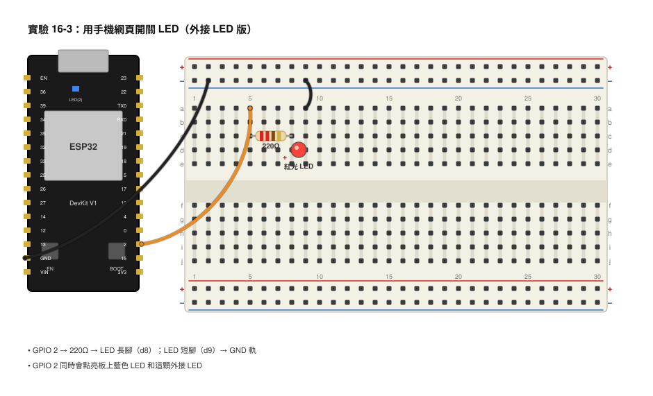
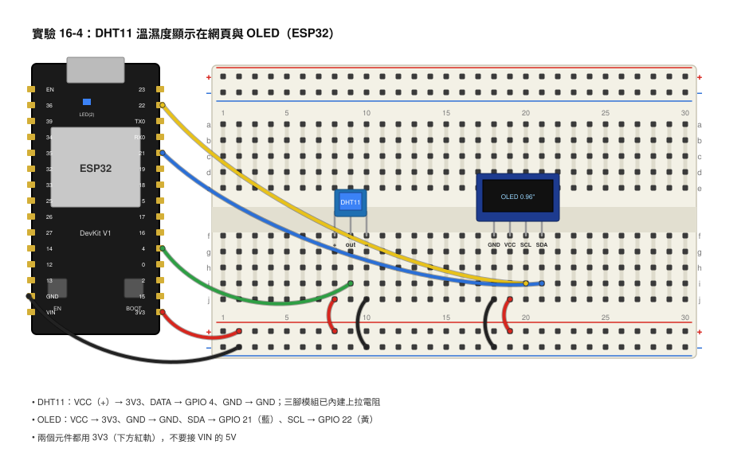
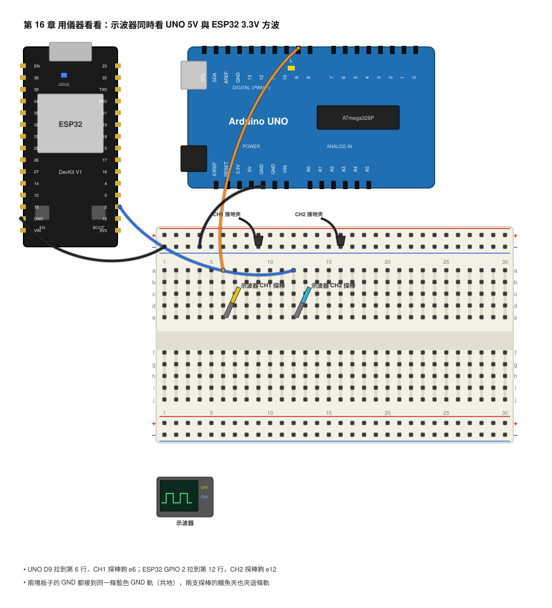

# 第 16 章　ESP32 與無線

## 本章目標
- 學完你會說出 ESP32 和 Arduino UNO 的四個主要差別，並且知道「3.3V 邏輯」代表什麼。
- 學完你會在 Arduino IDE 裡安裝 ESP32 開發板，上傳第一個程式，並處理「卡在 Connecting」的狀況。
- 學完你會讓 ESP32 連上 Wi-Fi、印出 IP 位址，並用手機打開一個網頁來開關 LED。
- 學完你會把 DHT11 的溫濕度同時顯示在網頁和 OLED 上。
- 學完你會用示波器比較 ESP32 的 3.3V 和 UNO 的 5V 高電位，並能說出 MQTT 與深度睡眠大概是做什麼用的。

## 開場：那顆會自己上網的小板子

你有沒有想過，家裡的智慧插座、空氣清淨機、掃地機器人，為什麼可以用手機 App 遙控？它們裡面並沒有一台電腦，也沒有插網路線。打開外殼，你多半會看到一片指甲大小、銀色外殼上印著「ESP32」或「ESP8266」的小模組。這些模組來自深圳的一家公司樂鑫（Espressif），價格只要幾十塊台幣，卻內建了 Wi-Fi 和藍牙。

前面幾章我們用 Arduino UNO 讀感測器、控制馬達、跟 OLED 講話。可是 UNO 是一座孤島：它量到的溫度只能印在電腦螢幕上，你人不在電腦前就看不到。想躺在床上用手機看房間溫濕度，或出門前用手機關電風扇，UNO 做不到。

這一章我們換一塊板子：ESP32 DevKit V1。它跟 UNO 一樣用 Arduino IDE 寫程式，同樣有 `setup()` 和 `loop()`，同樣用 `digitalWrite()` 點 LED，但它會上網。本章結束時，你的手機會多出一個「網頁遙控器」，而且是你自己寫的。

## 核心概念

### ESP32 跟 UNO 差在哪裡？

比喻：UNO 像一輛可靠的腳踏車，構造簡單、好修、怎麼摔都不太會壞。ESP32 像一台電動滑板車：速度快、功能多、還有無線通訊，但需要注意的地方也多一點。

| 項目 | Arduino UNO | ESP32 DevKit V1 |
|------|-------------|-----------------|
| 工作電壓（邏輯電位） | 5V | **3.3V** |
| 處理器速度 | 16 MHz，單核心 | 240 MHz，雙核心（Dual Core） |
| 程式記憶體 | 32 KB | 4 MB |
| 無線 | 沒有 | Wi-Fi（2.4 GHz）＋藍牙（Bluetooth） |
| 類比輸入 | 6 腳，0–1023（10 位元） | 多腳，0–4095（12 位元） |
| PWM 輸出 | 6 腳，`analogWrite()` | 幾乎所有腳，`ledcWrite()` |
| 價格 | 中 | 便宜 |

「雙核心」的意思是板子裡有兩個處理器同時工作，其中一個通常在忙著處理 Wi-Fi，另一個跑你寫的程式。你暫時不需要管它，Arduino 的函式庫會幫你安排。

最重要的差別是第一列：**ESP32 的所有腳位都是 3.3V**。它輸出 HIGH 的時候是 3.3V，不是 5V；它的輸入腳也只能承受最高 3.3V。

### 3.3V 邏輯：為什麼不能接 5V 訊號？

比喻：UNO 的腳位像一條設計給大卡車走的橋，ESP32 的腳位像一條只給機車走的小橋。機車（3.3V）開上大橋沒問題；大卡車（5V）開上小橋，橋會垮。

ESP32 的輸入腳位最高只能承受大約 3.6V。如果你把 UNO 的 5V 輸出直接接到 ESP32 的輸入腳，多出來的電壓會從晶片內部不該走的路衝進去，輕則讀值錯亂，重則腳位燒壞。

反過來卻沒問題：ESP32 輸出 3.3V 給 UNO 讀，UNO 要多高才算 HIGH？第 11 章學過，UNO 的門檻大約是 3V（5V 的 0.6 倍）。3.3V 高於 3V，所以 UNO 讀得到。

那如果非要把 5V 訊號餵給 ESP32 怎麼辦？用第 3 章的分壓器就行。拿兩個相同的電阻串聯：

```
 UNO 5V 訊號 ──[ 10kΩ ]──┬──[ 10kΩ ]── GND
                         │
                      ESP32 輸入腳（這裡是 2.5V）
```

算一下：V_out = 5V × 10kΩ ÷ (10kΩ + 10kΩ) = 5V × 0.5 = **2.5V**。2.5V 低於 3.3V，安全；而且高於 ESP32 判定 HIGH 的門檻（大約 3.3V × 0.75 ≈ 2.5V，實際上大多數板子 2.5V 已能讀到 HIGH，如果不穩可以把下面那顆換成 15kΩ，得到 3V）。第 17 章的迷你示波器專題就會用到這招。

### 哪些腳位可以用、哪些不行？

ESP32 DevKit V1 有 30 支腳（有些版本是 36 支）。下面是你最常用的，以及要避開的：

```
                ┌──────────────────────┐
         3V3 ───┤ 3.3V 輸出（最多約 500mA）  VIN ├─── 5V 輸入（USB 供電時這裡有 5V）
         GND ───┤                          GND ├───
     GPIO 36 ───┤ 只能輸入（VP）         GPIO 23 ├───
     GPIO 39 ───┤ 只能輸入（VN）         GPIO 22 ├─── I2C SCL（OLED）
     GPIO 34 ───┤ 只能輸入 ★類比輸入預設  GPIO 21 ├─── I2C SDA（OLED）
     GPIO 35 ───┤ 只能輸入               GPIO 19 ├───
     GPIO 32 ───┤                        GPIO 18 ├─── ★PWM 輸出預設
     GPIO 33 ───┤                         GPIO 5 ├───
     GPIO 25 ───┤                        GPIO 17 ├───
     GPIO 26 ───┤                        GPIO 16 ├───
     GPIO 27 ───┤                         GPIO 4 ├─── DHT11 預設
     GPIO 14 ───┤                         GPIO 2 ├─── ★板上藍色 LED
     GPIO 12 ───┤ 開機時必須是 LOW          GPIO 15 ├───
         GND ───┤                         GND ├───
     GPIO 13 ───┤                   [EN]  [BOOT] │  ← 兩顆按鈕
                └──────────[ USB ]────────────┘
```

規則整理：
1. **GPIO 34、35、36、39 只能當輸入**，不能 `digitalWrite()`，也沒有內建上拉電阻。它們很適合接光敏電阻、可變電阻這種類比訊號。
2. **GPIO 6–11 絕對不要接**。它們連到板子內部的快閃記憶體（Flash），一碰程式就會當掉。30 腳的 DevKit V1 根本沒把它們拉出來；如果你的板子有標示 CLK、CMD、SD0–SD3 的腳，那就是它們，跳過。
3. **GPIO 2 接著板上的藍色 LED**，就像 UNO 的 D13。本書 ESP32 的 LED 預設用它。
4. GPIO 0、2、12、15 在開機瞬間會被板子「偷看」來決定開機模式。平常用沒關係，但不要在這些腳接上拉或下拉電阻（例如 GPIO 12 接上拉會讓板子開不了機）。
5. 兩顆按鈕：**EN** 是重置（跟 UNO 的 RESET 一樣），**BOOT** 是上傳程式時用的，等一下會用到。

### Wi-Fi 是怎麼連上的？

比喻：Wi-Fi 分享器（路由器）像一棟公寓的管理員。每一台想進公寓的裝置都要先報上名字和密碼（SSID 和密碼），管理員確認後會分配一個「門牌號碼」給它，這就是 IP 位址（IP Address），長得像 `192.168.1.57`。同一棟公寓裡的住戶，只要知道門牌就能互相敲門。

所以手機要控制 ESP32，條件只有兩個：
1. 手機和 ESP32 連到**同一個** Wi-Fi。
2. 你知道 ESP32 的 IP 位址（它會從序列埠印給你）。

注意：ESP32 只支援 **2.4 GHz** 的 Wi-Fi。很多家用分享器同時有 2.4 GHz 和 5 GHz 兩個名字，連錯就永遠連不上。用手機開熱點也可以，但要在熱點設定裡選「2.4 GHz」或「相容模式」。

### 網頁伺服器：ESP32 怎麼「給你一個網頁」？

比喻：網頁伺服器（Web Server）像一間小店。瀏覽器（顧客）走進來說「我要 `/on` 這個東西」，店員（你的程式）就把對應的商品（一段 HTML 文字）遞出去。

你在手機瀏覽器輸入 `http://192.168.1.57/on`，意思是「敲 192.168.1.57 這個門牌，跟它要 `/on`」。ESP32 收到後會執行你指定的函式（例如把 LED 點亮），再回傳一段文字給瀏覽器顯示。整個流程只有三步：

1. `server.on("/on", handleOn);`：告訴伺服器「有人要 `/on` 時，呼叫 `handleOn()`」。
2. `server.begin();`：開店。
3. 在 `loop()` 裡不停呼叫 `server.handleClient();`：店員顧店，看有沒有顧客進來。

第三點很重要。`loop()` 裡如果有一個很長的 `delay(5000)`，店員就會睡著五秒鐘，顧客怎麼敲門都沒人理。所以後面的程式會用 `millis()` 來計時，而不是 `delay()`。

## 動手做

### 實驗 16-1：安裝 ESP32 並點亮板上 LED

**材料**
- ESP32 DevKit V1 ×1
- Micro USB 傳輸線 ×1（要能傳資料的，有些只能充電）
- 電腦（已安裝 Arduino IDE）
- 數位三用電表 ×1

**接線**

這個實驗只用 USB 線接電腦，不用麵包板。

```
 電腦 USB ════ Micro USB ════ [ ESP32 DevKit V1 ]
                                   GPIO 2 ──►|── 板上藍色 LED（已內建，不用接）
```

**步驟**

1. 打開 Arduino IDE，進入「檔案 → 偏好設定」（Mac 是「Arduino IDE → Settings」）。
2. 找到「額外的開發板管理員網址」欄位，貼上這一行，按「確定」：
   ```
   https://espressif.github.io/arduino-esp32/package_esp32_index.json
   ```
   如果欄位裡已經有別的網址，用逗號隔開再貼。
3. 進入「工具 → 開發板 → 開發板管理員」，在搜尋框輸入 `esp32`，找到 **esp32 by Espressif Systems**，按「安裝」。這會下載幾百 MB，請耐心等待。
4. 用 USB 線接上 ESP32。進入「工具 → 開發板 → esp32」，在很長的清單裡選 **ESP32 Dev Module**。
5. 「工具 → 連接埠」選擇新出現的那一個（Windows 是 COMx，Mac 是 /dev/cu.usbserial-xxxx）。如果沒有出現，你的電腦可能需要安裝 CP2102 驅動程式，請老師協助。
6. 把下面的程式貼進去，按「上傳」。

```cpp
// 實驗 16-1：ESP32 第一個程式，閃爍板上 LED
const int ledPin = 2;   // ESP32 DevKit V1 的板上藍色 LED 接在 GPIO 2

void setup() {
  pinMode(ledPin, OUTPUT);     // 把 GPIO 2 設成輸出
  Serial.begin(115200);        // ESP32 習慣用 115200，比 UNO 的 9600 快
  Serial.println("ESP32 準備好了！");
}

void loop() {
  digitalWrite(ledPin, HIGH);  // 點亮
  delay(500);                  // 等 0.5 秒
  digitalWrite(ledPin, LOW);   // 熄滅
  delay(500);
}
```

7. 看 IDE 下方的黑色輸出區。當你看到 `Connecting........_____....._____` 一直重複時，**按住板子上的 BOOT 鍵不放**，直到文字變成 `Writing at 0x00001000...` 再放開。這是 DevKit V1 最常見的小脾氣，不是壞掉。
8. 上傳完成後，打開序列埠監控視窗，右下角鮑率選 **115200**。

**你應該看到**

藍色 LED 每秒閃一次。序列埠監控視窗印出「ESP32 準備好了！」。如果看到一堆亂碼，多半是鮑率沒選 115200。

9. 拿三用電表切到直流電壓檔（20V），黑棒接 GND 腳，紅棒分別接 3V3 腳和 VIN 腳，記錄數值。

**觀察與記錄**

| 量測點 | 預期 | 你量到的 |
|--------|------|----------|
| 3V3 腳對 GND | 約 3.3V | |
| VIN 腳對 GND（USB 供電時） | 約 5V | |
| GPIO 2 對 GND（LED 亮時） | 約 3.3V | |
| GPIO 2 對 GND（LED 暗時） | 約 0V | |

### 實驗 16-2：連上 Wi-Fi，印出 IP 位址

**材料**
- 實驗 16-1 的全部
- 一個 2.4 GHz 的 Wi-Fi 名稱與密碼（教室的分享器或手機熱點）

**接線**

同實驗 16-1，只用 USB 線。

**步驟**

1. 把程式裡的 `你的Wi-Fi名稱` 和 `你的Wi-Fi密碼` 換成真的。大小寫要一模一樣。
2. 上傳，打開序列埠監控視窗（115200）。

```cpp
// 實驗 16-2：ESP32 連上 Wi-Fi 並印出 IP 位址
#include <WiFi.h>              // ESP32 內建的 Wi-Fi 函式庫

const char* ssid     = "你的Wi-Fi名稱";   // 分享器的名字（SSID）
const char* password = "你的Wi-Fi密碼";   // 密碼，不要把它上傳到網路上給別人看

void setup() {
  Serial.begin(115200);
  delay(500);                            // 給序列埠一點時間開起來
  Serial.print("正在連線到：");
  Serial.println(ssid);

  WiFi.mode(WIFI_STA);                   // STA 模式 = 當一台「客戶端」去連分享器
  WiFi.begin(ssid, password);            // 開始連線

  int tries = 0;
  while (WiFi.status() != WL_CONNECTED) { // 還沒連上就一直等
    delay(500);
    Serial.print(".");
    tries++;
    if (tries > 40) {                    // 等了 20 秒還沒連上，印提示
      Serial.println();
      Serial.println("連不上，請檢查名稱、密碼，以及是不是 2.4GHz");
      tries = 0;
    }
  }

  Serial.println();
  Serial.println("連上了！");
  Serial.print("IP 位址：");
  Serial.println(WiFi.localIP());        // 把這串數字記下來，等一下手機要用
  Serial.print("訊號強度 RSSI：");
  Serial.print(WiFi.RSSI());             // 負數，越接近 0 代表訊號越強
  Serial.println(" dBm");
}

void loop() {
  // 這個實驗 loop 不用做事
}
```

**你應該看到**

序列埠印出一排點點，幾秒後出現「連上了！IP 位址：192.168.x.x」。RSSI 大約在 -40（很強）到 -80（很弱）之間。

3. 拿手機，確認手機連到同一個 Wi-Fi，打開瀏覽器輸入 ESP32 的 IP。現在會顯示「無法連線」，這是正常的，因為我們還沒開店。下一個實驗就要開了。

**觀察與記錄**

| 項目 | 你的紀錄 |
|------|----------|
| Wi-Fi 名稱 | |
| ESP32 的 IP 位址 | |
| RSSI（dBm） | |
| 把 ESP32 拿到走廊再量一次 RSSI | |

### 實驗 16-3：用手機網頁開關 LED

**材料**
- 實驗 16-2 的全部
- （可選）紅色 LED ×1、220Ω 電阻 ×1、麵包板、杜邦線：想看外接 LED 的話加上這組

**接線**

用板上 LED 就不必接線。想接外接 LED 的話：

```
 ESP32 GPIO 2 ──[ 220Ω ]──►|── GND
                          LED
```



文字說明：ESP32 GPIO 2 → 220Ω → LED 長腳，LED 短腳 → ESP32 GND。GPIO 2 同時會點亮板上 LED 和外接 LED。

**步驟**

1. 填入 Wi-Fi 名稱和密碼，上傳。

```cpp
// 實驗 16-3：ESP32 網頁伺服器，用手機開關 LED
#include <WiFi.h>
#include <WebServer.h>          // ESP32 內建的簡易網頁伺服器

const char* ssid     = "你的Wi-Fi名稱";
const char* password = "你的Wi-Fi密碼";

const int ledPin = 2;           // 板上 LED
bool ledOn = false;             // 記住目前狀態，網頁要顯示

WebServer server(80);           // 80 是網頁的標準「門」（埠號）

// 組出一段 HTML 網頁文字，手機瀏覽器會把它畫出來
String makePage() {
  String html = "<!DOCTYPE html><html><head><meta charset='utf-8'>";
  html += "<meta name='viewport' content='width=device-width, initial-scale=1'>";  // 手機上字不會太小
  html += "<title>ESP32 LED</title></head>";
  html += "<body style='font-family:sans-serif;text-align:center;margin-top:40px'>";
  html += "<h1>ESP32 LED 遙控器</h1>";
  html += "<p style='font-size:1.5em'>目前狀態：";
  html += ledOn ? "<b style='color:orange'>亮</b>" : "<b style='color:gray'>暗</b>";
  html += "</p>";
  // 兩顆按鈕，按下去會連到 /on 或 /off
  html += "<p><a href='/on'><button style='font-size:2em;padding:20px'>開燈</button></a> ";
  html += "<a href='/off'><button style='font-size:2em;padding:20px'>關燈</button></a></p>";
  html += "</body></html>";
  return html;
}

// 有人連到「/」（首頁）時執行
void handleRoot() {
  server.send(200, "text/html; charset=utf-8", makePage());  // 200 代表「成功」
}

// 有人連到「/on」時執行
void handleOn() {
  ledOn = true;
  digitalWrite(ledPin, HIGH);                  // 真的點亮 LED
  Serial.println("收到 /on，開燈");
  server.send(200, "text/html; charset=utf-8", makePage());
}

// 有人連到「/off」時執行
void handleOff() {
  ledOn = false;
  digitalWrite(ledPin, LOW);
  Serial.println("收到 /off，關燈");
  server.send(200, "text/html; charset=utf-8", makePage());
}

void setup() {
  Serial.begin(115200);
  pinMode(ledPin, OUTPUT);
  digitalWrite(ledPin, LOW);

  WiFi.mode(WIFI_STA);
  WiFi.begin(ssid, password);                  // 連 Wi-Fi，跟實驗 16-2 一樣
  Serial.print("連線中");
  while (WiFi.status() != WL_CONNECTED) {
    delay(500);
    Serial.print(".");
  }
  Serial.println();
  Serial.print("請用手機瀏覽器打開：http://");
  Serial.println(WiFi.localIP());

  server.on("/", handleRoot);                  // 登記三條路：誰來要什麼，就叫誰處理
  server.on("/on", handleOn);
  server.on("/off", handleOff);
  server.begin();                              // 開店
  Serial.println("網頁伺服器已啟動");
}

void loop() {
  server.handleClient();                       // 顧店：一直檢查有沒有人敲門
  // 注意：這裡不要放長的 delay()，不然店員會睡著
}
```

2. 打開序列埠監控視窗，記下 IP。
3. 手機瀏覽器輸入 `http://` 加上那個 IP（例如 `http://192.168.1.57`）。
4. 按「開燈」、「關燈」，同時看板子和序列埠。

**你應該看到**

手機出現一個有兩顆大按鈕的網頁。按「開燈」，網址列變成 `.../on`，藍色 LED 亮，序列埠印「收到 /on，開燈」。按「關燈」則相反。同學的手機只要連同一個 Wi-Fi，也能控制你的 LED。

**觀察與記錄**

| 動作 | 網址列變成 | LED 狀態 | 序列埠印出 |
|------|-----------|----------|-----------|
| 輸入 IP 按 Enter | | | |
| 按「開燈」 | | | |
| 按「關燈」 | | | |
| 在網址後面手動加 `/on` | | | |

### 實驗 16-4：溫濕度顯示在網頁與 OLED

**材料**
- ESP32 DevKit V1 ×1
- DHT11 溫濕度感測器 ×1（三腳或四腳模組皆可）
- 0.96 吋 OLED（SSD1306，I2C）×1
- 10kΩ 電阻 ×1（如果 DHT11 是裸元件四腳版才需要；三腳模組已內建）
- 麵包板、杜邦線

**接線**

```
                 ┌─────────────────┐
     3V3 ────────┤ VCC    DHT11    │
     GPIO 4 ─────┤ DATA            │   （裸元件版：DATA 與 VCC 之間加 10kΩ 上拉）
     GND ────────┤ GND             │
                 └─────────────────┘

                 ┌─────────────────┐
     3V3 ────────┤ VCC    OLED     │
     GND ────────┤ GND   SSD1306   │
     GPIO 21 ────┤ SDA             │
     GPIO 22 ────┤ SCL             │
                 └─────────────────┘
```



文字說明：
- DHT11 VCC → ESP32 3V3；DHT11 DATA → ESP32 GPIO 4；DHT11 GND → ESP32 GND。
- OLED VCC → ESP32 3V3；OLED GND → ESP32 GND；OLED SDA → ESP32 GPIO 21；OLED SCL → ESP32 GPIO 22。
- 兩個元件都用 3V3，**不要接 VIN 的 5V**。OLED 模組雖然多半能吃 5V，但它的 SDA/SCL 訊號會回到 ESP32，統一用 3.3V 最安全。

**步驟**

1. 確認已安裝函式庫：「工具 → 管理程式庫」搜尋並安裝 **DHT sensor library**（Adafruit）、**Adafruit SSD1306**、**Adafruit GFX Library**。第 13 章和第 15 章應該已經裝過。
2. 填入 Wi-Fi 名稱和密碼，上傳。

```cpp
// 實驗 16-4：DHT11 溫濕度同時顯示在網頁和 OLED
#include <WiFi.h>
#include <WebServer.h>
#include <DHT.h>                 // Adafruit 的 DHT 函式庫
#include <Wire.h>                // I2C
#include <Adafruit_GFX.h>
#include <Adafruit_SSD1306.h>

const char* ssid     = "你的Wi-Fi名稱";
const char* password = "你的Wi-Fi密碼";

#define DHTPIN  4                // DHT11 資料腳接 GPIO 4
#define DHTTYPE DHT11
DHT dht(DHTPIN, DHTTYPE);

#define OLED_SDA 21
#define OLED_SCL 22
Adafruit_SSD1306 display(128, 64, &Wire, -1);  // 128×64 像素，沒有 reset 腳

WebServer server(80);

float temperature = 0.0;         // 最近一次讀到的溫度（°C）
float humidity    = 0.0;         // 最近一次讀到的濕度（%）
unsigned long lastReadTime = 0;  // 上次讀感測器的時間（毫秒）

// 讀 DHT11，讀失敗就保留上一次的值
void readSensor() {
  float t = dht.readTemperature();
  float h = dht.readHumidity();
  if (!isnan(t) && !isnan(h)) {  // isnan = 不是數字，代表讀失敗
    temperature = t;
    humidity = h;
  } else {
    Serial.println("DHT11 讀取失敗，用上一次的值");
  }
}

// 把數值畫到 OLED 上（OLED 預設字型沒有中文，所以用英文）
void showOnOled() {
  display.clearDisplay();
  display.setTextColor(SSD1306_WHITE);
  display.setTextSize(1);
  display.setCursor(0, 0);
  display.print("IP: ");
  display.println(WiFi.localIP());        // 第一行顯示 IP，手機要用

  display.setTextSize(2);                 // 字放大兩倍
  display.setCursor(0, 20);
  display.print("T:");
  display.print(temperature, 1);          // 小數一位
  display.println(" C");
  display.setCursor(0, 44);
  display.print("H:");
  display.print(humidity, 0);             // 整數
  display.println(" %");
  display.display();                      // 真的送到螢幕
}

// 網頁：每 5 秒自動重新整理一次
void handleRoot() {
  String html = "<!DOCTYPE html><html><head><meta charset='utf-8'>";
  html += "<meta name='viewport' content='width=device-width, initial-scale=1'>";
  html += "<meta http-equiv='refresh' content='5'>";   // 瀏覽器每 5 秒自己重新載入
  html += "<title>ESP32 氣象站</title></head>";
  html += "<body style='font-family:sans-serif;text-align:center;margin-top:40px'>";
  html += "<h1>教室溫濕度</h1>";
  html += "<p style='font-size:3em'>" + String(temperature, 1) + " &deg;C</p>";
  html += "<p style='font-size:3em'>" + String(humidity, 0) + " %</p>";
  html += "<p style='color:gray'>每 5 秒自動更新</p>";
  html += "</body></html>";
  server.send(200, "text/html; charset=utf-8", html);
}

void setup() {
  Serial.begin(115200);
  dht.begin();                                  // 啟動 DHT11

  Wire.begin(OLED_SDA, OLED_SCL);               // 指定 I2C 腳位
  if (!display.begin(SSD1306_SWITCHCAPVCC, 0x3C)) {  // OLED 位址 0x3C
    Serial.println("找不到 OLED，檢查接線或位址");
    while (true) delay(10);                     // 停在這裡
  }
  display.clearDisplay();
  display.setTextColor(SSD1306_WHITE);
  display.setTextSize(1);
  display.setCursor(0, 0);
  display.println("Connecting WiFi...");
  display.display();

  WiFi.mode(WIFI_STA);
  WiFi.begin(ssid, password);
  while (WiFi.status() != WL_CONNECTED) {
    delay(500);
    Serial.print(".");
  }
  Serial.println();
  Serial.print("網頁在 http://");
  Serial.println(WiFi.localIP());

  server.on("/", handleRoot);
  server.begin();

  readSensor();                                 // 先讀一次，網頁才有東西
  showOnOled();
}

void loop() {
  server.handleClient();                        // 顧店

  // 每 2 秒讀一次感測器（DHT11 最快只能每 1–2 秒讀一次）
  if (millis() - lastReadTime >= 2000) {
    lastReadTime = millis();
    readSensor();
    showOnOled();
    Serial.print("T=");
    Serial.print(temperature);
    Serial.print("  H=");
    Serial.println(humidity);
  }
}
```

3. 看 OLED，第一行會出現 IP，手機瀏覽器輸入它。
4. 用手指捏住 DHT11 十秒鐘，或對它呵氣，同時看 OLED 和手機。

**你應該看到**

OLED 顯示 IP 和大字的溫度、濕度。手機網頁每 5 秒自動更新。對 DHT11 呵氣後，濕度會明顯上升（可能從 60% 跳到 80% 以上），溫度慢慢上升一兩度，再慢慢回來。

**觀察與記錄**

| 情況 | OLED 溫度 | OLED 濕度 | 網頁溫度 | 網頁濕度 |
|------|----------|----------|----------|----------|
| 靜置 1 分鐘 | | | | |
| 手指捏住 10 秒 | | | | |
| 呵氣 3 次 | | | | |
| 放開 1 分鐘後 | | | | |

### 概念介紹：MQTT，物聯網的「公布欄」

剛才的網頁伺服器有個限制：手機必須主動去「敲門」才拿得到資料，而且手機和 ESP32 要在同一個 Wi-Fi 底下。如果你想在學校看家裡的溫度，網頁伺服器就不夠了。

物聯網（IoT, Internet of Things）常用另一種方法：MQTT。

比喻：MQTT 像學校的公布欄。公布欄放在一個大家都能到的地方（這台機器叫代理人，Broker，通常在網路上）。ESP32 把溫度寫在「教室溫度」這一欄（這叫發布，Publish，欄位名稱叫主題，Topic）。任何想知道教室溫度的人，只要跟公布欄說「教室溫度這欄有更新就通知我」（這叫訂閱，Subscribe）。ESP32 不需要知道誰在看，看的人也不需要知道 ESP32 在哪裡，大家只要都找得到公布欄就好。

```
 ESP32 ──發布「教室/溫度 = 27.5」──►┌──────────┐
                                   │  Broker  │──通知──► 手機 App
 手機 ──發布「教室/風扇 = 開」──────►│ （公布欄）│──通知──► ESP32（開風扇）
                                   └──────────┘
```

MQTT 的優點是訊息很小、很省電，而且 ESP32 可以放在任何有網路的地方。Arduino 有現成的 PubSubClient 函式庫，網路上也有免費的公開 Broker（例如 test.mosquitto.org）讓你練習。本書不深入教，但你已經會 Wi-Fi 了，剩下的只是多裝一個函式庫、多學三個指令：`connect()`、`publish()`、`subscribe()`。

### 概念介紹：深度睡眠，讓電池撐幾個月

ESP32 開著 Wi-Fi 的時候大約吃 80–160 mA。用第 4 章學的方法算一下：一顆 9V 電池大約 500 mAh，500 ÷ 100 = **5 小時**就沒電了。這樣的氣象站放在陽台撐不過一個下午。

比喻：深度睡眠（Deep Sleep）像冬眠的熊。熊醒著一天要吃很多東西，但冬眠時幾乎不消耗能量，只留一個「生理時鐘」等春天叫醒牠。ESP32 進入深度睡眠時幾乎把所有東西都關掉，只剩一個小小的計時器，耗電降到大約 0.01 mA，是醒著的萬分之一。

典型用法：醒來 → 連 Wi-Fi → 讀溫度 → 送出去 → 睡 10 分鐘 → 醒來……。醒著 5 秒、睡 600 秒，平均電流大約 100 mA × 5 ÷ 605 ≈ **0.8 mA**，同一顆 9V 電池可以撐 500 ÷ 0.8 ≈ 625 小時，差不多 26 天。

有兩件事要知道：
1. 深度睡眠醒來時，程式會**從 `setup()` 重新開始**，像按了一次重置。一般變數的值會不見。
2. 想跨越睡眠記住東西，變數前面要加 `RTC_DATA_ATTR`，它會存在那個不會關掉的小角落裡。

下面是一個最小的範例，每 10 秒醒來閃一下 LED，並記錄自己醒來第幾次：

```cpp
// 深度睡眠示範：醒來閃一下 LED、印出次數，再睡 10 秒
#define SLEEP_SECONDS 10
RTC_DATA_ATTR int wakeCount = 0;   // 這個變數睡覺時不會被清掉

void setup() {
  Serial.begin(115200);
  delay(300);
  wakeCount++;                     // 每醒來一次加 1
  Serial.print("第 ");
  Serial.print(wakeCount);
  Serial.println(" 次醒來");

  pinMode(2, OUTPUT);              // 閃一下板上 LED 表示「我醒了」
  digitalWrite(2, HIGH);
  delay(300);
  digitalWrite(2, LOW);

  Serial.println("要去睡了...");
  esp_sleep_enable_timer_wakeup((uint64_t)SLEEP_SECONDS * 1000000ULL);  // 單位是微秒
  esp_deep_sleep_start();          // 從這一行開始，板子就睡著了
}

void loop() {
  // 永遠不會執行到這裡，因為 setup() 最後就睡著了
}
```

上傳後你會看到序列埠每 10 秒印一次「第 N 次醒來」，N 一直增加。如果把 `RTC_DATA_ATTR` 拿掉，N 會永遠是 1。

## 用儀器看看

### 示波器：3.3V 和 5V 擺在一起看

這是本章最值得看的一個畫面。我們讓 UNO 和 ESP32 各閃一顆 LED，用示波器的兩個通道同時看它們的腳位電壓。

**接線**

1. 把第 12 章的 Blink 程式上傳到 UNO，但把腳位改成 D9，`delay` 改成 500 毫秒。ESP32 跑實驗 16-1 的程式。
2. 用一條杜邦線把 UNO 的 GND 和 ESP32 的 GND 接在一起（兩塊板子要有共同的 0V，才能比較）。
3. 探棒 CH1 鉤 UNO D9，CH2 鉤 ESP32 GPIO 2。兩支探棒的黑色鱷魚夾都夾到 GND（夾任何一塊板子的 GND 都可以，因為剛才接在一起了）。

```
 UNO D9 ───────────── CH1 探棒尖端
 UNO GND ──┬───────── CH1 鱷魚夾
           │
 ESP32 GND ┴───────── CH2 鱷魚夾
 ESP32 GPIO 2 ─────── CH2 探棒尖端
```



**設定**
- 兩個通道都 1 V/div，探棒 10×（記得示波器通道設定也要選 10×）。
- 把 CH2 的基準線往下移一點，讓兩條線不要疊在一起。
- 時間 200 ms/div。
- 觸發：CH1，上升緣，觸發電位 2.5V。

**畫面應該像這樣**

```
電壓
 5V ┤ ┌─────┐     ┌─────┐     ┌─────┐       ← CH1：UNO D9
    │ │     │     │     │     │     │
 0V ┼─┘     └─────┘     └─────┘     └────
    │
3.3V┤   ┌────┐    ┌────┐    ┌────┐         ← CH2：ESP32 GPIO 2
    │   │    │    │    │    │    │
 0V ┼───┘    └────┘    └────┘    └─────── 時間
      ◄──────────►
         1 秒（一個週期）
```

兩條都是方波，週期都是 1 秒，但高度差了 1.7V。用示波器的自動量測功能量 CH1 和 CH2 的「最大值（Max）」，把數字填進去：

| 通道 | 板子 | 量到的 HIGH 電壓 | 量到的 LOW 電壓 |
|------|------|-----------------|----------------|
| CH1 | UNO D9 | | |
| CH2 | ESP32 GPIO 2 | | |

ESP32 的 HIGH 可能只有 3.2V 左右而不是剛好 3.3V，這是正常的，腳位內部有一點點電阻。兩塊板子的方波起點不會對齊，因為它們各自按自己的時鐘走。

### 示波器：看 Wi-Fi 在吃電

ESP32 跑實驗 16-3。探棒 CH1 鉤 **3V3 腳**，鱷魚夾接 GND，設定 50 mV/div（有「AC 耦合」就打開，把 3.3V 直流濾掉只看抖動）、10 ms/div。你會看到每隔一段時間出現一小串往下的毛刺，那是 Wi-Fi 發射瞬間抽走大電流、讓 3.3V 下陷的痕跡。毛刺超過 200 mV 代表供電不夠力，這就是「Brownout」錯誤的來源。

### 邏輯分析儀：看 ESP32 跟 OLED 講話

第 15 章我們看過 UNO 和 OLED 的 I2C 訊號。現在把邏輯分析儀的 CH0 接 GPIO 21（SDA）、CH1 接 GPIO 22（SCL），GND 接 ESP32 GND，跑實驗 16-4，用 PulseView 的 I2C 解碼器看。你應該同樣看到位址 **0x3C**。不同的是訊號高電位變成 3.3V，邏輯分析儀的門檻（通常 1.5V 左右）仍然輕鬆判斷得出來。

## 常見錯誤與除錯

- **上傳一直卡在 `Connecting........_____`** → DevKit V1 沒有自動進入下載模式 → 看到 Connecting 時按住 BOOT 鍵不放，到出現 Writing 再放開。
- **上傳時出現 `Failed to connect to ESP32: Timed out`** → USB 線只能充電不能傳資料，或連接埠選錯 → 換一條線、確認「工具 → 連接埠」選的是 ESP32 的那一個。
- **連接埠裡找不到板子** → 電腦缺 CP2102 或 CH340 驅動程式 → 看板子上 USB 旁邊的小晶片是哪一種，請老師協助安裝驅動。
- **序列埠印一堆亂碼** → 鮑率不對 → 監控視窗右下角改 115200。
- **一直印點點，連不上 Wi-Fi** → SSID 或密碼打錯、連到 5 GHz 的名字、或熱點沒開 2.4 GHz → 重新檢查大小寫、改連 2.4 GHz。
- **序列埠印 `Brownout detector was triggered` 然後一直重開** → 供電不足 → 換短一點的 USB 線、換電腦的 USB 孔、不要透過 USB 集線器。
- **IP 印出來了，但手機打不開網頁** → 手機不在同一個 Wi-Fi、或手機用了行動網路 → 手機關掉行動數據、確認連同一個 SSID。有些學校的 Wi-Fi 會禁止裝置互連，改用手機熱點試試。
- **網頁按了沒反應，但序列埠沒印出收到** → `loop()` 裡有長 `delay()`，店員睡著了 → 改用 `millis()` 計時。
- **OLED 一片黑，序列埠印「找不到 OLED」** → 接線錯或位址是 0x3D → 用三用電表確認 VCC 有 3.3V；把程式的 0x3C 改成 0x3D 試試。
- **DHT11 一直讀取失敗** → DATA 腳接錯、裸元件缺上拉電阻、或讀太頻繁 → 檢查接線、加 10kΩ 上拉、讀取間隔至少 2 秒。
- **把感測器從 UNO 搬到 ESP32 後讀值怪怪的** → 感測器輸出 5V 訊號接進 3.3V 腳 → 改用 3V3 供電，或加分壓器。
- **接了東西之後板子開不了機** → 接在 GPIO 0、2、12、15 的元件影響了開機判斷 → 拔掉重開確認，換別的腳位。

## 想一想

1. ESP32 的 `digitalWrite(2, HIGH)` 會讓 GPIO 2 變成幾伏特？UNO 的 `digitalWrite(9, HIGH)` 呢？

<details><summary>參考答案</summary>

ESP32 約 3.3V，UNO 約 5V。這是兩塊板子最重要的差別。

</details>

2. 小明想把 UNO 的 D9 訊號接到 ESP32 的 GPIO 34 讀，可以直接接嗎？如果不行，要怎麼改？

<details><summary>參考答案</summary>

不能直接接，5V 超過 ESP32 腳位能承受的 3.3V。用兩個 10kΩ 串聯做分壓器，從中間接到 GPIO 34，得到 2.5V。反過來（ESP32 輸出給 UNO 讀）則可以直接接，因為 3.3V 高於 UNO 判定 HIGH 的 3V。

</details>

3. 下面哪些腳位可以用來 `digitalWrite()` 點亮 LED？GPIO 2、GPIO 18、GPIO 34、GPIO 6。

<details><summary>參考答案</summary>

GPIO 2 和 GPIO 18 可以。GPIO 34 只能輸入，不能輸出。GPIO 6 連到快閃記憶體，絕對不要用。

</details>

4. 手機已經連上 Wi-Fi，也輸入了正確的 IP，但網頁一直轉圈圈打不開。列出三個你會檢查的地方。

<details><summary>參考答案</summary>

（任三個）手機是不是連到跟 ESP32 相同的 Wi-Fi 名稱；手機的行動數據有沒有關掉；ESP32 序列埠有沒有印出「網頁伺服器已啟動」；`loop()` 裡有沒有長 `delay()` 讓 `handleClient()` 跑不到；學校 Wi-Fi 是否禁止裝置互連；IP 有沒有打錯（例如 ESP32 重開後拿到新的 IP）。

</details>

5. 一個 ESP32 氣象站用 3 顆 3 號電池（大約 2000 mAh）供電。如果它每小時醒來 10 秒（醒著時 120 mA）、其他時間深度睡眠（0.01 mA），大約可以撐幾天？

<details><summary>參考答案</summary>

每小時耗電量：醒著 120 mA × 10 秒 ÷ 3600 秒 ≈ 0.33 mAh，睡著 0.01 mA × 3590 秒 ÷ 3600 秒 ≈ 0.01 mAh，合計約 0.34 mAh/小時。2000 ÷ 0.34 ≈ 5900 小時 ≈ 245 天。實際上電池會自己慢慢漏電、電壓也會下降，所以可能是幾個月，但遠比不睡覺的 2000 ÷ 120 ≈ 17 小時好太多了。

</details>

6. 開放挑戰：把實驗 16-3 和 16-4 合併，做一個網頁同時顯示溫濕度又能開關 LED。進一步，讓它在濕度超過 80% 時自動點亮 LED（當作「要除濕了」的警示）。想一想，這個「自動」的判斷應該寫在 `loop()` 的哪裡？

<details><summary>參考答案</summary>

把實驗 16-3 的 `handleOn`、`handleOff` 和按鈕 HTML 加進 16-4 的程式。自動判斷寫在 `loop()` 裡「每 2 秒讀感測器」的那個 `if` 區塊內，讀完之後加一行 `if (humidity > 80) digitalWrite(ledPin, HIGH);`。這樣不管有沒有人開網頁，判斷都會持續進行；如果寫在 `handleRoot()` 裡，就只有有人開網頁時才會判斷。

</details>

## 本章小結

- ESP32 是 3.3V 邏輯的板子：輸出 HIGH 是 3.3V，輸入腳不可以接 5V 訊號，需要的話用分壓器降壓。
- 安裝：偏好設定加入 Espressif 的網址 → 開發板管理員安裝 esp32 → 選「ESP32 Dev Module」。上傳卡在 Connecting 就按住 BOOT。
- GPIO 34–39 只能輸入；GPIO 6–11 不能用；GPIO 2 接板上 LED；序列埠用 115200。
- Wi-Fi 連線只支援 2.4 GHz。連上後 ESP32 會拿到一個 IP 位址，手機要在同一個 Wi-Fi 才找得到它。
- 網頁伺服器三步驟：`server.on()` 登記路徑、`server.begin()` 開店、`loop()` 裡不停 `server.handleClient()`。`loop()` 不能有長 `delay()`。
- DHT11 接 GPIO 4、OLED 接 SDA=21、SCL=22，兩者都用 3V3 供電；OLED 位址 0x3C。
- 示波器雙通道對照可以親眼看到 5V 和 3.3V 的差距；兩塊板子要共 GND 才能比較。
- MQTT 是用「公布欄」轉發訊息的物聯網方法；深度睡眠讓 ESP32 平常只吃 0.01 mA，電池可以撐好幾個月。

## 名詞表

| 中文 | 英文 | 一句話解釋 |
|------|------|-----------|
| ESP32 | ESP32 | 樂鑫公司出的微控制器，內建 Wi-Fi 與藍牙，3.3V 邏輯。 |
| 3.3V 邏輯 | 3.3V logic | 腳位的 HIGH 是 3.3V，輸入也只能承受 3.3V 的規格。 |
| 雙核心 | Dual Core | 晶片裡有兩個處理器同時工作。 |
| 快閃記憶體 | Flash | 存放程式的記憶體，斷電不會消失；ESP32 的 GPIO 6–11 接著它。 |
| 只能輸入腳位 | Input-only pin | GPIO 34–39，不能輸出，也沒有內建上拉。 |
| BOOT 鍵 | BOOT button | 按住它可以讓 ESP32 進入下載模式，上傳程式用。 |
| 開發板管理員 | Boards Manager | Arduino IDE 裡安裝新板子支援的地方。 |
| SSID | Service Set Identifier | Wi-Fi 網路的名字。 |
| IP 位址 | IP Address | 網路上每台裝置的門牌號碼，例如 192.168.1.57。 |
| 訊號強度 | RSSI | Wi-Fi 訊號強度，負數，越接近 0 越強。 |
| 網頁伺服器 | Web Server | 等瀏覽器來「要東西」然後回傳網頁的程式。 |
| 埠號 | Port | 同一個 IP 上不同服務的「門」，網頁用 80。 |
| HTML | HyperText Markup Language | 描述網頁長什麼樣子的文字格式。 |
| 路徑 | Route / Path | 網址後面的 `/on`、`/off`，告訴伺服器你要哪個東西。 |
| 物聯網 | IoT, Internet of Things | 讓各種裝置都能上網互相傳資料的概念。 |
| MQTT | Message Queuing Telemetry Transport | 用「公布欄」（Broker）轉發小訊息的物聯網通訊方式。 |
| 代理人 | Broker | MQTT 裡負責收發訊息的中央伺服器。 |
| 發布／訂閱 | Publish / Subscribe | 往主題貼訊息，與登記「這個主題有更新就通知我」。 |
| 主題 | Topic | MQTT 訊息的分類名稱，例如「教室/溫度」。 |
| 深度睡眠 | Deep Sleep | ESP32 幾乎全部關機、只留計時器的省電模式。 |
| 欠壓偵測 | Brownout detector | 供電不足時讓板子重開的保護機制。 |
