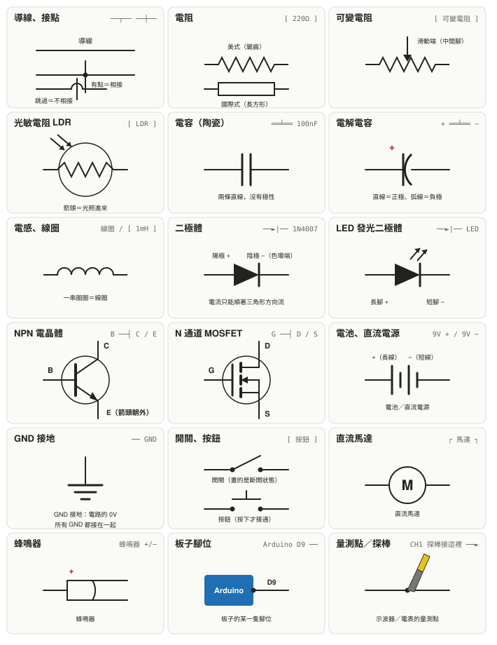

# 附錄 G　電路符號對照表

本書的電路圖有兩種畫法：

1. **文字示意圖**（ASCII 圖）：用鍵盤打得出來的符號畫，例如 `──[ 220Ω ]──►|── GND`。好處是和接線說明放在一起，一眼看出誰接誰。
2. **麵包板接線圖**：彩色的實物圖，照著插就對了。

但是你以後查資料、看零件說明書、看別人的電路，會遇到**標準電路符號**。下面這張圖把三者對照起來：每格左上是零件名稱，右上是本書 ASCII 圖的寫法，中間是標準符號。

## 怎麼讀本書的 ASCII 圖

| 本書寫法 | 意思 | 標準符號怎麼畫 | 備註 |
|---|---|---|---|
| `──`、`│`、`┬`、`┴`、`┼` | 導線與分叉 | 直線；有圓點的交叉才是相接 | 本書 ASCII 圖的 `┼` 一律代表相接 |
| `[ 220Ω ]`、`[ R1 ]` | 電阻 | 鋸齒（美式）或長方形（國際式） | 方括號裡是阻值或代號，沒有方向性 |
| `[ 10kΩ 可變電阻 ]`、「中間腳」 | 可變電阻 | 電阻加一個箭頭指向中間 | 三隻腳：兩端是固定電阻，中間腳是滑動端 |
| `[ LDR ]` | 光敏電阻 | 電阻外加圓圈，兩個箭頭射進來 | 光越亮，電阻越小 |
| `══╧══`、`══╤══` | 電容 | 兩條平行直線 | 陶瓷電容沒有極性 |
| `│+` `│−` 標在 `══╧══` 旁 | 電解電容 | 一直線一弧線，直線是正極 | **有極性，接反會爆** |
| 「線圈」、`[ 1mH ]` | 電感 | 一串半圓 | 本書多用文字標示 |
| `──►|──` | 二極體 | 三角形加一條直線 | 三角形指向電流可以流的方向；直線那端是陰極（色環端） |
| `──►|──` 旁邊寫 LED | 發光二極體 | 二極體加兩個往外的箭頭 | 長腳是正極（陽極） |
| `B ──┤` 配 `C`、`E` | NPN 電晶體 | 圓圈裡一條粗線，E 腳有箭頭朝外 | 2N2222：平面朝自己，左到右 E、B、C |
| `G ──┤` 配 `D`、`S` | N 通道 MOSFET | 閘極和通道之間有一條縫（絕緣） | IRLZ44N：左到右 G、D、S |
| `9V +`、`9V −`、`Arduino 5V` | 電池或直流電源 | 長短線成對；長線是正極 | 本書也用 `USB 5V`、`3.3V` 表示電源 |
| `GND` | 接地 | 三條越來越短的橫線 | 電路的 0V 基準；圖上所有 GND 都是同一個點 |
| `[ 按鈕 ]`、「開關」 | 開關 | 一條可以翹起來的線 | 本書的按鈕是「按下才接通」 |
| `┌ 馬達 ┐` 或「馬達」 | 直流馬達 | 圓圈裡寫 M | 接電感的規則都適用（要加飛輪二極體） |
| 「蜂鳴器」 | 蜂鳴器 | 半圓加兩條線 | 無源蜂鳴器要給它頻率才會響 |
| `Arduino D9 ──` | 板子的腳位 | 方塊代表板子，拉一條線出來 | 腳位名稱照板子上印的字 |
| `CH1 探棒接這裡 ───►` | 量測點 | 一個點，旁邊寫 CH1 或 V | 示波器的接地夾一律接 GND |

## 三個看圖的習慣

1. **先找電源和 GND。** 電流從電源正極出發，繞一圈回到 GND。找不到回路，電路就不會動。
2. **再找有方向性的零件。** 二極體、LED、電解電容、電晶體接反了不是不動就是燒掉。看到 `►|`、`+`、`−`、E/B/C 就停下來確認方向。
3. **把圖和麵包板對起來。** 圖上一條線代表「這些點是同一個電位」，在麵包板上就是同一列的五個孔，或是用一條杜邦線接起來。
